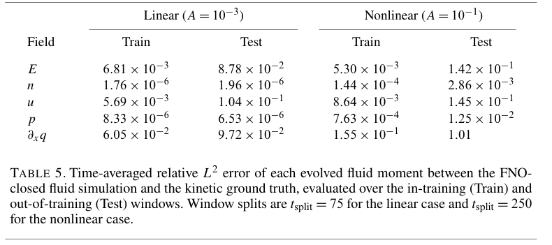
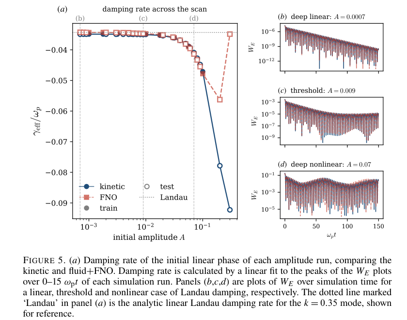

# A Neural Operator Closure for Landau Damping in Electrostatic Plasma

## 基本信息

- 作者：Samuel Burles；Enrico Camporeale；Oreste Pezzi
- 期刊/平台：*Journal of Plasma Physics* **92**, E149，正式版；2026-11-02 在原条目上升级，不重复计数。
- [正式 DOI](https://doi.org/10.1017/S0022377826102517)；[作者预印本别名](https://arxiv.org/abs/2607.29364)。
- 正式在线发表：**2026-10-30**，由出版商页面核实；PDF 标明 9 月 10 日接受。原 arXiv 首次提交为 7 月 31 日，原入库为 8 月 4 日，均保留为不同事件。
- [本地正式 PDF](../../2026-11-02/pdfs/Burles%20et%20al.%20-%202026%20-%20Neural%20operator%20Landau%20damping%20VOR.pdf)，39 页；旧作者稿保留在原本地目录作为历史来源。主台账改指正式版。
- 本次用正式 PDF、MinerU 与独立布局文本交叉核对，并目视第 1、19、20、25、26、28、35、36 页；本轮没有重新训练、推理或运行作者求解器。

## 研究问题

碰撞无关等离子体的 Vlasov 动理学可描述 Landau 阻尼，但相空间维度使大尺度反复计算代价很高；低阶流体矩方程又需要对未保留高阶矩（热流）作闭合。能否将 Fourier Neural Operator（FNO）置于可微流体求解器内进行在线训练，使其在独立部署时稳定再现一维静电 Landau 阻尼，并跨线性到非线性俘获区间泛化？

## 方法与模型

- 以静态离子背景的一维 Vlasov--Poisson 电子等离子体为动力学真值；流体端保留密度 `n`、速度 `u`、压强 `p` 与电场 `E`，由 FNO 给出热流梯度闭合。
- FNO 不仅输入当前的低阶矩，也读取一个历史时间窗，因此是非 Markov 闭合；这一设计对应被截断自由度对已分辨变量产生的记忆项，并针对相混合物理。
- 训练损失作用于“FNO 闭合后流体轨迹”而不是逐点拟合动理学热流：通过可微求解器反传，直接优化部署时的稳定性与已分辨矩演化。
- 综合训练覆盖初始扰动振幅 `A=10^-3` 到 `10^-1`（每 decade 4 点）；随后在更密的 `7×10^-4` 至 `3×10^-1` 测试网格检查插值与外推。

## 主要结论

- 在线训练的单一 FNO 在独立流体计算中同时复现线性与非线性 Landau 阻尼的已分辨矩及电场能量演化；文中对照的离线热流回归在相同部署设置下会漂移，解析 Hammett--Perkins 闭合则不能再现非线性俘获后的饱和与 bounce 调制。
- 跨振幅测试中，在训练包络内可插值到未见过的中间振幅；`E/n/u/p` 的相对 `L2` 误差在线性区低于 `10^-2`，随非线性增强升高。超过训练上限的 `A=0.2, 0.3` 明显失效。该振幅扫描统一只积分到 `150 ωp^-1`，不能套用单振幅非线性算例的 `500 ωp^-1` 长时表现。
- 单振幅的“训练窗外时间外推”是另一项测试：正式版 Table 4 中，线性阻尼率相对误差由训练窗约 0.156% 增至测试窗 **18.2%**；Table 5 的线性电场／速度误差到约 8.78%／10.4%，非线性到约 14.2%／14.5%。数值不发散不等于长时仍维持训练精度。
- 非线性区中，最优闭合的热流不必逐点等于动理学热流：其作用是补偿截断高阶矩对保留矩的总体影响。敏感性分析表明模型使用物理矩状态而非只自回归既往输出，且对记忆窗的依赖具有与电场能量振荡周期对应的结构。

## 与本仓库方向的关系

- 直接覆盖动理学等离子体模拟与机器学习闭合：为在保持关键动理学效应的前提下降低流体尺度模拟成本提供了可检验路径。
- 对 PIC/动理学--流体混合建模有方法学意义，但本文并未在激光驱动、强场 QED、三维电磁或真实束流条件下验证。
- 主题关键词：Landau damping；Vlasov--Poisson；kinetic closure；Fourier Neural Operator；differentiable solver；non-Markovian memory；plasma simulation。
- 相关性评分：4/5。

## 局限与注意事项

结论限于固定波数、一维静电、单模 Langmuir 波与静态离子背景；FNO 的低模谱截断、数值格式和训练分布都参与定义“有效热流”，更换求解器或数据集并不保证相同闭合。在线反传的显存开销也显著高于离线训练。将它推广到多维全电磁 PIC、磁重联、湍流或激光--等离子体相互作用前，需要分别验证尺度带宽、稳定性、能量守恒及训练分布外行为。

## 正式版补核：时间外推、振幅插值和有效闭合

**Table 5，正式 PDF 第 20 页**：所有数字是时间平均相对 L² 误差，无量纲；线性训练／测试以 `t=75 ωp⁻¹` 分界，非线性以 `250 ωp⁻¹` 分界。n／p 含大的平衡分量，误差很小不能单独证明小扰动被精确恢复，必须同时看 E／u。非线性热流散度误差从 0.155 增到 1.01，而保留矩仍较好，这支持“依赖离散格式的有效闭合”解释，不支持声称神经网络恢复了真实逐点动理学热流。Table 6 还显示离开训练窗后约 1.4 ωp⁻¹ 即跨过 10% 电场误差阈值；表中不同误差统计量不应混为一谈。

**Figure 5，正式 PDF 第 26 页**：(a) 横轴初始振幅 A、对数刻度，纵轴初始阶段有效阻尼率 γeff/ωp；蓝色为动理学、红色为 FNO，实／空标记区分训练与测试振幅。0.2／0.3 处明显偏离，不能当成已通过域外测试。(b—d) 横轴 ωpt，纵轴电场能量 WE、对数刻度；这里只扫描到 150，曲线相符没有验证其他波数／温度。阻尼率拟合的是初始 `0—15 ωp⁻¹` 电场能量峰，不能直接当作全时域误差或其他振幅定义下的解析阻尼率。

正式版明确：kλD=0.35，128 点流体空间网格，FNO 每层保留 32 模，历史窗 K=50、输出步距 Δt=0.1 ωp⁻¹，即约 5 ωp⁻¹ 物理记忆。换时间步会改变记忆长度，空间“分辨率灵活”也没有等价于已验证跨网格迁移。离线基线的失败限于本文匹配设置，作者未用相同在线流程比较其他架构；消融和 HSIC 给出模型依赖历史的证据，不等于唯一辨识了物理记忆核。

Figure 8 的深非线性总能量漂移约比动理学参考高 1—2 个数量级；网络没有强制能量守恒。正式版公开 [Zenodo 代码与训练数据 DOI](https://doi.org/10.5281/zenodo.22800112)，本轮只记录出处，未下载运行或独立验收。上述两幅原图表按原文 CC BY 许可裁取，未重绘；[裁框与哈希](../../2026-11-02/research/figure-manifest.json)、[本轮 PDF 核验](../../2026-11-02/pdf_validation.json)、[版本升级记录](../../2026-11-02/research/version-checks.json)。
