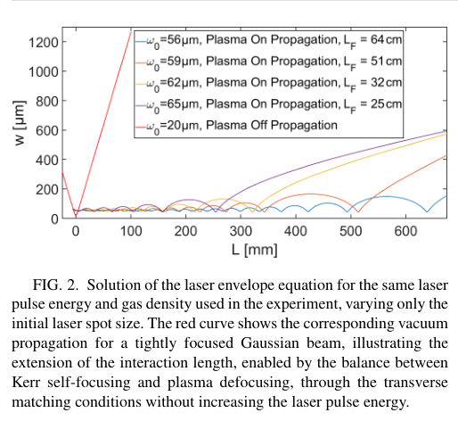
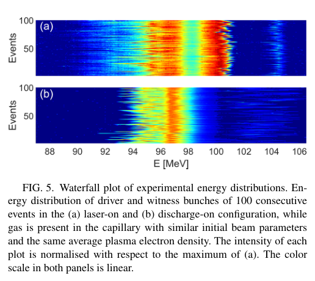

# 激光等离子体丝中的束驱尾场加速实验

## 0. 论文身份与本次原位更新

M. Galletti 等，*Experimental demonstration of beam-driven wakefield acceleration in laser-plasma filament*，[Physical Review E **114**, 055201](https://doi.org/10.1103/qjd9-p6dy)，Editors’ Suggestion。VOR 首页明确 **2026-05-26 收稿、09-29 接收、11-02 发表**；09-29 不是发表日期。2026-10-08 首次入库时读的是同作 [arXiv:2602.22841v1](https://arxiv.org/abs/2602.22841v1)，本次 11-04 在原笔记基础上更新，不另计独立作品。

当前全文依据为 [10 页 APS 排版 VOR](../../2026-11-04/pdfs/Galletti%20et%20al.%20-%202026%20-%20Beam%20driven%20wakefield%20filament%20VOR.pdf)，来自 [APS 官方 Harvest 全文接口](https://harvest.aps.org/v2/journals/articles/10.1103/qjd9-p6dy/fulltext)；[21 页历史作者稿](../pdfs/Galletti%20et%20al.%20-%202026%20-%20Beam-driven%20acceleration%20in%20laser-plasma%20filament.pdf)仅作版本对照。本文是 **rf linac 电子束驱动的 PWFA 实验**：激光负责生成等离子体，并经同源支路驱动光阴极；不是激光直接加速注入电子的 LWFA 实验。

## 1. 摘要与引言：实验建立了什么

SPARC_LAB 以约 10 mJ、350 fs 激光在氮气中生成细丝，用约 97 MeV 的驱动束激发尾场，再加速见证束。在 3 cm 级段获得约 8 MeV 平均增能；100 个连续事件中约 95% 成功加速，报告 rms 能量抖动小于 0.5%。这些是束流实验观测；具体局域场幅度、细丝传播机制和长级段能力分别依赖模拟或模型。

引言将该方案与放电毛细管、束流场电离、激光电离气体及 HOFI 通道比较。细丝由 Kerr 自聚焦与等离子体散焦等效应动态平衡产生，优势是低能量成等离子体与同源同步。论文引用的其他平台高重复率、长通道和高效率进展不是本实验新测结果。

## 2. Filamentation physics：模型、标定与可扩展性

### 2.1 原式的物理项与模型边界

VOR 式(1)使用慢变包络描述衍射、群速度色散、瞬时及延迟 Kerr 响应、等离子体吸收/散焦和电离损耗；延迟项权重为 0.5，响应时间约 70 fs。作者给出的真空束腰约 20 μm、Rayleigh 长度约 1.5 mm，细丝可维持约 45 mm 传播，平均横向尺度约 70 μm。包络与 FBPIC 的传播趋势一致，电离使用 ADK 模型，中性氮气分布来自 OPENFOAM；模拟轴上电子密度平台约为每立方厘米 8×10^14。

正式版新增式(2)说明 FBPIC 中 Kerr 极化的瞬时/延迟贡献，及其作为附加极化电流与自由电子电流共同进入 Ampère 方程。这样的模型交叉核对支持所测条件内的描述，不能单凭拟合将未测长通道或热稳态视为已验证。

**源文本待澄清：** VOR 式(1)后的文字将 Kerr 系数中的量写成

$$
k_0=\frac{\omega_0\tau_c}{n_0}.
$$

按同段定义，角频率乘碰撞时间再除折射率无量纲；而式(1)中配合单位为面积/功率的非线性折射率与光强使用时，通常需要逆长度系数。这里记录印刷式与量纲的不自洽，不自行替换系数，也未运行该方程。

### 2.2 新增长通道扫描是模型结果

**原图 2，VOR 第 3 页**：横轴传播距离 L（mm），纵轴横向包络 w（μm）。蓝/橙/黄/紫曲线分别改变初始光斑约 56/59/62/65 μm，标出的细丝长度约为 64/51/32/25 cm；红线是束腰 20 μm 的真空传播对照。趋势说明在这一包络模型中，横向匹配可改变自导引距离；不是在本次 3 cm 装置上测得了 64 cm 等离子体或 64 cm 加速。图中 w 的定义沿用原模型，不能与任意诊断的 FWHM 混用。

## 3. Experimental setup：成丝、电子源与诊断

主激光为 80 mJ、30 fs、800 nm、10 Hz Ti:sapphire 系统。一路倍频后照射 rf gun 铜阴极，产生可分时的双电子束，再经 rf linac 加速、速度聚束与 PMQ 聚焦；另一路以约 10 mJ、350 fs 生成等离子体。两路同源有利于同步。激光约比电子束早到 100 ps，以利用复合过程选择适当密度；这里的时间设置不等于独立测得了全部相位误差预算。

氮气毛细管长 3 cm、内径 2 mm；它用于容纳气体，不承担激光光学导引。发光细丝测得约 **45 mm 的十分之一峰值全宽长度**，横向 Gaussian 拟合 rms 约 **70 μm**；二者不是同一方向、同一宽度定义。历史笔记将“45 mm 全宽”笼统写出，本次补明定义。5–35 mm 平台区密度约每立方厘米 8×10^14，约 6.8% 的抖动来自积分发光信号；发光强度须经 Stark 展宽标定才用于密度估计，不是无标定的直接电子计数。

驱动/见证束参数约为：电荷 500/50 pC，rms 时长 0.6/0.2 ps（各约 ±0.1 ps），间隔 2.7±0.1 ps，入口 rms 半径 27/20 μm（各约 ±3 μm），输入能量约 97 MeV，归一化发射度约 2.9 μm。OTR 屏测横向形状，TDS 加磁谱仪测纵向与能谱，发射度由四极铁扫描获得。

Gaussian 束团的峰值数密度由总电荷归一化得到：

$$
N_b=Q/e,\qquad
n_b(0)=\frac{N_b}{(2\pi)^{3/2}\sigma_r^2\sigma_z}
=\frac{Q/e}{(2\pi)^{3/2}\sigma_r^2c\sigma_t}.
$$

这是将三维 Gaussian 数密度积分为总电子数，再用相对论束的长度近似为光速乘时长；所有长度采用同一单位。作者给出驱动/见证峰值密度约每立方厘米 1.5×10^15 / 0.82×10^15。驱动峰值与轴上等离子体密度之比约 **1.9**，并非原文“远大于”记号严格代表的渐近极限；blowout 结构还需结合数值密度与场图判断，不能只凭这个比值宣布强非线性全排空。

## 4. Experimental results：增能与成功率的不同分母

VOR 图 4 为激光关/开时各 100 个连续事件的平均能谱；驱动束最大损能约 4 MeV，见证束平均增能约 8 MeV，最终平均能量约 104.5±0.4 MeV。作者将束团分布峰值 10% 位置定义为能量边界，而平均能量取质心。因此最大驱动损能与平均见证增能不是可直接相除的能量转换效率。

以有效长度 3 cm 折算，平均增能梯度为

$$
\frac{\Delta E_W}{L}\simeq\frac{8\ {\rm MeV}}{0.03\ {\rm m}}
\simeq266\ {\rm MeV/m},\qquad
|E_{\rm acc,avg}|\simeq266\ {\rm MV/m}.
$$

第一量是单位长度能量增益，第二量对单电子由能量变化等于电荷乘纵向电压得到等效场幅度；它不是沿程场分布的逐点测量。正文称见证束电荷和相对能散保持，但未给完整输出六维相空间或发射度保存验证。

**原图 5，VOR 第 5 页**：横轴电子能量 E（MeV），纵轴 100 个连续事件编号；上图为激光成丝、下图为放电成等离子体，线性色标均按上图最大强度归一化。上图约 104–105 MeV 的见证条带更连续集中，支持稳定性比较；相对归一化图不能独立重构逐发绝对电荷。历史作者稿对应图为 Fig. 4，编号在 VOR 中已变。

成功率的分母是这组 100 个连续事件：激光成丝约 95%、放电约 75%。放电对照使用 7 kV、233 A，保留同一等离子体级段结构，但 **未使用附加稳定措施**；报告 rms 能量抖动约 1.3%，相对能散约 4%。该实验比较不等于与所有优化后放电/HOFI 方案的同条件性能竞赛。

VOR 图 6 的能量直方图则由各方案 **成功加速事件**的见证束平均能量构成。正文未另列“能量抖动”估计式、逐发数据与失败事件处理细节；因此小于 0.5% 应按作者加速能量统计口径保留，不能说全部 100 发均成功且无条件具有此稳定度。密度积分信号 6.8% 与束流能量抖动小于 0.5% 的差别也不构成独立测得细丝核心密度抖动的证据，作者将核心更稳定列为待进一步表征。

## 5. Discussion：PIC场与低热负荷的证据层级

VOR 图 7 采用横向 rms 70 μm、轴上密度每立方厘米 8×10^14 的 Gaussian 等离子体，设置与实验一致的双束参数；模拟给出驱动区约 150 MV/m 减速场和见证区约 260 MV/m 加速场，与按 3 cm 推算的能损/增益量级一致。历史作者稿方法节写明 PWFA 模拟传播至 5.4 mm；VOR 正文未提供替代的完整 3 cm 逐程收敛/输出相空间数据。因此不能把局域模拟场与长度乘积称为已完成全 3 cm 端到端模拟验证。

**纠正历史笔记的证据归类：** 约 2.5 mJ 是作者报告的激光脉冲能量损失测量，不是传播仿真给出的壁能沉积。VOR 进一步说明相当部分损失可能出现在毛细管后 PMQ 区和真空阻抗等传输环节；把全部损失保守归于壁是热负荷上界假设，不是实测壁热流或温升。旧稿给出的“低于 1 mJ/cm²”数值在 VOR 中已改成定性损伤阈值比较，本笔记不沿用为已测局域热负荷。

作者另提及独立放电测量：3 cm 毛细管约 100 mJ/放电，60 cm 结构约 2 J/放电。这些测量不构成本次成丝 10 Hz 实验的长期冷却/材料寿命对照。高重复率运行还需要激光、供气/抽气、复合与热恢复、准直同步和靶材寿命共同验证；低单发光能损失不能直接给出数十 kHz 的平均热负荷合格结论。

## 6. Conclusions 与可复现性

本工作验证了低能量激光成丝作为外部电子束 PWFA 等离子体源的可行性，直接数据支持本组 3 cm、10 Hz、约 8 MeV 增能和连续发次稳定性。25–64 cm 包络扫描、kHz 兼容性、EuPRAXIA 60 cm/GV 每米级段，以及窄通道的正电子/离子通道应用属于模型或展望，均不是本次新实验。

VOR Data Availability 明确 **没有公开支撑论文的研究数据或软件**，需向作者索取。下一步应取得逐发原始谱和成功判据、误差/失败样本处理、输出发射度及束流全相空间；补齐 3 cm 全程与网格/模式收敛，澄清包络系数记法；再开展长通道和高重复频热/气体恢复测试。没有转换靶后 γ 谱、光核/中子/核素产额、诊疗或防护验收。

## 7. 2026-11-04 版本核验记录

VOR 保留旧稿核心实验结果，但重写并扩充了 HOFI/放电比较，新增 Kerr 极化实现说明、固定能量长通道包络扫描，调整图号并更明确限制测得光能损失的归属。旧稿的方法细节不是自动属于 VOR 已公开的数据；二者版本边界如上保留。

本次全文读取 VOR 科学正文及数据声明，实际目视第 1–7 页；两幅最终原图摘录均重新查看完整坐标与图注。原图来自 M. Galletti 等，*Physical Review E* 114, 055201 (2026)，CC BY 4.0，裁取未重绘；见[页码/裁框/SHA与目检记录](../../2026-11-04/research/filament-visual.json)、[PDF核验](../../2026-11-04/pdf_validation.json)。旧 [作者稿 Fig. 4 摘录](../images/galletti/figure-4-waterfall.png)保留为历史证据，不再作为当前 VOR 图号引用。

本次只对另一篇公开 FEL URL 测试 MinerU，实际返回认证 `HTTP 401 / A0211 / user token expired`；该认证阻塞下没有对本文另建解析任务。本文使用已验证本地布局全文和页面渲染回退，见[解析记录](../../2026-11-04/research/mineru-attempts.json)。未复跑 FBPIC、包络/热模型或实验，局部算术仅用于解释文中已有数值。
