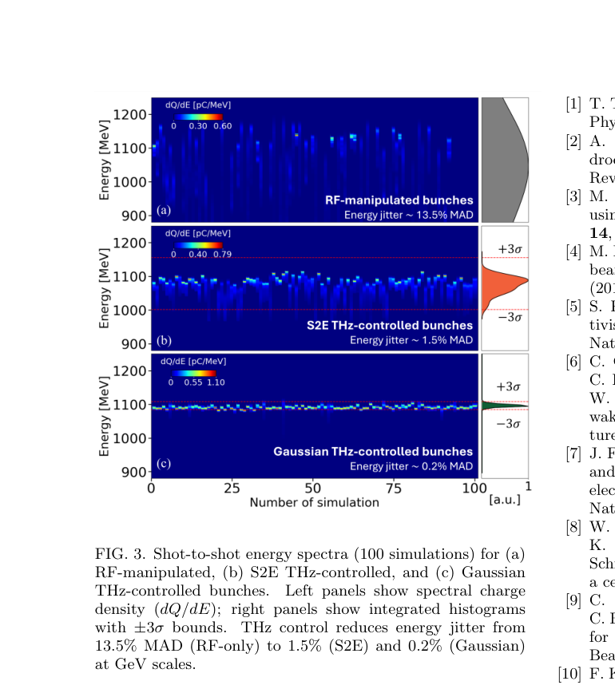

# 太赫兹调控外注入激光等离子体加速器

> A. Amini 等，*Physical Review Research*（2026-10-09），DOI `10.1103/wb14-xvj2`。正式出版元数据已核验；本地全文为对应 arXiv:`2604.16059v1` 作者预印本，而不是 APS VOR。以下基于该作者全文、布局文本和关键页渲染核读。

## 一句话结论

太赫兹介质波导与磁弧把外注入束团压缩并与驱动激光锁时，作者的 100 次 start-to-end 模拟把 GeV 级末态能量抖动从 `13.5%`（MAD）降至 `1.5%`；理想高斯束团可到 `0.2%`，但全文没有实验外注入或等离子体加速验收。

## 1. 构型与计算链

- 以同一激光系统产生太赫兹脉冲和 LWFA 驱动光，太赫兹介质衬里波导施加线性能量啁啾，随后用可调 `R56` 的磁弧压缩并匹配到等离子体通道。
- CLARA/FEBE start-to-end 链使用 ASTRA、GPT、ELEGANT 和 FBPIC，包含空间电荷、相干同步辐射、注入器到达时间抖动及等离子体阶段。
- 代表性 S2E 入射束能量 `230.1 MeV`、电荷 `5 pC`、归一化发射度约 `0.24 μm`、束长 `189 fs rms`；`9 cm` 等离子体通道轴上密度 `10^17 cm^-3`。

## 2. 图 3：100 次模拟的末态能谱

- **来源：** 论文 Fig. 3。
- **坐标：** 横轴为 100 次模拟编号，纵轴为电子能量 `MeV`；色标为谱电荷密度 `pC/MeV`，右侧为积分能谱分布。
- **趋势：** RF-only、真实 S2E 太赫兹调控和理想高斯束团三种情况的能量抖动依次约为 `13.5%`、`1.5%`、`0.2%`（MAD）。
- **论证作用：** 直接展示锁时和束团压缩如何降低逐发输出漂移，而不只是给单次最优轨迹。
- **限制：** 三组都是数值样本；理想高斯束团代表机器目标状态，不是已实现束源。

## 3. 定量结果

- S2E 束团从 `189.0 fs` 压到约 `7.8 fs rms`，到达时间抖动从 `98.4±9.8 fs` 降至 `8.0±0.8 fs rms`。
- 最优注入束从约 `229 MeV` 加速到 `1079.7 MeV`、能散 `1.0%`；仅 `12.7 fs` 偏时便使末态降至 `1035.4 MeV`、能散升至 `6.6%`。
- 真实 S2E 样本末态为 `1079.5±16.4 MeV`（median±MAD）、能散中位数 `1.1%`；理想高斯样本为 `1095.7±2.1 MeV`、能散和能量抖动均约 `0.2%`。

## 4. 证据边界

- **作者证据：** 多代码数值设计与 100 次含抖动模拟，不是太赫兹压缩器或外注入 LWFA 实验。
- **模型依赖：** `0.2%` 对应优化的高斯束源和同一套匹配/等离子体模型，不能直接外推到实机可用率或 FEL 性能。
- **未完成：** 未验证同步误差、太赫兹幅相漂移、束线失准、等离子体密度抖动和端到端效率的联合实验分布。
- **本地边界：** 本地未运行 ASTRA、GPT、ELEGANT、FBPIC 或复做 100 次扫描。
