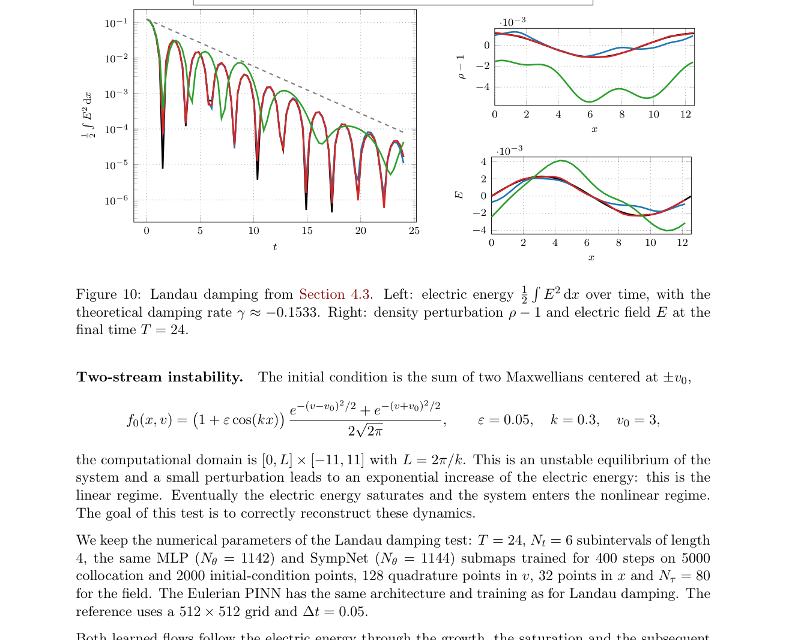

# 用神经特征映射求解 Vlasov 与漂移动力学输运

> M. Campos Pinto 等，arXiv:`2610.12395v1`（2026-10-08），预印本。以下基于官方 PDF、布局文本和关键页渲染核读；这是数值方法论文，不是新等离子体实验或工程级替代求解器。

## 一句话结论

Lagrangian PINN 不直接拟合细丝化分布，而学习分段特征流并回拉精确初值；它在 Landau 阻尼、双流不稳定和简化 tokamak 漂移动力学上明显优于普通 Eulerian PINN，但低维算例成本仍不及网格法，五维 gyrokinetic 扩展尚未完成。

## 1. 方法与基准

- 每个时间子区间训练一个近恒等的后向流映射，再按半群性质组合；MLP 与体积保持的 SympNet 两类网络用于比较。
- 测试包括线性平流、二维不可压 Euler、`1D1V` Vlasov–Poisson 的 Landau 阻尼/双流不稳定，以及大纵横比圆形 tokamak 的简化轴对称漂移动力学。
- 自洽场通过 Picard 迭代和谱/有限元求解器更新；参考解来自伪谱或半 Lagrangian 网格法。

## 2. 图 10：Landau 阻尼

- **来源：** 论文 Fig. 10。
- **坐标：** 左图横轴为归一化时间，纵轴为电场能量；右图横轴为空间位置，纵轴为密度扰动和电场，比较半 Lagrangian、MLP flow、SympNet flow 与普通 PINN。
- **趋势：** 两种流映射跟随理论阻尼率 `γ≈-0.1533` 到 `T=24`，SympNet 与参考几乎重合；普通 PINN 只跟住早期振荡并抹平相空间细丝。
- **论证作用：** 说明学习流映射可以把细尺度交给初值回拉，而不要求网络直接表示越来越细的分布函数。
- **限制：** 这是固定低维标准题，参考解和场更新网格仍参与训练/验证，不等于无网格全动理求解器。

## 3. 定量表现

- Landau 阻尼中两种流的质量漂移约 `10^-10`；SympNet 能量漂移约 `10^-5`，比 MLP 小约 50 倍。
- 双流不稳定到 `T=24` 时，`L²` 漂移约为 MLP `2×10^-2`、SympNet `5×10^-4`、参考 `2×10^-5`；普通 PINN未重现非线性演化。
- 漂移动力学 Rosenbluth–Hinton 测试在 `T=40` 约 16 个周期上给出 `ω_G=2.54`，与 GYSELA 的 `2.53` 相差约 `0.5%`；阻尼率则比 GYSELA 高约 `45%`。

## 4. 证据边界

- **算法验证：** 结果来自作者设置的低维数值基准，没有实验数据、独立代码复现或生产级五维 gyrokinetic 算例。
- **成本边界：** 作者明确承认当前低维场景不具备对网格求解器的成本竞争力，且子映射代价随既有映射数近线性增长。
- **未完成：** 五维 gyrokinetic、碰撞源项、自适应时间划分和公开代码仍是后续工作；文中代码仅承诺出版后公开或按请求提供。
- **本地边界：** 本地未训练网络、运行 GYSELA/半 Lagrangian 参考或复算误差表。
