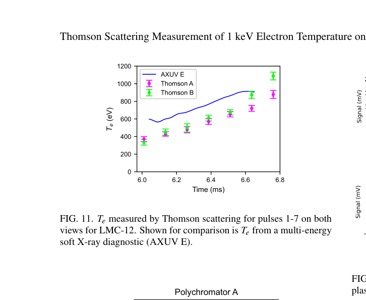

# LM26 的 1 keV 电子温度 Thomson 散射测量

> P. Carle 等，arXiv:`2610.11769v1`（2026-10-08），预印本。该文与 Howard 等压缩加热论文使用同一 LMC-12 炮次，但聚焦独立诊断设计与不确定度，不应视作第二次独立压缩实验。

## 一句话结论

在狭窄 `f/30` 访问和小于 `20°` 的前向散射条件下，LM26 的双视线、八时刻 Thomson 系统仍在 LMC-12 测到 `1090±40 eV`，并以约 6000 个光电子和真空对照排除了显著杂散光；最深压缩的第 8 脉冲击中内衬而不可用。

## 1. 诊断设计

- 两台 Nd:YAG 激光各提供 4 个 `1.9 J、10 ns、1064 nm` 脉冲，交错后形成 8 个、间隔 `125 μs` 的采样时刻。
- View A/B 散射角分别为 `10.4±0.2°` 与 `18.2±0.2°`，收集立体角约 `9.5×10^-4` 和 `7.2×10^-4 sr`；压缩后电子密度超过 `10^20 m^-3`，补偿较小收光角。
- UKAEA 四通道 polychromator 覆盖约 `990–1063 nm`；温度由测量信号与合成谱的加权 `χ²` 最小化获得，角度不确定度通过 `10^5` 次 Monte Carlo 传播。

## 2. 图 11：两视线温度与 AXUV 对照

- **来源：** 论文 Fig. 11。
- **坐标：** 横轴为炮次时间 `ms`，纵轴为电子温度 `eV`；品红/绿色为 Thomson A/B，蓝线为多能 AXUV。
- **趋势：** 两视线在早期相近，深压缩后 B 视线进入更热核心并升到 `1090±40 eV`，与 AXUV 升温趋势一致。
- **论证作用：** 为软 X 射线连续温度提供离散但更直接的独立光谱校验。
- **限制：** AXUV 与 Thomson 的视线、空间采样和时间分辨不同；趋势一致不意味着逐点同一体积或同一系统误差。

## 3. 信号质量与限制

- 第 7 脉冲两视线合计约 6000 个光电子，真空试验与激光线监视通道表明杂散光不是主要误差源。
- 未压缩等离子体也能测得约 `130±10 eV` 和 `100±30 eV`，便于炮前对光；第 8 脉冲击中内衬并产生宽带杂散光，未用于温度结论。
- 小散射角缩窄了谱宽并降低背景，但使温度更敏感于角度；论文把 `±0.2°` 几何误差纳入总不确定度。

## 4. 证据边界

- **直接实验：** polychromator 波形、背景、真空对照及 `1090±40 eV` Thomson 结果。
- **同炮次关系：** 它支撑 Howard 等的 LMC-12 电子升温结论，但不是另一个独立装置/炮次复现。
- **未完成：** 尚未测到更深压缩区或燃烧等离子体条件；几何、窗口和内衬遮挡仍限制后续量程。
- **本地边界：** 本地没有重放原始波形、重标定 polychromator 或重做角度 Monte Carlo。
