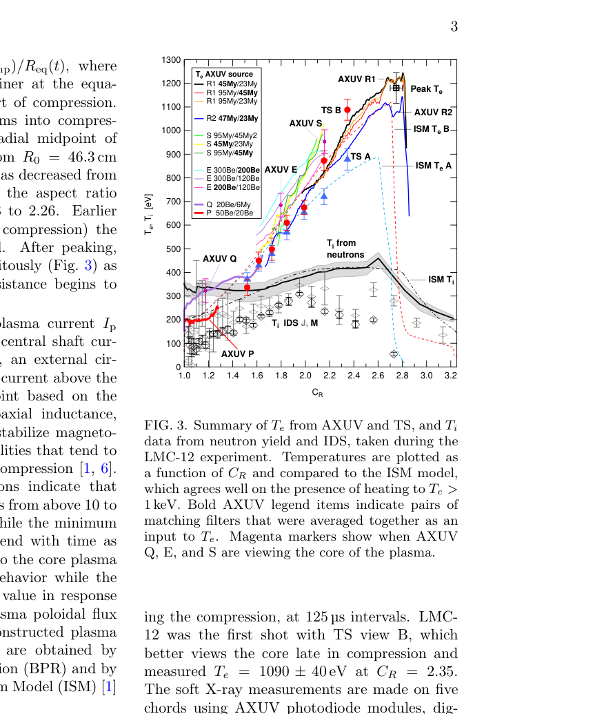

# LM26 磁化靶聚变装置的 1 keV 以上压缩加热

> S. J. Howard 等，arXiv:`2610.11890v1`（2026-10-08），预印本。以下基于官方 arXiv PDF、布局文本和关键页渲染核读。

## 一句话结论

LM26 的 LMC-12 炮次用固态锂内衬把球形 tokamak 径向压缩约 `2.75` 倍，AXUV 推得电子温度从约 `200 eV` 升至 `1180±65 eV`，相邻 Thomson 测量给出 `1090±40 eV`；离子温度 `459±33 eV` 则来自中子产额与模型反演，不能与直接温度测量等同。

## 1. 装置、诊断与模型

- 初始固态锂内衬直径 `1.76 m`，由 theta-pinch 线圈向内驱动；压缩开始后约 `3 ms` 达到最高电子温度。
- 电子温度由多滤片 AXUV 连续给出，并由两空间点、八时刻的 Thomson scattering 校验；磁平衡用 Bayesian Plasma Reconstruction 与 Integrated System Model（ISM）重构。
- D-D 中子由 8 个液闪和 1 个 `³He` 探测器测量；液闪效率依赖 UKAEA 的 MCNP 内衬散射模拟，离子温度再由电子密度和 Bosch–Hale 热反应率反演。

## 2. 图 3：温度随压缩比演化

- **来源：** 论文 Fig. 3。
- **坐标：** 横轴为内衬径向压缩比 `C_R`；纵轴为电子/离子温度 `eV`。彩线为不同 AXUV 滤片比，三角/圆点为 Thomson，黑线与灰带为中子反演离子温度，虚线为 ISM。
- **趋势：** `T_e` 随 `C_R` 快速升高并在约 `2.75` 达峰，随后随电流淬灭下降；`T_i` 的升幅更小且不确定度更强。
- **论证作用：** 把连续软 X 射线趋势、离散 Thomson 点和中子/模型离子温度放在同一压缩坐标上交叉约束。
- **限制：** 三类量的测量原理与模型依赖不同；图中一致性不能消除 AXUV 发射模型或中子热化假设的系统误差。

## 3. 主要结果

- AXUV 给出 `T_e=1180±65 eV`（`C_R=2.75`）；Thomson view B 在 `C_R=2.35` 测得 `1090±40 eV`，相对初始 `200±22 eV` 超过五倍升温。
- 中子反演给出 `T_i=459±33 eV`；压缩时段液闪 PSD 总产额 `(1.87±0.38)×10^6`，`³He` 探测器为 `(1.54±0.41)×10^6`。
- LMC-12 峰值电子/离子压缩加热功率分别为 `9.6 MW` 和 `3.0 MW`，另有约 `8.1 MW` 内部欧姆加热。

## 4. 证据边界

- **直接实验：** 磁信号、AXUV、Thomson、干涉和中子计数来自 LMC-12 实验。
- **模型辅助：** AXUV 温度需要谱/发射响应，`T_i` 假设 Maxwellian 且采用未直接测得的燃料稀释系数 `f_D=0.7`；平衡、功率和输运来自 BPR/ISM/MCNP。
- **范围限制：** 这是一次最佳炮次的压缩加热证据，不是净能量增益、燃烧等离子体或商业装置闭环。
- **本地边界：** 本地没有重跑 ISM、BPR、MCNP 或中子反演，也未访问原始波形。
