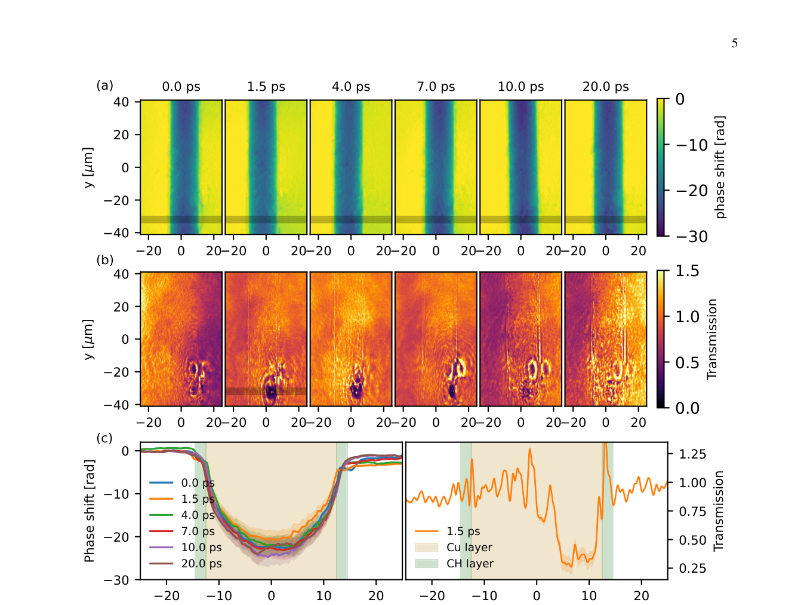

# 用 XFEL 共振吸收成像诊断 ICF 烧蚀层—燃料混合

> L. Huang 等，arXiv:`2610.11603v1`（2026-10-08），预印本。全文把铜丝泵浦—探针实验与直接/间接驱动 ICF 的原子物理、FLASH 合成诊断结合；两类证据在下文分开。

## 一句话结论

欧洲 XFEL 实验已在 CH 包覆铜丝上时间分辨地测到 `8.21 keV` 共振吸收变化，证明热致电荷态成像的可行性；把它用于球形 ICF 混合、燃烧和多 keV 热点仍是 FLASH/原子模型设计，且直接驱动模拟明确未包含核燃烧和 α 粒子沉积。

## 1. 实验与合成诊断

- HED-HiBEF 上的 ReLaX 激光最高 `7 J、30 fs`，聚焦到 `4 μm`，泵浦直径 `25 μm`、外覆 `2 μm CH` 的铜丝。
- XFEL 探针为 `1.7 mJ、25 fs`，带宽约 `20 eV`，中心能量 `8.21 keV`，对应热固体密度 Cu²²⁺ 的 K–L 跃迁；Talbot/CRL 成像给出相位和透射。
- FLYCHK/SCFLY 计算电荷态和温度依赖不透明度，FLASH 模拟直接/间接驱动壳层，再生成双能量共振吸收图。

## 2. 图 3：铜丝热斑的时间分辨相位与透射

- **来源：** 论文 Fig. 3。
- **坐标：** 横纵轴为靶面位置 `μm`；上排色标为相位移 `rad`，中排为归一化透射，时延覆盖 `0–20 ps`；下排为穿过 Cu/CH 层的线剖面。
- **趋势：** 热斑附近的透射在 `1.5 ps` 显著降低并随时间演化；模型给出 `8.21 keV` 不透明度在约 `500 eV` 附近最大，过度电离后下降。
- **论证作用：** 直接实验验证共振吸收对热致电荷态和不透明度变化敏感。
- **限制：** 铜丝是固体密度 proof-of-principle，不是正在聚变的球形 ICF 壳层，也不能单靠单能量透射唯一反演温度和混合。

## 3. ICF 设计结果

- 直接驱动模型采用约 `1.5 MJ` triple-picket、峰值 `245 TW`/`8×10^14 W/cm²`；壳层含 `1%` Cu 掺杂 CH 和 `140 μm` 冷冻 DT，`10.6 ns` 生成 `8.12/8.25 keV` 合成双能图。
- 论文明确该 FLASH 计算不含核燃烧或 α 粒子能量沉积，因此混合区未达到点火热点的多 keV 状态，图像是中等加热条件下的设计研究。
- 间接驱动模型用 `0.4%` W 掺杂 HDC、`200 eV` 恒定辐射温度和 `2 ns` 脉冲；`8.46/8.70 keV` 两通道分别对约 `0.7/1 keV` 区间敏感。

## 4. 证据边界

- **直接实验：** CH 包覆铜丝的 Talbot 相位/透射和皮秒演化。
- **模型辅助：** 球形直接驱动和 HDC 间接驱动的混合定位、两色区分和烧蚀层温度均来自二维 FLASH、原子模型与合成成像。
- **可行性估算：** `2 mJ` XFEL、压缩靶衰减 `10–100` 倍时预计保留 `20–200 μJ` 图像信号，是设计估算而非共址 ICF 实验结果。
- **本地边界：** 本地未运行 FLASH、SCFLY/FLYCHK、Talbot 重建或原始数据分析。
