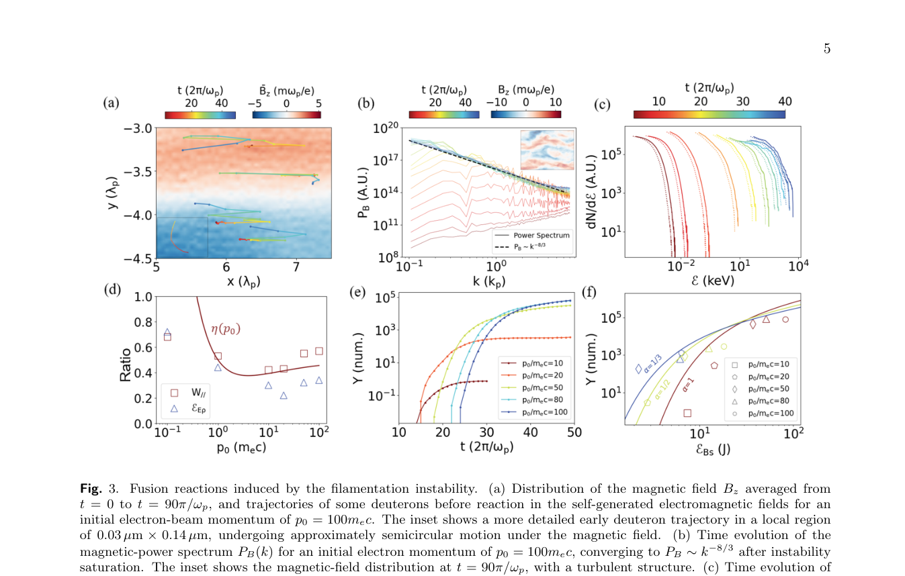

# 束流丝化驱动 D–T 聚变与偏振中子发射

> G. Qiu 等，arXiv:`2610.11061v1`（2026-10-08），预印本。以下基于官方 PDF、布局文本和关键页渲染核读；结论全部来自二维 PIC 与作者新实现的自旋相关 D–T 反应模块。

## 一句话结论

二维 PIC 预测对向相对论电子束的丝化场可把预偏振 D/T 离子加速到聚变能区，并使模拟中子计数随饱和磁能上升；`p₀=100m_ec` 时模型给出 `6.4×10^4` 个中子和约 `60%` 角向偏振，但无限束、周期边界和理想预偏振靶使其不能视作激光实验产额。

## 1. 模型设置

- 两束无限延展电子流密度各为 `10^19 cm^-3`，动量 `p₀/m_ec=10–100`，在 `20λ_p×20λ_p` 的二维周期区域内对向传播；`λ_p≈10.57 μm`。
- 背景 D/T 初始静止且平行自旋预偏振；PIC 中加入自旋进动、D–T 截面和角分布抽样，反应模块以理论截面作代码基准。
- 论文示意用两束激光产生电子流，但模拟从给定电子束开始，没有端到端激光—靶—电子耦合或三维靶结构。

## 2. 图 3：丝化场、离子谱和中子计数

- **来源：** 论文 Fig. 3。
- **坐标：** (a) 为以 `λ_p` 归一化的空间与平均磁场；(b) 为磁功率谱；(c) 为 D/T 能谱；(d) 为做功比例；(e) 为模型中子计数随 `2π/ω_p` 时间；(f) 为中子计数对饱和磁能 `J`。
- **趋势：** `p₀` 越大，丝化增长越慢但饱和磁能和最终中子计数更高；不同束流密度不对称度的点近似落在各自磁能—计数标度上。
- **论证作用：** 将“电子能量→磁/电场→离子加速→D–T 反应”的作者机制链定量串联。
- **限制：** 纵轴 `Y` 是特定二维盒、宏粒子权重和反应实现下的模拟计数，不是每发实验绝对源强。

## 3. 主要结果

- `p₀=10m_ec` 时自生磁场可达约 `1.1 kT`；饱和阶段磁场、电场和离子总能量约为 `7.4 J、3.0 J、0.21 J`。
- `p₀=100m_ec` 时最大 D/T 能量约 `5.21/3.55 MeV`；模型中子计数 `6.4×10^4`，而 `p₀=10m_ec` 仅约 `0.74`。
- 当两电子束密度比从 `1` 降到 `1/2` 或 `1/3`，`p₀=100m_ec` 的计数降到 `2.8×10^3` 和 `1.3×10^3`；最大偏振约 `60%`、方向约 `-20°`。

## 4. 证据边界

- **纯数值证据：** 没有 D–T 靶、电子束或偏振中子实验；二维无限束和周期边界会放大理想化程度。
- **物理假设：** 初始 D/T 完全预偏振、反应截面插值和高能外推、离子能谱及密度比都会影响计数与角分布。
- **未建模项：** 激光吸收、靶水动力学、有限横向束斑、燃料退偏振、三维输运、真实探测效率和屏蔽均未闭合。
- **本地边界：** 本地未运行 PIC、反应模块或复算中子极化。
