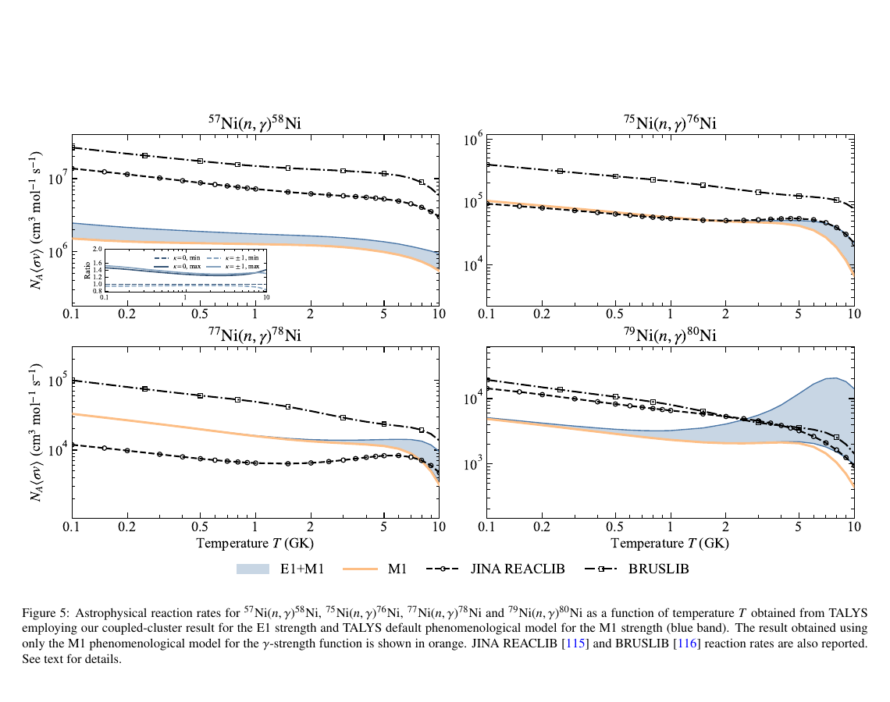

# Ni 同位素链从头算 E1 强度对中子俘获率的影响

> F. Bonaiti、J. E. Sobczyk，arXiv:`2610.13868v1`（2026-10-09），预印本。本文把 LIT-CC 从头算 E1 响应接入 TALYS 统计模型，不是新的中子俘获截面测量。

## 一句话结论

轴对称参考态的 Lorentz 积分变换—耦合簇（LIT-CC）计算显示，Ni 链随中子数增加出现更强的阈值上低能 E1 强度；接入 TALYS 后，形成 `68–78Ni` 的俘获率在 `3–10 GK` 被提高，而 `79Ni(n,γ)80Ni` 因阈值附近 pygmy dipole 强度从约 `0.5 GK` 就出现明显增强。

## 1. 结构与反应计算链

- 对 `58Ni` 和偶偶 `68–80Ni` 使用含二/三核子手征相互作用的 LIT-CC；轴对称参考态扩展了开壳层能力。
- `58Ni` 光吸收截面和 `68Ni` E1 强度用于实验基准；轴对称破缺由 `κ=0` 与 `κ=±1` 分量差异估计。
- 将从头算 E1 强度与 TALYS 默认唯象 M1 强度组合，比较仅 M1、JINA REACLIB 和 BRUSLIB 的天体反应率。

## 2. 图 5：四条 Ni 俘获链的温度依赖反应率

- **来源：** 论文 Fig. 5。
- **坐标与单位：** 横轴为温度 `T`（GK，对数尺度）；纵轴为 `N_A<σv>`（`cm³ mol^-1 s^-1`，对数尺度）。蓝带是 E1+M1，橙线为 M1-only，黑点划线为 JINA/BRUSLIB。
- **趋势：** 对 `75Ni`、`77Ni`，E1 贡献主要在数 GK 后抬高反应率；`79Ni→80Ni` 的蓝带从更低温度开始明显高于 M1-only，且反演不确定度快速扩大。
- **论证作用：** 将阈值附近 E1 结构差异直接映射到 r-process 所需的温度依赖俘获率。
- **限制：** 蓝带主要反映 LIT 反演区间，不是完整核力、模型空间、M1、光学势和能级密度联合不确定度。

## 3. 定量结果

- `5 GK` 时，`67Ni(n,γ)68Ni` 与 `77Ni(n,γ)78Ni` 在不确定度上沿相对 M1-only 的增强约 `16%` 与 `24%`。
- `10 GK` 时相应总率可达各自 M1-only 的约 `1.8` 与 `3` 倍。
- `79Ni(n,γ)80Ni` 因阈值附近强 pygmy dipole 模式，偏离 M1-only 的温度低至约 `0.5 GK`。
- 结果与 JINA REACLIB/BRUSLIB 多数在一个数量级内；作者明确指出三者都没有完整不确定度量化。

## 4. 证据边界

- **理论输入：** 除 `58Ni/68Ni` 基准外，中子丰富核的低能 E1 强度没有直接实验锚定。
- **混合模型：** E1 来自从头算，M1、Hauser–Feshbach、光学模型和部分统计输入仍由 TALYS 唯象模型提供。
- **不确定性边界：** 当前反应率误差受积分变换反演主导，但不等于总误差；角动量投影和阈值下强度仍待改进。
- **本地边界：** 本地未运行耦合簇、LIT 反演、TALYS 或核合成网络。
