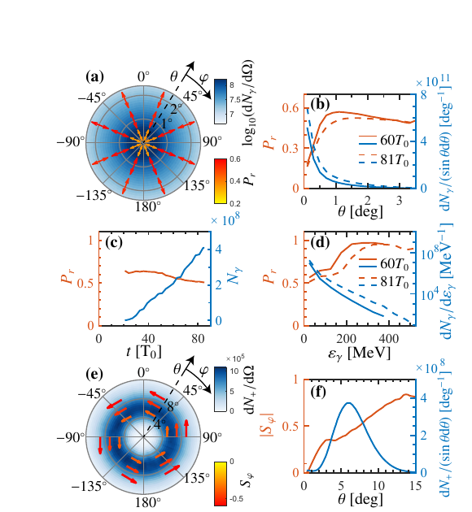

# 束流—多箔靶相互作用产生柱矢量 γ 射线

> Y. Cao 等，*Optica*（2026-10-09），DOI `10.1364/optica.612330`。正式出版元数据已核验；本地全文为对应 arXiv:`2508.16220v1` 作者预印本，不是 Optica VOR。

## 一句话结论

三维自旋分辨 QED-PIC 预测：`1.5 GeV、570 pC` 致密电子束依次穿过多层碳箔时，自生相干渡越辐射（CTR）可把径向偏振传递给非线性 Compton γ 光子，在约 `θ=1.1°` 处达到约 `57%` 偏振，并在更高能量趋近更高偏振；这仍是理想束流—靶数值方案，不是已实现 γ 源。

## 1. 模型与构型

- 自旋分辨 QED-PIC 代码 SLIPs 同时处理场电离、非线性 Compton 散射和非线性 Breit–Wheeler 对产生。
- 多层碳箔厚 `0.5 μm`、间距 `5 μm`、初始密度 `4×10^28 m^-3`；种子电子束能量 `1.5 GeV`、电荷 `570 pC`、能散 `5%`、角散 `0.5°`。
- 束流过箔激发径向 CTR 场，电子自聚焦和相位匹配抑制不同辐射平面的偏振抵消；低 Z 靶用于减小韧致辐射和 Bethe–Heitler 背景。

## 2. 图 2：γ/正电子的角分布与偏振

- **来源：** 论文 Fig. 2。
- **坐标与单位：** 极坐标给出 γ 光子或正电子的极角 `θ`、方位角 `φ`；蓝色为角分布，红色箭头/曲线为 γ 径向偏振 `P_r` 或正电子方位自旋偏振 `S_φ`；能谱横轴为 `MeV`。
- **趋势：** γ 偏振在轴上因偏振抵消而低，在 `θ≈1.1°` 达约 `57%`；能量从 MeV 区升到约 `200 MeV` 时模型偏振由约 `60%` 接近 `100%`，能谱截止约 `400 MeV`。
- **论证作用：** 把空间偏振拓扑、能谱和由 γ 衰变得到的方位自旋正电子放在同一模拟链中。
- **限制：** 后期更多箔提高通量和截止能量但降低平均偏振；图中正电子例子改用 `10 GeV、5 nC` 种子束，不能与基准 γ 工况混为一组实验指标。

## 3. 定量结果与相关工作

- `1°<θ<1.5°` 的 γ 光子束 rms 发散约 `15.4×15.4 mrad²`，纵向/横向尺寸约 `0.27 μm` 和 `0.36×0.36 μm²`。
- 模型在 `50/100/150/200 MeV` 给出的峰值亮度约为 `1.9×10^26/3.2×10^25/7.9×10^24/3.3×10^24 photons/(s·mm²·mrad²·0.1% BW)`。
- `10 GeV、5 nC` 示例产生约 `38 pC` 正电子，峰值极角约 `6.0°`、FWHM 约 `5.1°`，大角处 `|S_φ|` 接近 `80%`。
- 本库已有 `10.1017/hpl.2026.10121`：旋转电子束打单箔，连续调节径向—方位混合偏振。本篇采用多箔、自聚焦和径向 CTR，并进一步讨论正电子自旋；作者重叠且主题相近，但构型、主要结果和正式标识均不同，故不是重复记录。

## 4. 证据边界

- **纯数值证据：** 没有多箔靶 γ 偏振或正电子实验；束流压缩、箔间距、对准和耐受性均按理想模型处理。
- **产额边界：** 瞬时模拟亮度和角窗内粒子数不是设施平均通量，也没有闭合重复频率、激光/加速器效率、靶更换和屏蔽。
- **模型边界：** 结果依赖宏粒子统计、QED 过程抽样、二维角窗和低 Z 靶背景假设；未给出端到端探测器响应。
- **本地边界：** 本地未运行 SLIPs、复算偏振或模拟实验背景。
