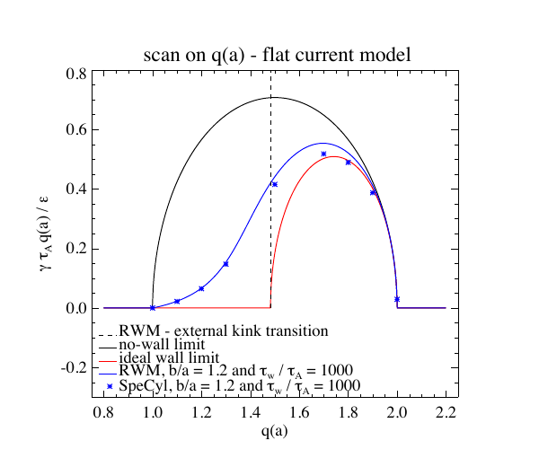

# SpeCyl 自由边界电阻壁模模块的实现与验证

> F. Galeazzi、D. Bonfiglio、L. Spinicci、S. Cappello，arXiv:`2610.13428v1`（2026-10-09），预印本。本文是三维全 MHD 代码边界条件实现与验证，不是新的 RFX-mod/RFX-mod2 实验结果。

## 一句话结论

SpeCyl 新模块把边缘三维自由流速度与双薄壳电阻磁边界自洽耦合，在圆截面大纵横比解析基准上重现 `(m,n)=(2,1)` 电阻壁模/外扭曲模增长率，全部平衡平均相对误差约 `6%`、RWM 低增长率区约 `3–4%`，并复现既有 RFX-mod 建模的增长率尺度。

## 1. 数值实现

- 等离子体外设置两个同轴薄电阻壳；壳间及外部取真空，壳位置和壁时间常数可独立变化。
- SpeCyl 求解非线性三维全 MHD，边缘速度采用自由流处理，新磁边界连接等离子体、内壳和外壳的切向电场与径向磁场。
- 验证基准采用 Shafranov 圆截面、大纵横比、平坦电流解析理论，并扫描壁位置、壁时间常数与边缘安全因子。

## 2. 图 8：随边缘安全因子变化的增长率

- **来源：** 论文 Fig. 8。
- **坐标与单位：** 横轴是边缘安全因子 `q(a)`；纵轴为归一化增长率 `γ τ_A q(a)^2 ε`。蓝线为数值求解色散关系，星号为 SpeCyl，黑/红线为无壁/理想壁极限；虚线给出 RWM—外扭曲模阈值。
- **趋势：** `b/a=1.2、τ_w/τ_A=1000` 时，SpeCyl 随 `q(a)` 的增长率跟随色散关系，并在 `q(a)_crit≈1.48` 附近捕捉不稳定性类型转换。
- **论证作用：** 验证新边界不仅在单一平衡上吻合，也能随安全因子变化保持正确的阈值与增长率趋势。
- **限制：** 解析参考假设圆截面、大纵横比和平坦电流，不能直接代表真实装置几何或非线性饱和。

## 3. 主要结果

- 壁位置扫描正确重现理想壁临界距离 `(b/a)_lim≈1.189`；壁时间常数扫描跨约 6 个数量级仍跟随解析色散关系。
- 全部初始平衡的平均相对误差约 `6%`，RWM 小增长率区约 `3–4%`。
- 采用 RFX-mod 参数时，透明内壁极限给出约 `46 s^-1`，真实 Inconel 壳时间常数下约 `35 s^-1`；既有 RFXlocking 参考模拟约 `47 s^-1`。
- 这些结果验证的是线性增长率和边界实现；论文没有给出 RFX-mod2 的新放电、反馈控制或非线性破裂预测。

## 4. 证据边界

- **代码验证：** 与解析色散关系和既有建模的一致性支持实现正确性，但不是独立实验确认。
- **物理范围：** 薄壳、真空区、圆截面/大纵横比基准以及所选电阻模型限制外推。
- **未完成：** 真实三维导体、复杂截面、反馈线圈、非线性饱和和 RFX-mod2 专用预测仍待后续研究。
- **本地边界：** 本地未编译 SpeCyl、运行扫描或复算增长率拟合。
