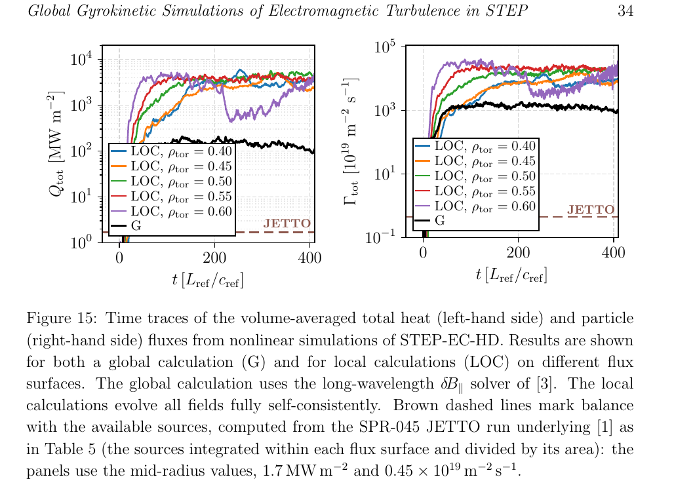

# STEP 电磁湍流的全局回旋动理学模拟

> D. Kennedy 等，*Nuclear Fusion*（2026-10-12），DOI `10.1088/1741-4326/aeaaf4`，CC BY 正式记录。IOP 路径受验证页限制，本地全文为对应 arXiv:`2609.02803v1` 作者预印本，不是 IOP VOR。

## 一句话结论

GENE 全局电磁回旋动理学模拟仍在 STEP-EC-HD 参考梯度上得到远超可用热源的 hKBM 湍流输运：全局热流约 `295–1400 MW/m²`，虽比局部通量低 `3–5` 倍，却仍比 JETTO 热源平衡值 `1.5–1.7 MW/m²` 高两个数量级以上；这说明参考剖面不是输运稳态，但不等于 STEP 没有可行运行窗口。

## 1. 计算设置

- 研究对象是 STEP-EC-HD 概念燃烧平顶工作点；使用 GENE 的全局几何和长波 `δB_∥` 求解器。
- 全局域覆盖约 `ρ_tor=0.3–0.7`，与 `ρ_tor=0.40–0.60` 的五组局部 flux-tube 模拟比较；电子温度约 `9.6–12.9 keV`，电子密度约 `(1.72–1.99)×10^20 m^-3`。
- 论文首先验证全局线性谱能重现局部 hKBM；微撕裂模（MTM）的约半离子回旋半径电流片对同时容纳 hKBM 的全局网格过细，未被充分分辨。

## 2. 图 15：热流与粒子流时间轨迹

- **来源：** 论文 Fig. 15。
- **坐标与单位：** 横轴为归一化时间 `t[L_ref/c_ref]`；左纵轴为总热流 `MW/m²`，右纵轴为粒子流 `10^19 m^-2 s^-1`，均为对数尺度。黑线是全局计算，彩线是五个局部磁面的计算，棕虚线为 JETTO 源平衡。
- **趋势：** 局部热流饱和在约 `3.6–4.8×10^3 MW/m²`，全局热流约 `10^2–10^3 MW/m²`；两者都远高于 `~1.7 MW/m²` 的热源水平。
- **论证作用：** 显示有限 `ρ*` 和全局边界可压低通量，却没有消除参考剖面的极端输运态。
- **限制：** 这是梯度驱动模拟，数值源维持目标剖面；真实通量驱动系统会让剖面松弛，不能把稳态前的高通量直接当作装置损失功率。

## 3. 主要结果

- Table 5 给出全局热流 `295/800/1290/1400/1130 MW/m²`，相应局部值 `4780/4380/4390/3650/4010 MW/m²`；JETTO 平衡值仅 `1.5–1.7 MW/m²`。
- 全局电子粒子流约 `690–4180×10^19 m^-2 s^-1`，局部为 `6050–9850×10^19 m^-2 s^-1`，而 JETTO 仅 `0.12–1.08×10^19 m^-2 s^-1`。
- `ρ_tor≥0.45` 时局部与全局热流相差约 `3–5` 倍；作者把差异部分归因于全局缓冲区和 Dirichlet 边界对大径向尺度的约束。
- 全局结果支持“参考梯度非输运稳态”，但既有 T3D 降阶通量驱动研究仍提示借助 `β'` 稳定化可能存在接近设计聚变功率的另一状态，本文未证明其可达性。

## 4. 证据边界

- **数值而非实验：** 所有结论来自 STEP 概念平衡的 GENE 计算，不是 STEP 放电或燃烧等离子体测量。
- **分辨率边界：** MTM 电流片未被全局网格充分解析；局部/全局同时解析多尺度仍不可行。
- **稳态边界：** 梯度驱动结果不能独立回答可行性，完整通量驱动全局 GK 在当前成本下不可行。
- **本地边界：** 本地未运行 GENE、JETTO/T3D 或复核数值收敛。
