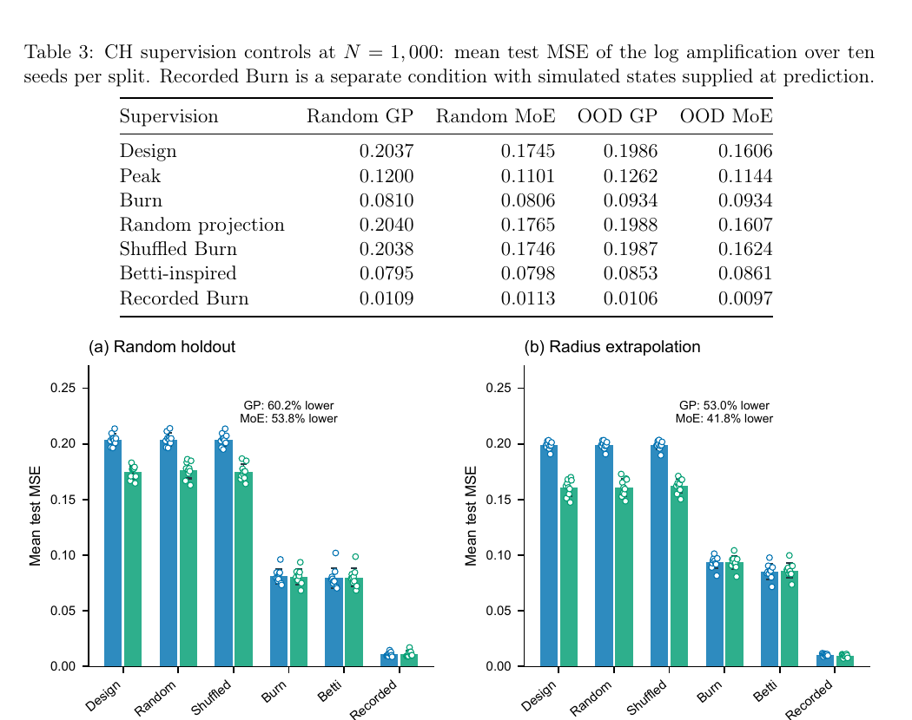

# 用物理状态监督内爆设计的高斯过程代理

> C. Liu、H. Shen、C. Li，arXiv:`2610.13822v1`（2026-10-09），预印本。以下基于官方 PDF、布局文本和关键页渲染核读；这是内爆模拟数据库上的机器学习方法，不是 ICF 实验或点火预测验证。

## 一句话结论

在 `1987` 对一维 CH 内爆模拟上，用“不含 α 加热”计算中的燃烧加权物理状态监督一个只吃设计变量的高斯过程，可把对数增益 MSE 在随机留出和设计半径外推中分别降低 `60.25%` 与 `52.98%`；但转到 `3000` 个 Be/Cocktail 新设计时外推收益接近消失，专家混合甚至退化。

## 1. 方法与数据

- 参考模拟包含 α 粒子自加热；监督状态来自配对的无 α 加热计算，包含燃烧加权的物理量。预测时不再运行参考内爆，而由设计变量先预测状态，再供全局 GP 或软专家混合（GP–MoE）使用。
- CH 主数据库有 `1987` 对一维内爆，训练预算从 `125` 到 `1000`；随机投影和打乱状态作为负对照，避免把额外维度误当成物理增益。
- 新建 `3000` 个 Be/Cocktail 设计测试跨靶族迁移；另用带热反馈的低成本 ODE 检查完整“状态编码器＋代理”链。

## 2. 图 2：物理状态监督的对照实验

- **来源：** 论文 Fig. 2 与 Table 3。
- **坐标与单位：** 两幅图纵轴均为 `log10` 放大率的平均测试 MSE；左图是随机留出，右图是设计半径外推；点为 10 个随机种子。
- **趋势：** Design/随机投影/打乱状态的 GP MSE 约 `0.20`，学习到的 Burn 状态降到 `0.0810/0.0934`；若直接给真实测试状态，MSE 可到约 `0.01`。
- **论证作用：** 负对照表明收益来自物理状态与样本的对应关系，而非单纯增加特征；真实状态与学习状态的差距也暴露编码器仍是瓶颈。
- **限制：** “Recorded Burn”在预测时使用模拟真值，信息条件不同，只能作为上限，不能与可部署代理等价比较。

## 3. 定量结果与迁移限制

- `N=1000` 时全局 GP 的随机/OOD MSE 从 `0.2037/0.1986` 降至 `0.0810/0.0934`，降幅 `60.25%/52.98%`；GP–MoE 降幅为 `53.84%/41.84%`。
- Be/Cocktail 随机留出上，Burn GP 在 `N=250/1000` 时降低 MSE `26.98%/43.72%`；但半径外推只改善 `5.19%/0.64%`，置信区间跨零。
- `N=1000` 的 Be/Cocktail 上，学习状态的 GP–MoE 比匹配的全局 GP 更差：随机/OOD 增益为 `-40.21%/-12.37%`。
- 数据库用 `200` 个网格单元；6 个设计相对 `1600` 单元的最大对数放大率差为 `0.3914 dex`，与代理误差同量级，不能把统计准确度解读为连续介质收敛。

## 4. 证据边界

- **模拟监督：** 标签、状态和响应均来自作者的一维内爆计算，没有 NIF/OMEGA 实验数据或三维不稳定性。
- **部署边界：** 设计变量预测状态避免了预测时再跑参考模拟，但训练仍依赖成对计算；跨材料、跨半径外推尚不稳健。
- **专家模型边界：** MoE 在小样本可有帮助，在较大预算和靶族迁移时不保证优于单一 GP。
- **本地边界：** 本地未重跑内爆数据库、训练 GP/MoE 或复算 bootstrap 区间。
