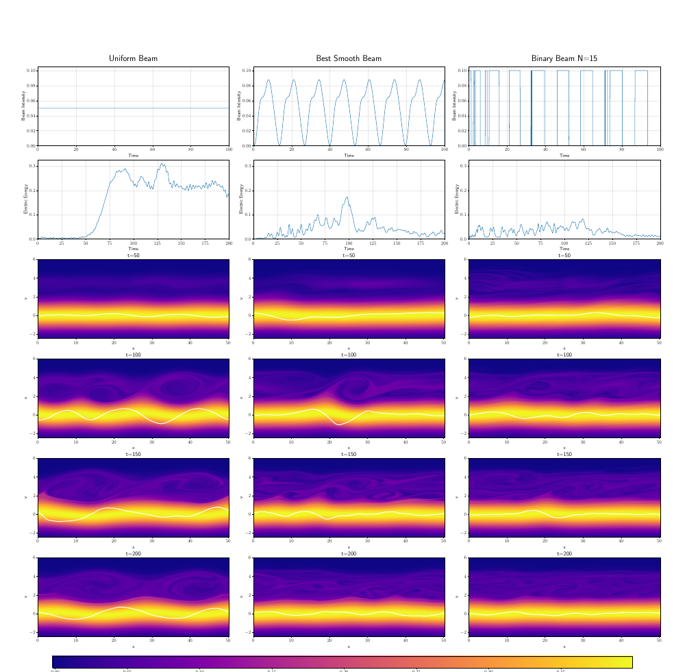

# 用全局优化设计抑制 bump-on-tail 不稳定性的束流轮廓

> S. Mignelli、L. Einkemmer，arXiv:`2610.13391v1`（2026-10-09），预印本。全文研究一维空间—一维速度 Vlasov–Poisson 模型中的束流时间调制，不是束流线或聚变装置实验。

## 一句话结论

在 `1D1V` Vlasov–Poisson 模型中，CMA-ES 和差分进化比局部梯度法/贝叶斯优化更能跨越崎岖目标面；15 周期 ON/OFF 束流把归一化时间积分电场能从均匀束的 `1` 降到 `0.189`，即约 `81.1%` 抑制，并优于最佳平滑轮廓的 `0.285`。

## 1. 模型与优化目标

- 快粒子束注入静止等离子体后形成速度分布隆起，触发 bump-on-tail 不稳定性；作者用 `1D1V` Vlasov–Poisson 方程演化分布函数。
- 目标函数 FOM 是全空间、全时间的电场能 `∫dt∫dx E²/2`，再按同总注入量的均匀束归一化；小于 1 表示抑制。
- 比较 L-BFGS-B、贝叶斯优化、CMA-ES、粒子群和差分进化；重点优化可实验实现的完全 ON/OFF 二值束流周期。

## 2. 图 13：均匀、平滑与二值束流

- **来源：** 论文 Fig. 13。
- **坐标与单位：** 三列分别是均匀束、最佳平滑束和 `N=15` 二值束；上两行为束流强度与电场能随归一化时间演化，下方热图为 `t=50/100/150/200` 的相空间分布，白线表示背景分布的空间起伏。
- **趋势：** 均匀束在约 `t=60` 后电场能快速增长；平滑调制降低峰值，二值束进一步压低并使晚期空间起伏更小。
- **论证作用：** 把优化目标的数值改善与相空间演化联系起来，说明 ON/OFF 轮廓不只是目标函数上的偶然最优点。
- **限制：** 热图来自同一一维静电模型，未包含横向束流、磁场、碰撞、装置注入器带宽或反馈延迟。

## 3. 优化结果

- 最佳平滑轮廓由差分进化得到 `FOM=0.285`；`N=15` 最佳二值轮廓由 CMA-ES 得到 `FOM=0.189`。
- 二值轮廓相对均匀束抑制约 `81.1%`，相对最佳平滑轮廓进一步降低约三分之一。
- `N=5/10/15/20` 的预算分别约 `10000/15000/20000/20000` 次函数评估；高维情形中种群方法更稳健，贝叶斯优化随维度上升明显退化。
- 目标面高度非凸，局部法依赖初值；“更易实验实现”只指完全开/关的时间调制，不代表作者已验证硬件波形、峰值电流或束流品质。

## 4. 证据边界

- **纯数值证据：** 没有中性束注入、电子束线或等离子体实验，不能把 `81.1%` 当成装置抑制率。
- **归一化边界：** FOM 是特定模拟时窗内的积分电场能，不直接等价于传输效率、加热功率或损失粒子数。
- **模型边界：** 一维静电无碰撞模型忽略横向不稳定性、有限束斑、磁几何和执行器限制。
- **本地边界：** 本地未运行 Vlasov 求解器或任何优化算法。
