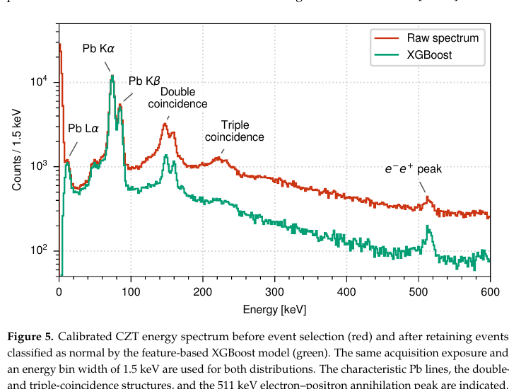

# CZT 探测器的机器学习脉冲形状甄别

> S. Manti 等，*Condensed Matter* 11, 38（2026-10-13），DOI `10.3390/condmat11040038`。本地全文为 MDPI 正式 CC BY VOR。

## 一句话结论

DAΦNE BTF 的 `300 MeV` 电子束打 `1 mm` 铅靶后，CZT 波形的 25 个时域/形态特征使 XGBoost 在人工形态标签上达到 `AUC=0.996、accuracy=96.8%`；应用到 `790,700` 个事件后保留 `48.2%` 并压低连续本底，但这衡量的是与人工标签的一致性，不是独立已知粒子拓扑下的真实信号效率。

## 1. 束靶与数据

- BTF 标称 `300 MeV` 电子束轰击 `1 mm` Pb 靶，产生 Pb 特征 X 射线、宽连续本底及 `511 keV` 正负电子湮灭峰。
- 准半球 CZT 在约 `22 °C` 工作，波形以 `125 MS/s、16 bit` 采样；束能、能散和单脉冲强度由设施设定但本文没有逐炮独立测量。
- 约 `10,000` 条波形经形态准则和人工复核标成 normal/anomalous，再按 `80/20` 划分训练/测试；阈值按 F1 最大化选择。

## 2. 图 5：事件筛选前后能谱

- **来源：** 论文 Fig. 5，正式 VOR 第 8 页。
- **坐标与单位：** 横轴能量 `keV`，纵轴每 `1.5 keV` bin 的计数（对数坐标）；红色为原始谱，绿色为 XGBoost 保留事件。
- **趋势：** 连续谱、约 `150/220 keV` 双/三重 coincidence 结构被明显压低；Pb `Lα/Kα/Kβ` 与 `511 keV` 峰仍可见。
- **论证作用：** 展示分类器不仅给出总体 accuracy，还改变真实采集谱中的峰—本底对比。
- **限制：** 选择后总事件只剩 `381,351/790,700=48.2%`；图没有给出随能量变化的真光子效率、假拒绝率或峰面积保持率，因此不能从视觉增强直接得到无偏定量谱。

## 3. 机器学习结果

- 完整特征集的固定测试集 `AUC=0.996、accuracy=96.8%`；单一 `DOI_RMS` 阈值只有 `AUC≈0.85`。
- 数百个训练事件时 accuracy 约 `93%`，数千事件时接近 `97%`；独立验证集选择 F1 阈值后测试 accuracy 为 `96.5%`。
- 论文把双/三步波形、pile-up 和电子学异常作为主要拒绝对象，尚未用经校准 Monte Carlo 或独立标签确定每类物理相互作用。

## 4. 证据边界

- **直接实验：** 束靶、CZT 波形和筛选前后谱来自真实加速器束流测试。
- **标签边界：** 指标只证明与人工形态标签一致；不能等同于已知 γ/电子/中子的混淆矩阵。
- **迁移边界：** 独立采集、其他晶体、温度和通量下的稳定性尚未验证，也未完成在线 DAQ 部署。
- **本地边界：** 本地未训练 XGBoost、重标波形或复算谱效率。
