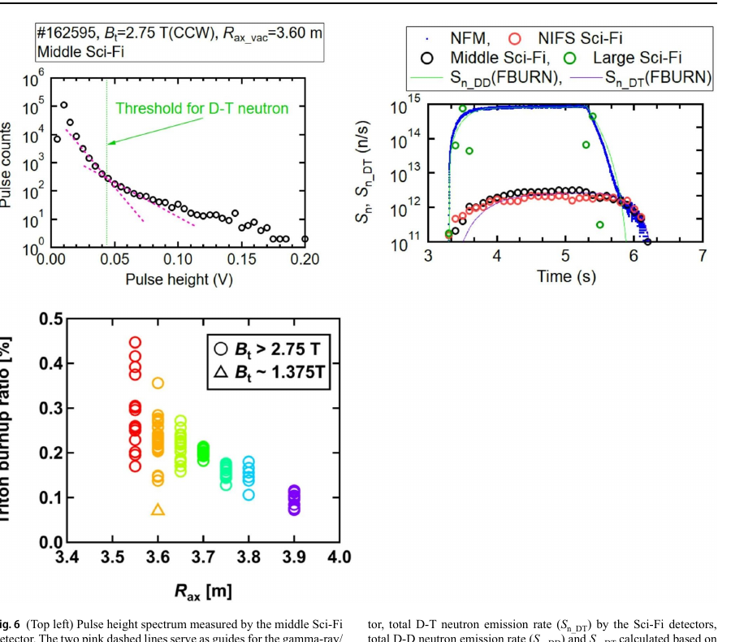

# LHD 氚燃耗探测器与高能粒子约束

> K. Ogawa 等，*Journal of Fusion Energy* 45, 62（2026-10-13），DOI `10.1007/s10894-026-00603-w`。本地全文为 Springer 正式 CC BY VOR。

## 一句话结论

LHD 用三档灵敏度的闪烁光纤探测器从强 D–D/γ 背景中提取次级 D–T 中子，测得氚燃耗比随磁轴由约 `3.9 m` 向内移到约 `3.55 m` 时由约 `0.1%` 增至最高约 `0.45%`；时间演化与 FBURN 在氚径向扩散系数 `0.25 m²/s` 时接近，但这仍是对 α 粒子约束的代理和模型辅助推断。

## 1. 探测器与物理量

- D–D 反应产生的约 `1 MeV` 氚在减速到约 `100 keV` 后可发生次级 D–T 反应；定义氚燃耗比 `Y_DT/Y_DD`，用它表征高能粒子是否在等离子体中保持足够长时间。
- NIFS/Toyama Sci-Fi 适用总中子率约 `5×10^13–2×10^16 n/s`；中档探测器约 `9×10^12–5×10^14 n/s`；大面积探测器约 `1×10^12–3×10^13 n/s`。
- 高能 D–T 中子沿 BCF-10 光纤产生更大反冲质子信号，通过离线脉冲高度甄别压低 D–D 中子与 γ 背景。

## 2. 图 6：阈值、时间演化与磁构型依赖

- **来源：** 论文 Fig. 6，正式 VOR 第 5 页。
- **坐标与单位：** 左上为脉冲高度 `V`—计数；右上为时间 `s`—中子发射率 `n/s`；左下为磁轴位置 `R_ax (m)`—氚燃耗比 `%`。
- **趋势：** 典型中档探测器以 `0.042 V` 分割 D–T 尾部；`S_n≈10^15 n/s` 放电中，D–T 信号上升慢于总 D–D 信号。磁轴向内移时燃耗比总体上升。
- **论证作用：** 同时闭合探测阈值、时间分辨与磁构型扫描，证明观测不是单个积分计数的偶然差异。
- **限制：** 大面积探测器在该高通量炮次发生 pile-up；D–T 绝对率通过特定时刻与总中子率比对换算，图中 FBURN 曲线还依赖拟合的输运系数。

## 3. 定量解释

- 时间 bin 为 `100 ms`；NIFS 与中档探测器得到相近的 `S_n,DT(t)`，作者把延迟解释为 `1 MeV` 氚减速过程。
- 用多组径向扩散系数比较后，`0.25 m²/s` 的 FBURN 结果与测量时间趋势最接近。
- 作者称这是首次在 stellarator/heliotron 中用氚燃耗评估 α 粒子约束；同时指出氚减速时间约为 α 粒子的 3 倍，因此不能把氚的扩散系数直接等同于反应堆 α 粒子扩散。

## 4. 证据边界

- **直接实验：** 脉冲高度分布、三种探测器的时间序列以及磁轴扫描来自 LHD 氘等离子体实验。
- **模型辅助：** D–T 率换算、径向扩散系数和与 α 粒子约束的联系依赖 FBURN、截面与减速模型。
- **外推边界：** LHD 的氘等离子体代理不能证明未来 D–T 反应堆中的 α 自加热、损失或壁负荷。
- **本地边界：** 本地未重放波形、重定阈值或运行 FBURN。
