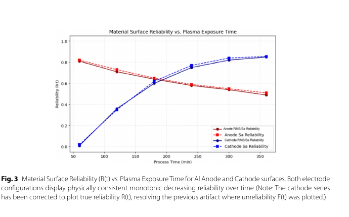

# He 等离子体作用后 AFM/SEM 粗糙度与可靠性模型

> A. Pahsa，*Discover Nano* 21, 513（2026-10-13），DOI `10.1186/s11671-026-04982-z`。本地全文为 Springer 正式 VOR；论文复用作者此前实验数据并重新做统计分析。

## 一句话结论

论文把 He 辉光放电后铝片的 AFM 粗糙度与 SEM 灰度代理量映射到 Weibull 可靠性，报告多组 Pearson `r≈0.988–0.994`；但有效共同时间点只有 `n=3`，铝又不是现实聚变第一壁材料，且 Fig. 3 的阴极“可靠性”曲线仍随时间升高，与 Table 6/正文的 `0.99→0.15` 下降相反，因此只能保留为方法与来源差异记录。

## 1. 数据与方法

- 低压 He DC 辉光放电约 `10^-3 Torr、10 kV`，He 纯度 `99.999%`、流量 `100 mL/min`；铝样品在阳极/阴极位置暴露 `60–360 min`，另有未辐照对照。
- 本文不提供新的材料体系实验，AFM/SEM 图像来自此前已发表数据；AFM 扫描 `20×20 μm²`，SEM 灰度图分成 16 个 ROI 并用 AFM 高度范围校准。
- 对照 AFM 的 `Rq=32.4±1.2 nm`；到 `360 min`，正文报告阳极 `138.6±4.3 nm`、阴极 `257.2±8.1 nm`。

## 2. 图 3：论文内部未闭合的曲线

- **来源：** 论文 Fig. 3，正式 VOR 第 10 页。
- **坐标与单位：** 横轴处理时间 `min`，纵轴标成无量纲可靠性 `R(t)`；红色为阳极，蓝色为阴极。
- **表面趋势：** 红色从约 `0.81` 降到 `0.49`，蓝色却从近 `0` 升到约 `0.85`。
- **内部冲突：** 图注声称阴极已经从失败概率 `F(t)` 修正为可靠性 `R(t)`，但 Table 6 与正文给出的阴极 AFM 可靠性是 `0.99、0.99、0.64、0.64、0.25、0.18、0.15`，应总体下降；蓝线更像 `1-R(t)`。因此不以 Fig. 3 的蓝线支持寿命结论。
- **论证作用：** 该图反而清楚暴露了变量定义/绘图链未闭合，是使用此文时必须保留的质量警告。

## 3. 可用结果与局限

- 阳极 Sa–Rq `r=0.988`、RMS–Ra `r=0.992`；阴极相应为 `0.993/0.994`。如此高的相关在 `n=3` 下很容易受共同单调趋势和单点影响，不能当作跨材料验证。
- 论文把阴极 `360 min` 的 SEM 可靠性 `0.852/0.855` 标成非单调异常，归因于电子束成像噪声和再沉积；这又与 AFM `0.15/0.145` 明显不一致。
- 铝的熔点、溅射、氧化和氢同位素滞留均不同于 W/Be；实验还缺少 `14 MeV` 中子、ELM 热冲击、磁约束和氢同位素注入。

## 4. 证据边界

- **原始事实：** He 放电、AFM/SEM 粗糙度源于既有实验数据，不是本轮新实验。
- **统计推断：** Weibull `R(t)`、Pearson 相关和 SEM→AFM 代理是本文二次分析；小样本与绘图冲突限制结论。
- **工程边界：** 不能用该铝样品曲线估算 ITER/W/Be 部件寿命，也不能据此声称 SEM 已替代 AFM 的通用资格。
- **本地边界：** 本地未重处理原始图像、复算 Weibull 参数或独立核查此前数据集。
