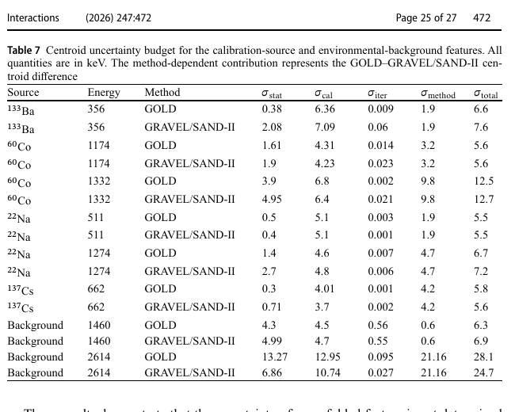

# EJ-315 液闪 γ 谱响应标定与展开

> T. Saikia 等，*Interactions* 247, 472（2026-10-13），DOI `10.1007/s10751-026-02815-0`。本地全文为 Springer 正式会议论文 VOR。

## 一句话结论

作者用 `133Ba、137Cs、22Na、60Co` 标准源约束 EJ-315 的能量分辨模型，并以 GEANT4 响应矩阵分别做 GOLD 与 GRAVEL/SAND-II 展开；主要特征的总质心不确定度约 `5.4–12.7 keV`，而环境本底 `2614 keV` 结构对算法的经验依赖项达 `21.16 keV`，故只能作诊断提示，不能当成高能 γ 精确谱线。

## 1. 实验与算法链

- EJ-315 为氘代有机液闪，γ 响应以 Compton 连续谱为主；用 `20 keV` 能量 bin 构建 detector-specific GEANT4 响应矩阵，并用实测分辨率展宽。
- 测量谱先做按 live time 归一的环境本底修正，再独立运行 GOLD 和 GRAVEL/SAND-II；每次迭代都把结果 refold 回探测器空间。
- 迭代停止同时检查谱变化、质心变化、峰面积、Poisson 型 deviance 和峰身份连续性，避免单纯追求最窄 FWHM。

## 2. 表 7：质心不确定度分解

- **来源：** 论文 Table 7，正式 VOR 第 25 页。
- **列与单位：** 能量与 `σ_stat、σ_cal、σ_iter、σ_method、σ_total` 均为 `keV`；`σ_method` 是两种展开算法质心差的经验量，不是独立随机误差。
- **趋势：** 校准源中迭代区间贡献均 `<0.06 keV`，校准项通常更大；高能端算法差异上升。环境 `1460 keV` 结构总不确定度 `6.3/6.9 keV`，`2614 keV` 则为 `28.1/24.7 keV`。
- **论证作用：** 说明“展开看见峰”不足以确立能量准确度，必须区分计数、标定、停止迭代和算法选择。
- **限制：** 把 GOLD–GRAVEL 差异并入平方和只是经验敏感度指标；它没有覆盖 GEANT4 物理模型、源几何或响应矩阵系统偏差的全部可能性。

## 3. 主要结果

- `133Ba 356 keV` 重建为 `356.9/355.0 keV`；`137Cs 662 keV` 为 `665.9/661.7 keV`。
- `22Na 511 keV` 为 `516.1/514.2 keV`；`60Co` 两个特征均被同时分开，但质心偏差可达约 `12–22 keV`。
- `60Co` 的 live-time 本底修正对主峰位置和宽度影响小，但会改变选择的迭代数与面积；不能把“峰位稳定”延伸为绝对效率已标定。

## 4. 证据边界

- **直接实验：** 标准源和环境本底谱来自实际 EJ-315 测量。
- **模型辅助：** 展开结果依赖 GEANT4 响应、经验分辨率、阈值、本底和正则化式的迭代停止。
- **应用边界：** 可用于混合中子–γ 场的响应方法参考，但本文没有激光 γ/中子源、绝对效率或脉冲形状中子–γ 甄别的端到端验证。
- **本地边界：** 本地未重跑 GEANT4、GOLD、GRAVEL/SAND-II 或不确定度 bootstrap。
