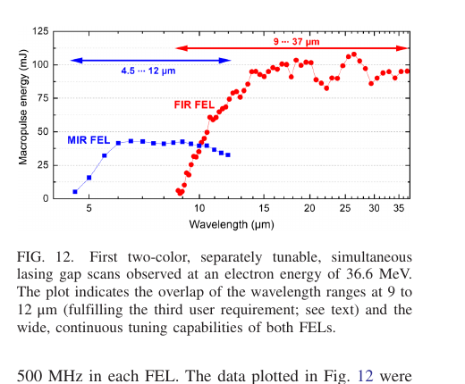

# 双振荡器双颜色红外自由电子激光

> W. Schöllkopf 等，*Physical Review Accelerators and Beams* 29, 103403（2026-10-13），DOI `10.1103/b27b-9gg1`。本地全文为 APS 正式 CC BY VOR。

## 一句话结论

FHI FEL 用 `500 MHz` 横向偏转腔把同一台直线加速器的 `1 GHz` 电子束团列交替送入 MIR/FIR 两个振荡器，实测同时、独立调谐的双颜色输出；在 `36.6 MeV` 束能下 MIR 覆盖 `4.5–12 μm`、FIR 覆盖 `9–37 μm`，交叉相关只支持“剩余相对抖动处于亚皮秒量级”的间接判断，不等于完整的绝对到达时间标定。

## 1. 装置与测量

- 热阴极电子枪和 S 波段直线加速器给出 `15–50 MeV`、单束团电荷 `>200 pC`、束团长度数 ps 的电子束；标准束团重复频率为 `1 GHz`，宏脉冲约 `10 μs @ 10 Hz`。
- `500 MHz` kicker 使相邻束团以约 `±2°` 交替偏转，每个 FEL 因而以 `500 MHz` 工作；也验证了每路 `55.6 MHz` 的降重复频率双颜色模式。
- 新 FIR 振荡器已在 `17–45 MeV` 束能下给出 `4.7–175 μm` 输出；全文还用四维 Maxwell–Lorentz 模拟解释长波端 slippage 与饱和。

## 2. 图 12：双颜色独立调谐

- **来源：** 论文 Fig. 12，正式 VOR 第 11 页。
- **坐标与单位：** 横轴波长 `μm`，纵轴宏脉冲能量 `mJ`；蓝色方块为 MIR FEL，红色圆点为 FIR FEL。
- **趋势：** `36.6 MeV` 时 MIR 连续扫过 `4.5–12 μm`，FIR 扫过 `9–37 μm`，`9–12 μm` 区间重叠；FIR 宏脉冲能量在长波端约 `80–110 mJ`。
- **论证作用：** 直接证明两个振荡器可同时起振且各自调谐，而不是用一个光腔的谐波或后续频率转换冒充双颜色工作。
- **限制：** 这组图是在 `500 MHz/路` 的电子束分流模式下测得；宏脉冲能量不能直接当作单微脉冲能量，也没有给出所有波长组合下的端站光斑与长期稳定性。

## 3. 同步与可用性

- MIR/FIR 在 `8 μm` 中心波长下通过 `1 mm` GaSe 晶体做和频交叉相关；三组腔长失谐的相关峰 FWHM 为 `2.1、3.7、7.1 ps`。
- 相关峰宽与预期的单脉冲时宽同量级，作者据此将额外相对 timing jitter 约束到亚 ps；该量不是用独立超短基准脉冲直接解卷积得到。
- 双颜色 FIR/MIR 波长比可从约 `0.75` 调至 `7.0`。装置已进入用户实验，但本论文展示的是 FEL/端站 commissioning 与性能测量，不是激光等离子体加速结果。

## 4. 证据边界

- **直接实验：** 双振荡器同时起振、波长扫描、宏脉冲能量和 GaSe 交叉相关均来自实际装置测量。
- **模型辅助：** `166 μm` 长波工作、slippage 和饱和演化包含四维 FEL 模拟；不能把模拟曲线当作全波段实测。
- **应用边界：** 论文说明 MIR–FIR 泵浦探测潜力，但没有在本文完成材料、等离子体或核过程的用户实验验证。
- **本地边界：** 本地未运行 FEL 模拟、束流光学或交叉相关拟合，只核验正式全文与图表。
