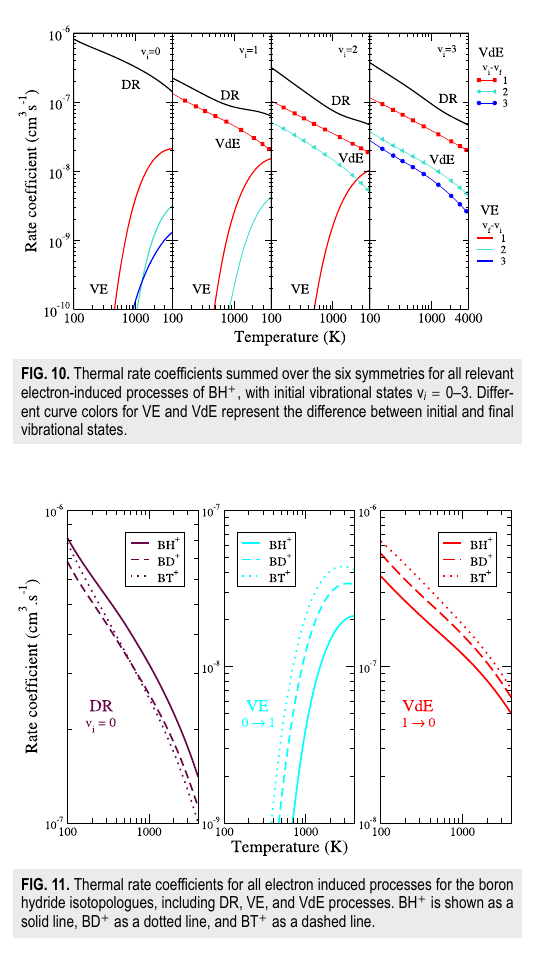

# BH⁺ 低能电子碰撞：解离复合与振动跃迁

> R. Mezlini 等，*The Journal of Chemical Physics* 165, 144309（2026-10-14），DOI `10.1063/5.0354874`。本地全文为 AIP 正式 VOR。

## 一句话结论

论文以 MRCI、complex-Kohn 电子散射与多通道量子亏损理论（MQDT）给出 `BH⁺/BD⁺/BT⁺` 的解离复合（DR）、振动激发（VE）和退激发（VdE）截面/热速率；低温下 DR 与 VdE 占优、升温后 VE 增强，较重同位素通常降低 DR 而提高 VE/VdE，但这些结果是原子分子理论数据，不是 ITER 边界等离子体的直接测量。

## 1. 物理问题与方法

- ITER 全钨壁方案仍需要硼化层吸附氧杂质；硼层受氢同位素等离子体侵蚀后可形成 `BH⁺、BD⁺、BT⁺`，其电子碰撞会改变边界区的离子组成与能量分配。
- 作者用多参考组态相互作用（MRCI）计算 `BH/BH⁺` 势能曲线，用 complex-Kohn 方法取得自电离宽度，再以 MQDT 同时处理靠近离子平衡键长的势能曲线交叉（直接/Feshbach 路径）与 Rydberg 介导的非交叉路径。
- `v_i=0–3` 的热速率由能量相关截面对各向同性电子速度分布积分：

$$
\alpha(T_e)=\frac{\sqrt{8\pi m_e}}{(2\pi m_e kT_e)^{3/2}}
\int \sigma(E)E\exp\!\left(-\frac{E}{kT_e}\right)\,dE.
$$

这里 `σ(E)` 是相应 DR、VE 或 VdE 截面；因此低能共振和阈值结构会直接放大低温速率的不确定性。

## 2. 图 10–11：温度、振动态与同位素效应

- **来源：** 正式 VOR Fig. 10–11，第 10 个正文页（本地 PDF 第 11 页）。
- **坐标与单位：** 横轴电子温度 `100–4000 K`，纵轴速率系数 `cm³ s⁻¹`，两轴均采用对数刻度；Fig. 10 分列初始振动态 `v_i=0–3`，Fig. 11 比较 `BH⁺/BD⁺/BT⁺`。
- **趋势：** 所有初始振动态的 DR 随温度升高而降低；低温下 VdE 大于 VE，VE 随温度升高快速上升。较重的 `BD⁺/BT⁺` 一般给出更低 DR 和更高 VE/VdE，差异在低温阈值区最明显。
- **机制：** `³Δ` 势能曲线在平衡键长附近与离子曲线有利交叉，控制 `2 eV` 以下的大部分 DR；没有低能交叉的 Rydberg 间接路径低数个数量级。
- **限制：** 图给出理论速率而非装置反演；振动/转动分布、实际电子能谱、杂质输运与壁面源项尚未与 ITER 或线性装置数据闭合。

## 3. 证据边界

- **已计算：** 从头算分子结构、散射共振、MQDT 截面与 Maxwell 型热平均；作者称这是首套同时覆盖 DR、VE、VdE 及三种同位素的综合数据。
- **未实验验证：** 没有束流或边界等离子体碰撞测量，也没有把这些速率嵌入碰撞—辐射或全装置输运模型。
- **数据可得性：** 论文只写明数据可向通讯作者合理申请，没有提供公开数据仓库。
- **本地边界：** 本地只核验正式全文、公式、图表和速率趋势；未运行 MRCI、complex-Kohn、MQDT 或边界等离子体计算。
