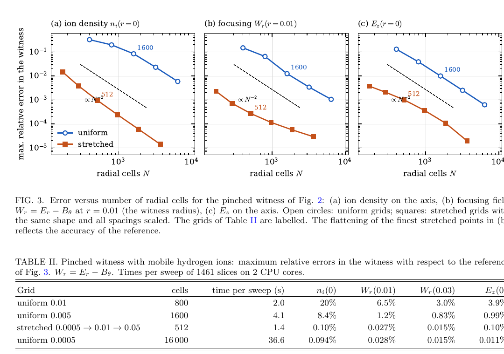

# QUARZ：非均匀径向网格的准静态等离子体尾场 PIC

> A. Pukhov、T. C. Wilson，arXiv:`2610.16910` v1（2026-10-12）。本地全文为作者预印本。

## 一句话结论

QUARZ 在任意单调径向网格上保持离散 Gauss 定律、轴线上均匀等离子体沉积与二阶精度；对强聚焦见证束，512 单元拉伸网格以约 `1/30` 的网格量和计算量达到 16000 单元均匀网格的近轴精度，并在 AWAKE 自调制算例上与 HiPACE++ 对齐，但仍是轴对称/低方位模准静态模型。

## 1. 算法与适用范围

- 算法在柱坐标准静态变量 `ξ=t−z` 中逐片推进，径向算子结合帽函数有限元和守恒有限体积；横向磁场使用 Baxevanis–Stupakov 显式无迭代求解。
- `m=0` 描述轴对称场，可选 `m=1` 描述束流偏移、倾斜与 hosing；等离子体宏粒子在横截面仍用笛卡尔坐标推进，因此可穿过轴线而无需特殊反射规则。
- C++/Kokkos 实现支持 CPU/GPU，并沿 `ξ` 做 MPI 流水线。准静态假设不能跟随被俘获且 `γ−p_z` 过小的粒子，代码会移除这类粒子。

## 2. 图 3 与 Table II：拉伸网格收敛

- **来源：** 预印本 Fig. 3 与 Table II，第 6 页。
- **坐标：** 三个双对数图横轴径向单元数 `N`，纵轴见证束区最大相对误差；分别考察轴上离子密度、`r=0.01` 聚焦场 `W_r=E_r−B_θ` 与轴上 `E_z`。
- **趋势：** 拉伸网格（橙色）在同一 `N` 下比均匀网格（蓝色）低约两至三数量级，并显示近二阶收敛；512 单元拉伸网格与 16000 单元均匀网格在聚焦场上约同精度。
- **定量：** 512 单元方案每次 1461 slices sweep 为 `1.4 s`，16000 单元均匀网格为 `36.6 s`；前者的轴上离子密度/见证束半径处聚焦场/轴上纵场误差约 `0.10%/0.027%/0.10%`。
- **限制：** 最细聚焦场误差平台由参考解精度与粒子采样噪声决定；“30 倍”是这一多尺度案例的网格收益，不是所有尾场问题的通用速度比。

## 3. AWAKE 与开发证据

- AWAKE 质子束自调制中，QUARZ 的均匀/拉伸网格与三维 HiPACE++ 在约 40 个等离子体波长上的尾场振幅和相位相符；轴对称模型不会包含三维近轴质子采样噪声引发的束头撕裂。
- 16 张 GH200 GPU 把 `12 m`、301 sweeps 的完整算例完成到约 `5–11 min`；不同网格总耗时只相差 `2–2.5×`，因为粒子推进、输出与流水线填充也占成本。
- 作者称代码、测试和文档均由 Claude Opus 5.5 在物理学家约束下“zero-touch”生成，并以独立解析/数值基准决定可信度；这是一项开发过程声明，不是代码正确性的充分证据。

## 4. 证据边界

- **已验证：** 网格收敛、离散守恒、CPU/GPU 标度和 HiPACE++ 对照；论文还公开指向代码与逐提交 AI 会话以供审计。
- **未覆盖：** 更高方位模、自适应网格、非准静态俘获、暖等离子体泡闭合和真实 AWAKE 实验数据的端到端重建。
- **本地边界：** 本地未编译 QUARZ、未执行测试套件或复跑 HiPACE++；只核验全文、收敛图、计时表和作者的开发声明。
