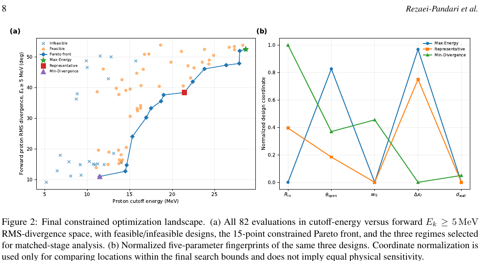

# C 形靶激光质子加速的能量—发散角多目标设计

> M. Rezaei-Pandari、M. Shayganmanesh、M. H. Mahdieh，arXiv:`2610.14824` v1（2026-10-10）。本地全文为作者预印本。

## 一句话结论

82 个二维 Smilei 设计与约束贝叶斯优化给出 15 个可行 Pareto 点：最大能量端为 `28.64 MeV / 52.51°`，最小发散端为 `11.47 MeV / 11.13°`，说明能量与束质是明确冲突目标；但结果依赖二维、固定终止时刻、单次宏粒子采样与理想化预等离子体，不能直接当作实验靶最优解。

## 1. 设计空间与指标

- C 形靶由内半径 `R_in`、开口角 `θ_open`、壁厚 `d_wall` 描述，同时优化激光腰斑 `w₀` 与焦点偏移 `Δx_f`；脉冲场包络 FWHM 为 `25 fs`，强度包络 FWHM 约 `17.68 fs`。
- 目标函数为提高质子截止能量并降低前向 `E_k≥5 MeV` 质子的中心 RMS 发散角，同时要求质子专属能量转换效率 `η_H≥9%`。
- 截止能量不是最极端单个宏粒子，而是谱强度仍高于峰值 `10⁻⁶` 的最高能箱；这一操作定义抑制稀疏数值尾，但仍不是渐近能量。

## 2. 图 2：约束 Pareto 前沿

- **来源：** 预印本 Fig. 2，第 8 页。
- **坐标与单位：** 左图横轴质子截止能量 `MeV`，纵轴 `E_k≥5 MeV` 前向质子 RMS 发散角 `deg`；蓝叉/橙点为不可行/可行设计，蓝线为 15 点 Pareto 前沿。
- **趋势：** 82 个设计中 60 个满足效率约束；能量与发散角在可行样本中 Spearman `ρ=0.787`，高能端通常显著更宽。
- **代表解：** 冻结优化指标下 Max-Energy、Representative、Min-Divergence 分别表征高能宽束、中间折中与低能窄束；匹配阶段重算得到近似一致的 `28.54 MeV / 52.63°` 与 `11.98 MeV / 12.10°`。
- **限制：** 归一化设计坐标只表示搜索边界中的位置，不能把不同变量的曲线跨度解释为相同物理敏感度。

## 3. 机制解释与负结果

- 作者提出“几何/焦点 → 光场积累 → 电子能化与再分布 → 界面电荷分离 → 外鞘层强度/角支撑 → 质子能量—发散角”的层级链。
- 折中解在约 `100 fs` 出现 `18.57°` 的瞬态准直，但随后在 `300 fs` 展宽到 `36.87°`；不同能阈值仍出现该极小值，因此不是 `5 MeV` 阈值伪影。
- 高能方案中 `E_k>25 MeV` 尾部发散角约 `9.03°`，远小于全部 `E_k≥5 MeV` 的 `52.63°`；论文明确承认该尾部准直机制尚未解析。
- 主反射延时在三类方案间接近，持续二次反射反而在折中解更强，因此数据不支持“俘获越久、能量越高”的单调解释。

## 4. 证据边界

- **模拟/设计：** 所有主要结论来自二维 PIC 和贝叶斯优化，没有靶制备、激光对比度或质子谱实验。
- **数值限制：** 每个设计只运行一个 production-resolution realization；固定时刻截止、积分效率和薄壁电荷仍有 PPC/网格敏感性，未给出重复 seed 置信区间。
- **实验迁移：** 共同的 `0.1 μm` 预等离子体是比较用参数化轮廓，不是不同几何的流体预脉冲预测；三维效应与几何专属预等离子体尚未测试。
- **本地边界：** 本地未运行 Smilei、BoTorch 或机制诊断，只核验全文、图表、定义和作者报告的敏感性检查。
