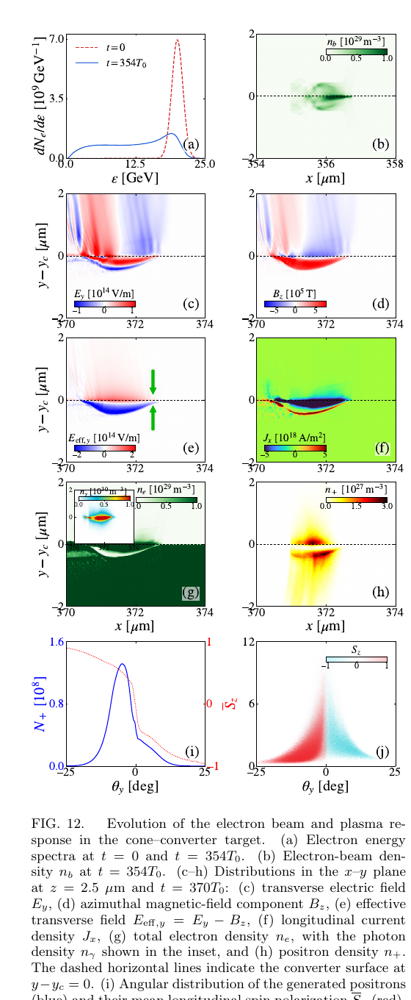

# SPIRE：自旋与光子偏振分辨的强场 QED-PIC

> X.-Z. Wu、H.-H. Song、W.-M. Wang、Y.-F. Li，arXiv:`2610.14664` v1（2026-10-10）。本地全文为作者预印本。

## 一句话结论

SPIRE 把经典 1D/2D/3D PIC、紧聚焦矢量涡旋光、非线性 Compton/Breit–Wheeler、自旋进动与真空双折射/二色性合并到同一框架，并通过 SMILEI 与既有论文算例逐模块复现；它证明了实现的一致性，但尚未提供公开源码，也不是对强场 QED 实验的独立预测验收。

## 1. 数值框架

- 经典部分采用 Yee 网格 FDTD、相对论 Boris 推进、Esirkepov 电荷守恒电流沉积、Maxwell 相容激光边界和相对论移动窗口；覆盖静电膨胀、THz 辐射、激光/束流尾场和 OAM 激光注入。
- 强场部分在局域常场近似（LCFA）下把非线性 Compton 散射和非线性 Breit–Wheeler 对产生视为随机事件；电子/正电子自旋还包括无辐射自能修正与带场依赖反常磁矩的 T-BMT 进动。
- 光子偏振由 Stokes 向量表示；除辐射与对产生外，代码还实现真空双折射和真空二色性。这里的“QED 修正”仍是半经典粒子轨道加随机率，不是求解完整量子场动力学。

## 2. 图 12：锥形靶—转换体偏振正电子复现算例

- **来源：** 预印本 Fig. 12，第 16 页。
- **输入：** `20 GeV`、`2.8 nC` 电子束掠入长 `350 μm` 的空心碳锥并接 `20 μm` 实心转换体；靶电子密度约 `1.0×10²⁹ m⁻³`，移动窗口为 `4×5×5 μm³`。
- **图量：** (a) 电子能谱，(c–e) 电场/磁场/有效横向场，(f) 纵向电流，(g–h) 电子、光子与正电子密度，(i–j) 正电子角分布及纵向自旋 `S_z`。
- **论证作用：** 算例同时调用长距离移动窗口、自旋分辨辐射和偏振相关对产生，复现参考文献中锥形靶方案的主要图形特征。
- **限制：** 这是对既有数值结果的复现，而非与实验数据比较；正电子束产额/极化对网格、宏粒子数、LCFA 有效性和材料模型的系统误差没有独立量化。

## 3. 验证与证据边界

- **经典 PIC：** 多个维度和物理场景与 SMILEI 对照，支持场求解、移动窗口与注入模块的实现一致性。
- **QED 模块：** 以既有发表曲线作为回归基准，覆盖偏振电子、真空双折射/二色性和稠密偏振正电子；这属于代码验证，不等于对新物理场景的实验确认。
- **可复现性缺口：** 正文未给出 SPIRE 源码或固定版本仓库；部分基准参数完整，但不能据此独立审计实现。
- **本地边界：** 本地未编译或运行 SPIRE/SMILEI，也未复算任一 QED 概率或 3D 算例；只核验预印本全文、图表与参数。
