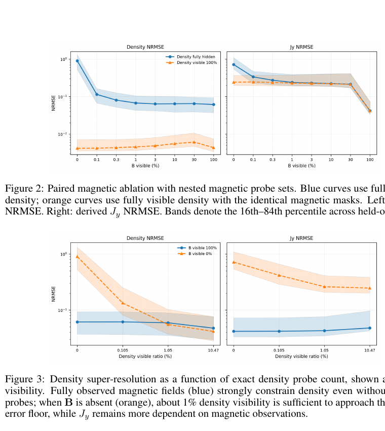

# 等离子体状态重建的多模态基础模型原型

> B. Xia 等，arXiv:`2610.15076` v1（2026-10-10），NeurIPS 2026 Physical World AI workshop 预印本。全文为作者预印本。

## 一句话结论

一个 `5.5M` 参数的掩码 3D U-Net 在固定 `βₑ₀=0.2` 的 250 次 VPIC 重联模拟上统一完成稀疏观测、跨模态补全、超分辨和时间补全；仅 `0.1%` 磁场可见率便把完全隐藏密度的中位 NRMSE 从约 `0.9` 降到 `0.1`，但数据全部为同一参数网格的合成模拟，尚无 FLARE 实验、跨 `β` 或 sim-to-real 验证。

## 1. 数据与模型

- 数据集为 250 次二维轴对称 VPIC 磁重联计算，扫描碰撞率、轴向场和驱动时间，但固定参考电子 beta `βₑ₀=0.2`；225 次用于训练、25 次作运行级验证，避免同一轨迹的重叠窗口跨集合。
- 输入/输出为三分量磁场和电子密度的 24 帧窗口；四个物理通道与四个显式观测掩码共同输入残差 3D U-Net。
- 网络只在空间维池化，保留全部时间帧，并在瓶颈加入全局时空注意力和旋转位置编码；训练时分别对磁场/密度施加随机、规则网格、连续块和时间缺失。
- 论文中的“基础模型”仅指一套权重覆盖多个掩码/补全任务，不表示跨装置、跨参数区或大模型规模的通用性。

## 2. 图 2–3：跨模态信息转移

- **来源：** 预印本 Fig. 2–3，第 8 页。
- **坐标：** Fig. 2 横轴为磁场可见比例，Fig. 3 横轴为密度可见比例；纵轴分别为密度 NRMSE 与从磁场导出的 `J_y` NRMSE，阴影为 25 个 held-out runs 的 `16–84%` 区间。
- **关键结果：** 密度完全隐藏时，磁场可见率从 0 增至 `0.1%` 即把密度 NRMSE 从约 `0.9` 降到约 `0.1`；磁场全可见时，即使没有密度探针，密度误差也维持在约 `0.06–0.07`。
- **非对称性：** 密度能帮助恢复大尺度状态，但电流 `J_y` 由磁场空间导数得到，对直接磁测仍高度敏感；约 `1%` 密度可见率可以接近密度重建误差下限，却不能同样恢复精细电流结构。
- **缺失几何：** 分散的空间/时间采样普遍优于连续缺块；全局注意力能路由远距离信息，但没有显式施加等离子体演化方程。

## 3. 证据边界

- **验证范围：** 验证集仍从与训练集相同的离散参数笛卡尔网格随机抽取，未测试完全未见的碰撞率、轴向场或驱动时间。
- **诊断现实性：** 掩码是理想网格采样，不是 FLARE 的固定探针、线积分或含校准误差的真实诊断；预测也未对观测点做硬约束。
- **模型缺口：** 没有与线性/Voronoi 等简单稀疏重建基线比较，没有结构消融、物理一致性约束或校准预测不确定度。
- **本地边界：** 本地未运行 VPIC、训练网络或复算 NRMSE；只核验全文、数据划分、图表和作者明确给出的限制。
