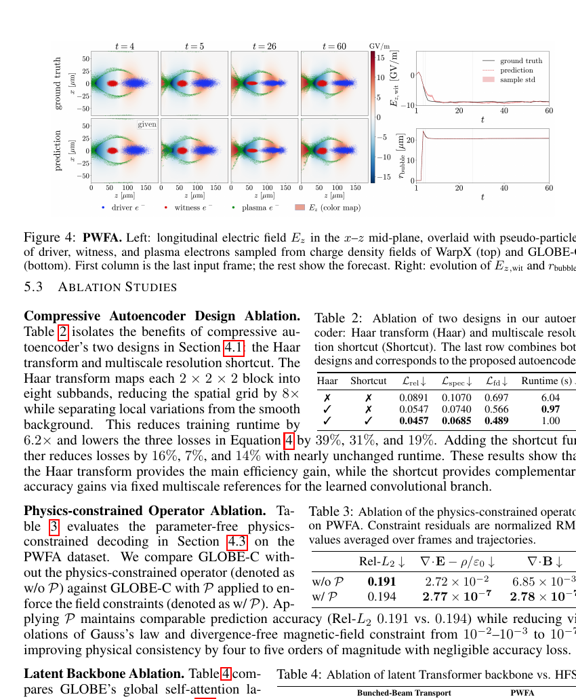

# GLOBE：三维束流—场演化的物理约束生成潜空间算子

> H. Zou、A. Scheinker、Y. Shi，arXiv:`2610.14537` v1（2026-10-10）。本地全文为 under-review 预印本。

## 一句话结论

GLOBE 在压缩潜空间中用控制条件 Transformer 预测主动力学、用生成残差补回细尺度，再以无参数 Poisson/Maxwell 投影满足瞬时场约束；在束团输运和 PWFA 两个 WarpX 三维数据集上相对最强基线把相对 `L₂` 误差降低 `9%/13%`，并把约一小时 PIC 推理缩短到约一分钟，但这仍是同分布仿真代理，不是实验闭环或跨机器基础模型。

## 1. 数据、模型与约束

- **束团输运：** 464 条 `750 keV` 质子束—四极/射频通道轨迹，其中 52 条测试；每条 401 帧、`256×336×336` 网格，作者报告约 `6600 s GPU/trajectory`。
- **PWFA：** 504 条电子驱动等离子体尾场轨迹，其中 56 条测试；每条 60 帧、10 个密度/场变量、`336×216×216` 网格，传播 `19.6 mm`，约 `4130 s GPU/trajectory`。
- 编码器把约 `10⁷` 个空间单元压入潜变量；确定性算子负责大尺度动力学，flow-matching 生成模型只预测归一化残差，避免直接生成完整三维状态时失稳。
- 静电问题从预测电荷密度解 Poisson 方程；电磁问题用频谱投影施加 Gauss 定律和 `∇·B=0`。这些算子约束单帧场的一致性，并不保证整个自回归轨迹满足能量、动量或相空间守恒。

## 2. 图 4 与约束消融：PWFA 长时预测

- **来源：** 预印本 Fig. 4 与 Table 3，第 9 页。
- **图量：** 左侧比较 WarpX 真值与 GLOBE-C 的纵向场 `E_z`、驱动束、见证束和等离子体电子；右侧跟踪见证束位置的加速场与泡半径。
- **精度：** GLOBE-C 相对 DPOT 的相对 `L₂` 误差由 `0.177→0.161`（束团）与 `0.224→0.194`（PWFA）；低频谱误差降低 `69%/51%`，中频误差降低 `54%/20%`。
- **物理约束：** PWFA 中投影前后相对 `L₂` 为 `0.191/0.194`，几乎不变；Gauss 残差由 `2.72×10⁻²` 降至 `2.77×10⁻⁷`，`∇·B` 残差由 `6.85×10⁻³` 降至 `2.78×10⁻⁷`。
- **速度：** 生成残差版本相对 WarpX 报告 `102×/189×` 加速；这只比较已训练模型的 rollout 与单条 WarpX 轨迹，不包含数据生成和训练成本。

## 3. 证据边界

- **仿真代理：** 两个数据集都由 WarpX 生成，没有实机诊断、控制器或跨代码真值；报告误差是对同一设计分布中的留出轨迹。
- **生成不确定性：** 生成模型指标取 8 个样本均值，但样本散布不是经覆盖率校准的预测区间，也不含 PIC 模型误差。
- **“基础模型”边界：** 当前模型分别针对两个 benchmark 训练，论文把跨机器、跨边界/初值和实时状态估计列为未来工作。
- **本地边界：** 本地未取得训练代码/数据发布定位，也未运行 WarpX 或 GLOBE；只核验预印本、表格、图和约束定义。
