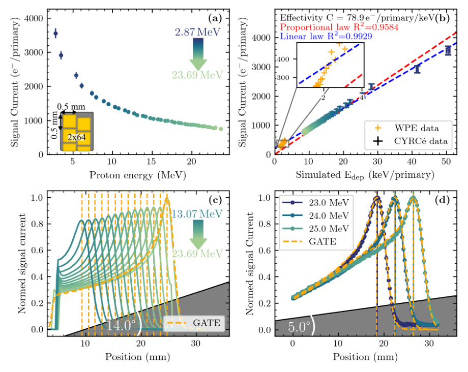

# GaN 像素阵列：质子剂量、成像、能量与实时束流监测

> Nico Frédéric Brosda 等，arXiv:[2610.20304v1](https://arxiv.org/abs/2610.20304)，2026-10-14，35 页作者预印本。未核实到对应正式期刊版本。

## 一句话结论

GaN 阵列在连续质子束中展示线性、亚毫米成像、毫秒监测与 MGy 辐照后可校准响应；优化楔形几何的亚 10 keV 指峰位重复性换算出的能量变化分辨，7 mGy/1 ms 全视场单帧及 FLASH 应用仍含外推。

## 1. 动机、器件与信号质量

论文从质子 Bragg 峰对射程的敏感性引入诊断需求。器件为蓝宝石衬底 GaN pin 二极管，含 128 通道线阵和二维矩阵，典型节距 0.5/1 mm；外置 AS5900 读出。主体实验来自 CYRCé 连续回旋质子束，能量最高 25 MeV；另有 WPE 100–226.7 MeV 探索性测量。

128 通道在 70–1700 pA/cm² 电流密度范围内呈比例响应，R²=0.99994；像素响应离散度低于 2%，最优阵列约 0.6%；受测 256 像素中 255 个工作。这里的线性范围是已测连续束流条件，没有覆盖任意超短单脉冲峰值通量。

## 2. 多 MGy 辐照与损伤模型

第一轮在 25 MeV、43.6 Gy/s 下累积约 2.4 MGy，信号约下降三倍；冷却约三个月后仍有线性和空间响应。第二轮用楔形降能同时覆盖约 17 MeV 至低于 1 MeV，最高估计吸收剂量 6.7 MGy。

局部质子能量、通量和剂量来自 GATE/Geant4 几何模拟。按位移损伤剂量重标度可改善不同位置的重合，但拟合参数仍随能量变化，NIEL 没有完全解释低能区损伤。持续工作不等于灵敏度不变，长期应用须重新标定各通道。

## 3. 空间成像与单帧剂量的条件

线阵减小像素宽度或平移过采样后达到约 0.25 mm 有效空间采样，并以胶片作归一化结构/对比度比较；胶片未经剂量标定，不能当作绝对剂量校准。鼠足成像使用 11×11、0.5 mm 节距阵列平移拼接；约 7 mGy/1 ms 是对具有相同灵敏度的未来全视场单次曝光配置的估算，本次不是完整单帧鼠足成像。

## 4. 图 6：能量响应与 Bragg 峰位

- **来源：** 预印本 Fig. 6，第 17 页，直接裁图。
- **坐标：** (a) 入射能量 MeV 与每入射质子的响应；(b) GATE 预测沉积能量 keV/primary 与归一化响应，插图是 WPE 高能数据；(c,d) 横轴像素位置 mm，纵轴归一化电流，虚线是 GATE。
- **趋势：** 高能质子在薄敏感层中沉积能量较少；楔形厚度把能量改变映射为峰位移动。14° 楔形约为 350 keV/像素；5° PEEK 楔形配 0.25 mm 有效节距，重复峰位不确定度约 0.1 节距，斜率 15.8 节距/MeV。

$$
\delta E\simeq\frac{\delta p}{dp/dE}
=\frac{0.1}{15.8}\,{\rm MeV}\simeq6.3\,{\rm keV}.
$$

按文中约数计算约为 6–7 keV，因此作者保守表述低于 10 keV。它是特定谱形、楔形和峰拟合下的能量变化分辨，不能当作每个质子的独立能谱分辨或 230 MeV 全能区绝对精度。高能临床数据与低能趋势仅在数量级上相符；模拟整体平移约 1 mm 的对齐也须保留。

## 5. 实时监测、方法与边界

固定阵列以 1 ms 积分观察束线扫描丝和约 50 Hz 热斑波动；现有电子学可设 50 μs，但保持信噪比需要相应通量。论文据此讨论 FLASH 前景，尚未在这里完成超高瞬时剂量率质子脉冲的完整饱和/恢复测试。

有直接器件和束流实验，也有 GATE 辅助剂量估算及性能外推；不能升级为临床部署、激光超短脉冲束流验收或对 MGy 辐照完全无损。数据和代码按文中 availability 声明处理；本地未复跑 GATE/Geant4 或器件拟合。

## 全文与核验

- [本地 PDF](../pdfs/Brosda%20et%20al.%20-%202026%20-%20GaN%20proton%20detector.pdf)；[官方全文来源](https://arxiv.org/pdf/2610.20304)。
- PDF 文件头、类型、页数、SHA-256、全页可读性、布局文本通过；MinerU 显式 `pipeline` 解析得到真实论文正文，已结合原 PDF 关键页检查。验证记录见[当日报告](../pdf_validation.json)。
