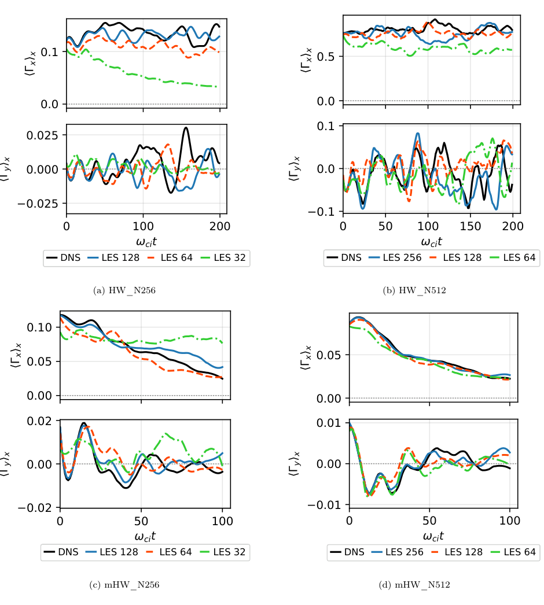

# Germano 差分滤波与 CNN 结合的等离子体湍流 LES

> Jony Castagna、Josh Williams，arXiv:[2610.20204v1](https://arxiv.org/abs/2610.20204)，2026-10-14，31 页作者预印本。未核实到对应正式期刊版本。

## 一句话结论

网络先重建细网格上的滤波场，再用受正则化约束的反卷积计算亚网格反馈；大多数案例改善长期统计，但最粗 32²→256² 重建出现错误输运。最高实际墙钟加速 1.55×，49.45× 是 MPI task-time 比值。

## 1. 物理模型与解析层

研究使用 BOUT++ 的二维周期 Hasegawa–Wakatani（HW）和 modified-HW 漂移波模型，比较密度、势、涡量、能量/广义涡量、谱与粒子通量。mHW 从平行电子耦合中去掉 zonal 分量，以容许剪切流及趋层流演化。

$$
\mathcal F_\ell=(I-\ell^2\nabla_\perp^2)^{-1},\qquad
\widetilde f=\mathcal F_\ell f,\qquad
\widehat f(\mathbf k)=(1+\ell^2|\mathbf k|^2)\widehat{\widetilde f}(\mathbf k).
$$

连续滤波算子在指定周期边界下可逆，但网格降采样会丢失高频信息；解析可逆性不能保证从粗样本精确恢复原场。反算乘子又随 k² 增大，可能放大网络误差。

## 2. 实现、训练与其证据范围

DirectUNetSR 输入粗网格密度、势和涡量，输出细网格滤波密度/势，再由势计算涡量。展示的 32²→256² 配置约 167 万参数，使用周期卷积、平滑谱截断和五步 van Cittert 迭代，而非无限精确的解析逆。损失在这些固定操作之后与 DNS 比较。

四组参考模型为 HW/mHW 各 256²、512²，LES 每方向粗 2、4、8 倍；每组 100 条参考轨迹，样本按 80/10/10 分训练/验证/测试，训练 100 epoch。论文未清楚建立逐轨迹独立划分或跨参数分布外验证，不能直接外推到真实边界等离子体。

## 3. 结果：图像相似不等于正确输运

细 LES 多能维持能量、谱和 PDF 的整体形态；最粗 32²→256² 丢失太多惯性区信息。对 mHW，它不仅数值上持续运行，而且可能保持错误高通量、妨碍 DNS 的趋层流趋势，因此不能只按“未崩溃”验收。

### 图 13：径向与极向粒子通量

- **来源：** 预印本 Fig. 13，第 25 页。上下两行分别为 HW/mHW，左右为参考 256²/512²。
- **坐标：** 每格上图为域平均径向通量，下图为极向通量，均按模型无量纲化；横轴标 ωci t。黑色 DNS，蓝/橙/绿是逐渐变粗的 LES。
- **读图：** (c) 最粗绿色曲线未跟随下降，终点约 0.09；正文写 DNS 约 0.026，此图可见曲线约为 0.04，两者仍有读图/报告差异，但最粗 LES 明显过高；(a) 最粗网格则低估径向通量。(d) 大网格案例能较好跟随总体衰减，但瞬时极向通量仍有幅值和符号差异。
- **时间边界：** 正文/图注称 HW 验证至 1000、mHW 至 100；这张图的 HW 可见横轴只画到 200，故不能凭此图独立确认完整 1000 时长。mHW 的计时日志覆盖 1000，不等于 1000 内物理统计已验证。

## 4. 性能与应用价值

$$
S_{\rm wall}=T_{\rm DNS}/T_{\rm LES},\qquad
S_{\rm MPI}=S_{\rm wall}\,P_{\rm DNS}/P_{\rm LES}.
$$

DNS 用 32 CPU MPI tasks；LES 用 1 CPU task 加 1 张 H100。512²→64² 的 HW/mHW 墙钟比为 1.39/1.55，其余报告案例低于 1，即更慢；MPI task-time 降低 4.82–49.45 不计 GPU 成本，也不是同硬件串行加速。模型适合研究保留物理反馈的混合代理，但成本应覆盖数据生成、训练及 GPU。

## 5. 结论与本地边界

全部证据来自二维简化流体模型及其 DNS，没有动理学 PIC、三维 scrape-off-layer、实机诊断或反馈控制验证。本文的价值在于明确区分滤波、降采样、学习重建和反卷积，并提供失败案例。本轮未运行 BOUT++、训练网络或复算通量。

## 全文与核验

- [本地 PDF](../pdfs/Castagna%20and%20Williams%20-%202026%20-%20Filtered%20plasma%20turbulence%20CNN.pdf)；[官方全文来源](https://arxiv.org/pdf/2610.20204)。
- PDF 文件头、类型、页数、SHA-256、全页可读性、布局文本通过；MinerU 显式 `pipeline` 解析得到真实论文正文，已结合原 PDF 关键页检查。验证记录见[当日报告](../pdf_validation.json)。
