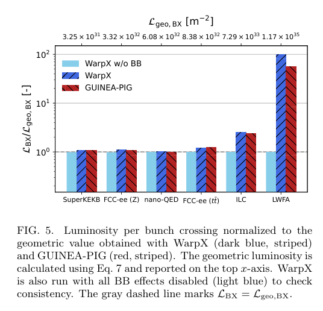

# WarpX 束束碰撞基准：QED 模块、收敛与 GPU 性能

> Arianna Formenti 等，arXiv:[2610.17557v1](https://arxiv.org/abs/2610.17557)，2026-10-13 提交，PDF 署稿日期 2026-10-14，19 页作者预印本。未核实到正式期刊版本。

## 一句话结论

WarpX 26.09 在多个轻子对撞机设计点复现旧束束代码的主要分布，并提供 GPU 并行计算；但 ILC 亮度差约 8%，最强 LWFA-QED 案例的总亮度/高能亮度差约 78%/40%，尚不能视为全参数精密一致。

## 1. 数值方法与过程分类

论文先说明束束聚焦、beamstrahlung 及次级粒子如何改变亮度和背景。WarpX 在固定三维网格上同步推进两束，而 GUINEA-PIG/CAIN 按纵向切片交互。这里用相对论共动静电近似，基准主要使用逐 z 切片二维 Poisson 解，以便与旧代码比较；这不是对完整 Maxwell 电磁求解器的一般验收。

相干过程为束流集体场驱动的 beamstrahlung 与相干成对产生，用 LCFA；非相干 Compton、辐射 Bhabha、线性 Breit–Wheeler、Bethe–Heitler 和 Landau–Lifshitz 通道用二体 Monte Carlo/等效虚光子描述。此处 Landau–Lifshitz 指非相干成对过程名称，不能混为经典辐射反作用方程。

## 2. 场景、数值配置与收敛

设计点涵盖 SuperKEKB、FCC-ee Z/tt̄、ILC、理想 10 nm nano-QED 束及每束 5 TeV 的 LWFA 对撞机概念；另比较 LWFA γγ 转换点—相互作用点配置。后两者是设计模拟，不代表已得到这种激光电子束。

基准常用 512³ 网格、每束 10⁶ 宏粒子，扁束提高竖直网格数。相交角用小角度近似变换，未包括 crab-waist 变换。多数非 LWFA 算例亮度在更细网格变化几个百分点；LWFA 的 L₅/L₂₀ 对横向加密仍变化约 7%/11%，纵向/时间分辨率未做同样完整扫描。

## 3. 图 5：亮度归一化与跨代码分歧

- **来源：** 预印本 Fig. 5，第 8 页。
- **坐标：** 横向是六种设计场景，纵轴为每束团交叉亮度除以相同几何亮度，无量纲、对数刻度；上轴列出对应几何亮度 m⁻²。浅蓝关闭束束效应，深蓝 WarpX，红色 GUINEA-PIG。
- **结果：** SuperKEKB、FCC-ee 两点及 nano-QED 总亮度差小于 1.3%；ILC 约 8%。LWFA 两代码柱高明显分离，总亮度差约 78%，即便只选中心质心能量 95% 以上仍约 40%。
- **意义：** 极强场中低能次级对可支配总亮度，因而总亮度巨大不等于有用高能碰撞率。必须同时验收能量阈值积分、谱、对反馈和网格收敛，不能仅看谱外形相似。

$$
\mathcal L_{\rm BX}=K\int dt\,d^3r\,n_1n_2,\qquad
K\simeq2c\quad\text{（超相对论正碰）}.
$$

它是单次交叉的空间时间重叠，单位 m⁻²；若要每秒亮度，还需乘束团交叉频率。副产物贡献和能量阈值必须另作定义。

## 4. 性能与精度边界

在 Perlmutter 的 4 张 A100 上，七种生产算例约 1.70–6.81 min；GUINEA-PIG/CAIN 用单 CPU 核，耗时为小时至一天以上。作者明确这只是实际周转时间对照，不是硬件等价加速比。

包含 QED/次级粒子的弱标度把工作量扩大 8 倍时，每步耗时增加约 1.4–2.8 倍；关闭 QED 的简化 Poisson 标度优于部分生产任务，因此不能把简化场求解效率当作全物理效率。

## 5. 结论与可复现性

版本为 WarpX 26.09、GUINEA-PIG 1.2.2、CAIN 2.42，文中指向输入/数据归档；本轮只验证正文和图表，未审核该归档、编译或复跑代码。LCFA 低能光子限制、切片场近似、强 QED 大分歧和有限收敛仍须按观测量评估。没有新的对撞实验、转换靶光核产额或辐射防护验证。

## 全文与核验

- [本地 PDF](../pdfs/Formenti%20et%20al.%20-%202026%20-%20WarpX%20beam%20beam%20benchmark.pdf)；[官方全文来源](https://arxiv.org/pdf/2610.17557)。
- PDF 文件头、类型、页数、SHA-256、全页可读性、布局文本通过；MinerU 显式 `pipeline` 解析得到真实论文正文，已结合原 PDF 关键页检查。验证记录见[当日报告](../pdf_validation.json)。
