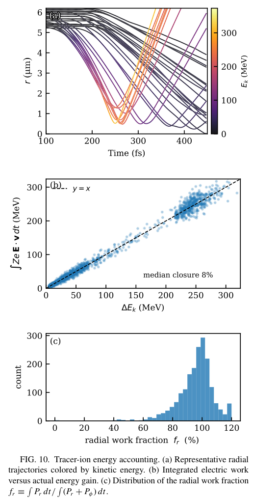

# 激光驱动无碰撞圆柱会聚中的路径积分静电增能

> D. Pan、M. Murakami、S. Fujioka、H. Nagatomo，*Physical Review E* **114**, 045206，2026-10-15。DOI：[10.1103/8jqr-lcb3](https://doi.org/10.1103/8jqr-lcb3)。本地读取 APS 正式 VOR，12 页。

## 一句话结论

二维 EPOCH 扫描表明，碳离子在微管内壁至轴心的运动过程中持续获得径向静电功；磁场主要改变停滞后的轨道与滞留。最高 0.89 GeV 指中心微米内平均离子能量的时间峰值，不能当作可抽取束流能量或谱截止。

## 1. 问题、设置与诊断定义

论文先区分平面 TNSA、辐射压和激波加速，再提出空心微管的特殊性：内径决定离子与动态电荷分离结构共同运动的路程。四束激光从二维边界对称入射，波长 0.8 μm、FWHM 100 fs；靶为全电离碳，初始离子密度 3×10²² cm⁻³，网格 10 nm，每格 100 个离子和 200 个电子宏粒子。

基准内半径 5 μm、壁厚 3 μm、八叶调制深度 1 μm，每束峰值强度 I₀=10²¹ W/cm²。20 个算例覆盖内半径 3、5、7、10 μm 与强度 0.25–4 I₀。另有无叶片光滑圆柱对照。加倍宏粒子数使峰值改变 0.1%，网格减半使其改变 −3.8%，属于有限参数的数值收敛检查。

$$
\mathcal E_{\rm peak}=\max_t\langle(\gamma-1)m_i c^2\rangle_{r<1\,\mu{\rm m}},\qquad
\alpha=\frac{\mathcal E_{\rm peak}}{\tfrac12m_i v_{\rm imp}^2}.
$$

入射速度只在内壁附近指定壳层的内向离子中测量；α 因而依赖诊断选区。分布非 Maxwell，局部平均动能不能等同热力学温度。

## 2. 全局演化与增能机制

激光热电子先建立鞘场，离子约在 230–250 fs 会聚，之后出现入向、出向多流和有限方位速度。双峰径向速度分布可由弹道穿轴产生；论文没有把它单独当作热化证据，也没有发现成熟流体强激波所需的清晰传播密度跳变。

能量预算遵循 Lorentz 功率关系：磁力始终垂直于速度，动能变化来自电场。用柱坐标分解后，径向与方位功率分别为 ZeEᵣvᵣ 和 ZeEφvφ。基准总体诊断中，径向通道占净面内电功超过 98%；全部半径扫描中超过 97%。动态磁场对应的方位电场通道较小，不能从强 B 场与高能离子同时出现就认定磁感应增能。

### 图 10：逐轨道功与动能闭合

- **来源：** 正式 VOR Fig. 10，第 8 页；直接页面裁图。
- **坐标与单位：** (a) 时间 fs、半径 μm，颜色是单离子动能 MeV；(b) 横轴真实动能增量 MeV，纵轴沿轨道积分的电功 MeV；(c) 横轴径向功比例 %，纵轴示踪粒子数。
- **结果：** 1900 条示踪轨道的回归斜率 1.01，中位闭合误差 8%，径向功占比中位数 97%。离子沿内向路径逐步增能，较早到达者更多采样 200–260 fs 的强场。
- **意义与限制：** 轨道诊断支持因果能量通道；8% 残差说明后处理场采样仍有限，不能声称逐粒子精确闭合。

## 3. 参数标度与约化模型

固定 5 μm 时，局部峰值与入流动能分别近似随强度的 0.41、0.37 次幂变化，α≈3.12±0.13。固定 I₀ 时，把内径半径由 3 增至 10 μm，局部峰值从 115 增至 488 MeV，主要收益来自更长的做功路径。

$$
\Delta E_k=\int Ze\mathbf E\cdot\mathbf v\,dt,\qquad
\mathcal E_{\rm peak}\simeq[1+\kappa(R_{\rm in}-r_0)]\mathcal E_{\rm imp},
\quad\kappa=0.53\,\mu{\rm m}^{-1},\quad r_0=0.9\,\mu{\rm m}.
$$

路径平均场约随强度的 0.47 次幂变化，更接近几何固定尺度下的 0.5，而非 Debye 长度控制的 0.25。瞬时空间积分只刻画标度，不能替代完整的时间轨道积分；拟合截距也不是独立测得的停滞核半径。最大半径处 α 的强度变异系数达 13.9%，因子化只是近似。

光滑靶与叶片靶基准峰值约 210/205 MeV，叶片主要把中心高于 50 MeV 的离子时间积分数量提高约 1.6 倍。该结果提示靶设计应分别考察能量输入、作用路程和滞留，不能只优化磁场峰值。

## 4. 应用与证据边界

这是二维、预电离、无碰撞模型内的机制研究。尚缺三维轴向损失、碰撞和电离演化，以及可抽取电荷、下游发散/发射度、激光至束流效率和核产额。没有激光微管实验或辐照应用验收；本轮也未运行 EPOCH。

## 全文与核验

- [本地 PDF](../pdfs/Pan%20et%20al.%20-%202026%20-%20Electrostatic%20energization%20in%20cylindrical%20convergence.pdf)；[官方全文来源](https://harvest.aps.org/v2/journals/articles/10.1103/8jqr-lcb3/fulltext)。
- PDF 文件头、类型、页数、SHA-256、全页可读性、布局文本通过；MinerU 显式 `pipeline` 解析得到真实论文正文，已结合原 PDF 关键页检查。验证记录见[当日报告](../pdf_validation.json)。
