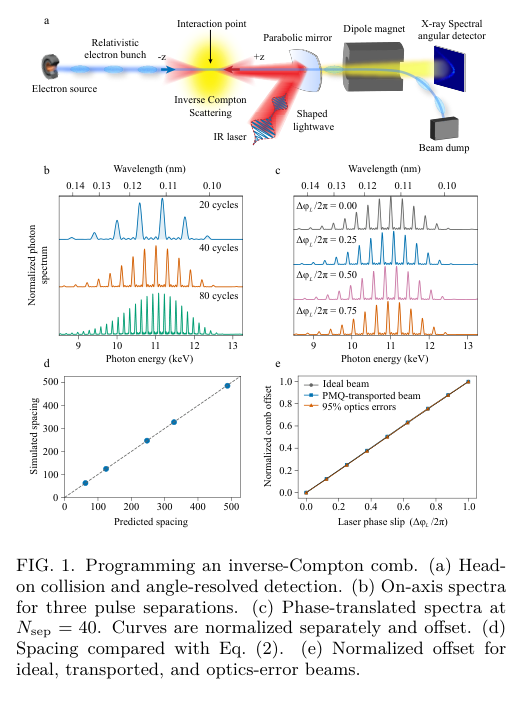
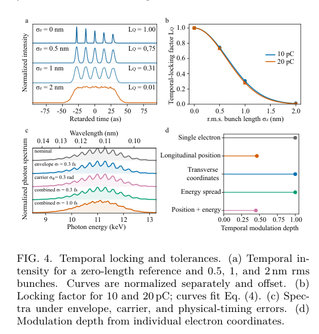

# 激光 Compton 硬 X 射线频梳：间距、偏移与时间锁模

> Hao Zhang、Ji Qiang、Shukui Zhang、Sergio Carbajo，arXiv:[2610.17166v1](https://arxiv.org/abs/2610.17166)，2026-10-12 提交，PDF 署稿日期 2026-10-14，8 页作者预印本。未核实到正式期刊版本。arXiv 网页把第二作者显示为“1Ji Qiang”，PDF 清楚为 Ji Qiang，笔记按 PDF 记载。

## 一句话结论

ImpactX 输运加逐电子 Liénard–Wiechert 辐射计算预测，激光子脉冲间隔调节约 11 keV 频梳齿距，相邻相位调节整体偏移；10 μm 电子束虽能保留谱齿，13.9 as 周期的时间锁模却要求亚纳米束长。

## 1. 物理问题与设计点

光学频梳有独立的齿距和偏移两个坐标。论文研究这一映射能否在电子束空间电荷输运、发散和有限收集角之后保留，而不是只计算理想单电子。

激光波长 1030 nm、a₀=0.55，五个 10 fs 子脉冲；电子 γ=50、10 pC、初始归一化发射度 0.5 mm·mrad、rms 束长 10 μm、相对能散 10⁻³。ImpactX 用 10⁴ 宏粒子、64³ 空间电荷网格及三联永磁四极铁输运，焦点约 5.1 μm、发散约 2 mrad。

## 2. 图 1：两个可编程坐标

- **来源：** 预印本 Fig. 1，第 1 页；(a) 是概念束线，(b–e) 是计算曲线。
- **坐标：** (b,c) 横轴光子能量 keV、上轴波长 nm，纵轴归一化谱并人为错开；(d) 模型与计算齿距按激光频率归一化；(e) 横轴相邻子脉冲相位除以 2π，纵轴频梳偏移除以齿距。
- **趋势：** 延长子脉冲间隔使谱齿更密，改变相位使谱格整体平移；归一化曲线不表示相同绝对光子数。齿距模型误差小于 0.52%，输运与光学误差对相位传递斜率改变小于 0.2%。

$$
\frac{\Delta\omega_X}{\omega_L}\simeq
\frac{4\gamma^2}{N_{\rm sep}(1+\gamma^2\theta^2)+(a_0^2/2)\tau_{\rm eff}},
\qquad
\frac{\delta\omega_X}{\Delta\omega_X}\simeq\frac{\Delta\phi_L}{2\pi}\pmod1.
$$

相邻散射波包的到达时间差决定干涉齿距；额外相位决定每个极大的位移。二者共享 Doppler/延迟因子，归一化位移中的因子相消，这解释偏移映射为何较稳健。公式限于文中的平滑包络和收集条件。

## 3. 发散、收集角与光子统计

固定焦斑时，可辨最大脉冲间隔约随归一化发射度平方的倒数变化；更大收集角提高光子数，也增强角度引起的 Doppler 展宽。把电荷从 10 增至 20 pC，在 2 mrad 内光子数只增至 1.935 倍，因空间电荷增大焦斑。

Nsep=40 的输运设计点给出约 16 个可辨谱齿、分析能带内 2.33×10⁴ 光子，调制度 0.709；理想单位探测效率、零背景下的相位分辨估算不包含真实实验响应。较宽电子束极限下的“梳密度×光子数”乘积标度，也不能直接套用于 σx/w₀≈0.511 的工作点。

## 4. 图 4：有谱齿与时间锁模的区别

- **来源：** 预印本 Fig. 4，第 4 页。
- **坐标：** (a) 延迟时间 as 与独立归一化强度；(b) rms 束长 nm 与时间锁模因子；(c) 光子能量 keV 与归一化谱；(d) 不同电子自由度造成的时间调制度下降。
- **定量：** 0.5 nm 束长的锁模因子约 0.75，2 nm 时约 0.014（10 pC）；保持 0.8 要求约小于 0.43 nm。实际输运后的 9.93 μm 束长仍有谱调制，却几乎没有时间锁模。
- **物理意义：** 每个电子的散射脉冲列可各自干涉形成谱齿；不同电子的纵向位移改变到达时间，跨电子的强度叠加可保留谱齿却洗掉共同时间峰。

辐射计算在电子之间按加权强度非相干求和，而不是把不同宏粒子的复电场直接相干相加。因此频梳和时间结构的条件均不等于已经实现宏观相干辐射增益。1 fs 实际子脉冲时序误差可使谱相关性丢失，光子总数却几乎不变，验收不能只测总通量。

## 5. 应用与证据边界

文中硬 X 射线 Ramsey、核跃迁和瞬态多色探针是前景，未完成核激发或源实验；没有转换靶、光核、中子产额或防护结果。输入和数据按合理请求获取，未在本地独立下载审核；本轮未运行 ImpactX 或辐射求解器。

## 全文与核验

- [本地 PDF](../pdfs/Zhang%20et%20al.%20-%202026%20-%20Programmable%20hard%20X%20ray%20spectral%20comb.pdf)；[官方全文来源](https://arxiv.org/pdf/2610.17166)。
- PDF 文件头、类型、页数、SHA-256、全页可读性、布局文本通过；MinerU 显式 `pipeline` 解析得到真实论文正文，已结合原 PDF 关键页检查。验证记录见[当日报告](../pdf_validation.json)。
