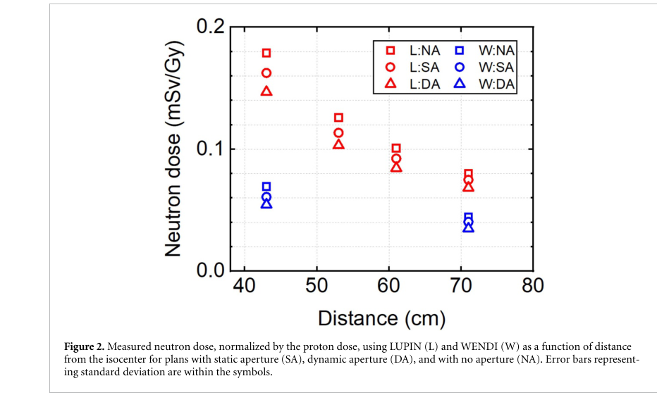

# 脉冲机架式质子治疗机的场外中子剂量测量

> Hailei Zhang、Thomas R. Mazur、Gabriele Zorloni、Arash Darafsheh，*Physics in Medicine & Biology* **71**, 205001，2026-10-15。DOI：[10.1088/1361-6560/aeaf3e](https://doi.org/10.1088/1361-6560/aeaf3e)。读取 IOP 正式开放 VOR，11 个 PDF 页，首个是出版商封面。

## 一句话结论

对 Mevion Hyperscan 同步回旋加速器的特定体模计划，WENDI-II 相对适合脉冲场的 LUPIN 低报约 1.7–2.7 倍；测量必须同时保留束流时间结构、孔径、床角与距离。结果是环境剂量当量 H*(10)，不是直接测得的胎儿吸收剂量或风险。

## 1. 引言与实验设计

同步回旋加速器以宏脉冲输送质子，平均剂量率相同也可能有更高的瞬时中子通量，使计数器死时间和电荷饱和影响读数。论文聚焦这种测量偏差及机架、孔径对场外暴露的影响。

RANDO 体模的左侧脑部球形靶直径 6 cm，计划 33 次、总计 66 Gy(RBE)，采用 RBE=1.1。三射野分别为顶点、侧向、后前；比较无孔径 NA、静态孔径 SA 和动态孔径 DA。计划 MU 为 1720、1558、1454。WENDI-II 与 LUPIN-BF3-NP 在距等中心 43、53、61、71 cm 的位置测 H*(10)，测量重复两次；WENDI 只测 43/71 cm。

另用旋转对称的亚克力体模和 227/6.4 MeV 单束斑研究床角，避免把计划优化、几何与探测器响应混为一个因素。

## 2. 图 2：距离、孔径与探测器读数

- **来源：** 正式 VOR Fig. 2，第 6 个 PDF 页，文章页码 5。
- **坐标：** 横轴距等中心距离 cm；纵轴按处方质子剂量归一化的中子 H*(10)，mSv/Gy。红色 L 是 LUPIN，蓝色 W 是 WENDI；方、圆、三角分别对应 NA、SA、DA。
- **趋势：** 距离增大时读数下降，DA 最低、NA 最高；但孔径方案同时改变 MU，不能把差异全部归因于孔径材料本身。WENDI 明显低报，近距离的偏差更大。
- **限制：** 图中很小的误差条主要反映重复测量，论文估计整体测量不确定度约不超过 15%，不能据图中符号大小认定绝对精度。

把每分次测量线性累加到 66 Gy(RBE)，在 43/71 cm 位置：SA 为 10.7/4.9 mSv，DA 为 9.7/4.5 mSv，NA 为 11.8/5.3 mSv。它们只适用于给定装置、体模和计划，不是通用质子治疗剂量系数。

## 3. 床角、死时间与测量解释

后前单射野在床角 270° 比 0° 的读数约高 15%（43 cm）及 25%（71 cm）；全部三个射野合计的差异约 5%。作者用来自加速器/喷嘴的方向性杂散中子解释非对称，但未进行输运分解，仍属于有实验支持的假说。

日志估计最大中子单脉冲剂量约 120 nSv/pulse，低于所引 LUPIN 饱和阈值约 500 nSv/pulse，却超过 WENDI 约 10–20 nSv/pulse 的范围，支持死时间/饱和解释。

$$
H^*(10)=\int\Phi(E)\,h^*_{\Phi}(10,E)\,dE.
$$

上式说明环境剂量当量是中子能谱与转换系数的折叠。仪器实际计数还须经过自身能量响应与时间响应；平均通量或总电荷相同，不能保证脉冲场读数等价。这里的 66 Gy(RBE) 归一化也不能和物理吸收剂量无条件混用。

## 4. 讨论、应用与边界

- **直接证据：** 特定临床装置的体模、计数器对照和床角扫描。
- **模型/估算：** 治疗计划由 TPS Monte Carlo 产生；全疗程数值由分次数据累加；H*(10) 被用作保守操作替代量。
- **未分离：** 体模内部与束线外部中子的贡献、具体能谱、散射光子与影像 X 射线的完整贡献；也未估计继发癌风险。
- **研究启示：** 对激光脉冲中子源，同样应检验单脉冲响应和探测器恢复时间；本文数值不能直接移植到激光源或作为个体临床决策。
- **本地边界：** 本轮没有运行治疗计划、输运、剂量或风险模型。

## 全文与核验

- [本地 PDF](../pdfs/Zhang%20et%20al.%20-%202026%20-%20Pulsed%20proton%20therapy%20neutron%20dose.pdf)；[官方全文来源](https://iopscience.iop.org/article/10.1088/1361-6560/aeaf3e/pdf)。
- PDF 文件头、类型、页数、SHA-256、全页可读性、布局文本通过；MinerU 显式 `pipeline` 解析得到真实论文正文，已结合原 PDF 关键页检查。验证记录见[当日报告](../pdf_validation.json)。
