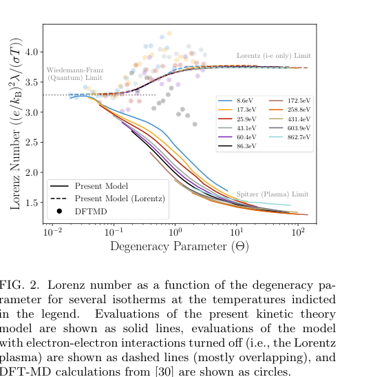

# 从温稠密物质到 Spitzer 极限的电子输运

> Lucas J. Babati、Nathaniel R. Shaffer、Louis Jose、Scott D. Baalrud。正式出版元数据为 *Physical Review Letters*，2026-10-16，[10.1103/177n-4yfm](https://doi.org/10.1103/177n-4yfm)。本次实际阅读 **arXiv:2606.02881v1，2026-06-01 提交、PDF 署稿 June 3，7 页**；标题与四位作者对应。正式 PDF 暂不可得，不宣称作者稿等同最终 VOR。

## 一句话结论

平均力势、量子散射和 BUU 动理学方程共同处理强关联、简并及电子—电子碰撞，构建输运系数表；在经典氢等离子体极限，电子—电子作用对热、电输运比值不可忽略。

## 模型与适用对象

平均原子双组分模型 AA-TCP 为相互作用势和电离态提供输入；对完整 Boltzmann–Uehling–Uhlenbeck 方程作扩展 Chapman–Enskog 求解，计算电导率 σ（S/m）、热导率 κ（W/(m·K)）及热电耦合系数。Lorentz 对照模型只保留电子—离子作用，不等同于完整模型。

氢比较跨越 Γ≈0.07–3、简并参数 Θ=k_BT/E_F≈0.02–100；铝比较取固体密度 2.7 g/cm³。文中的 DFT-MD/Kubo–Greenwood 基准和既有实验是参考数据；这篇不是一次新的 HED 实验。

## 图 2：Lorenz 数是严格的极限检查

原图为作者稿第 3 页 Fig. 2。横轴 Θ、对数刻度，无量纲；纵轴 L=(e/k_B)²κ/(σT)，无量纲。不同颜色是图例所列等温线，实线为完整模型，虚线为关闭电子—电子碰撞，圆点为既有 DFT-MD 数据。

强简并端趋向 Wiedemann–Franz 值 π²/3≈3.29；非简并、弱耦合氢端，完整模型趋向 Spitzer 值约 1.62，而 Lorentz 模型和所比较的 KG 数据趋向不同极限。关键不是两条 σ 曲线看上去接近，而是热、电输运的组合能否恢复正确极限。图中圆点为计算基准，不能当作实测点。

## 结果、成本与限制

电子—电子修正在低密度/弱简并氢中重要；强简并时受 Pauli 阻塞抑制，在高电离铝中相对电子—离子作用还约按 1/Z̄ 缩小。固体密度铝的部分实验支持模型，但并非全部一致：文中指出 Sperling 数据与所列各模型均不一致，不能概括为“全部实验验证”。

每个密度—温度—组分点约需单处理器数分钟，适合离线制表，仍太慢而不宜在流体每单元每步内联调用。作者建议弱耦合经典区域用解析公式、过渡区用平均力模型制表、更强耦合且简并区域用 DFT-MD；Γ、Θ 阈值是建模建议，不是跨元素通用误差保证。

对激光靶和辐射流体模拟，本工作提供输运闭合与渐近检验思路；没有计算束流输运、光核产额或材料损伤。完整推导指向伴随论文；本轮只核验本文，未审计伴随推导、运行 AA-TCP 或生成新的系数表。

## 全文与核验

- [本地 PDF](../pdfs/Babati%20et%20al.%20-%202026%20-%20Mean%20force%20plasma%20conductivity.pdf)；[取得的全文来源](https://arxiv.org/pdf/2606.02881v1)；[作者稿身份](https://arxiv.org/abs/2606.02881v1)。
- 文件头、类型、SHA-256、pdfinfo、全页 pypdf 可读性与布局文本核验；首页及关键图表已目视检查。MinerU 状态逐篇记录于[当日报告](../pdf_validation.json)，仅采信与本地 PDF 相符的正文。
- PDF 与提取正文按规则仅本地保存；图表来自该 PDF，裁框/页码见[出处清单](../research/figure-manifest.json)。
