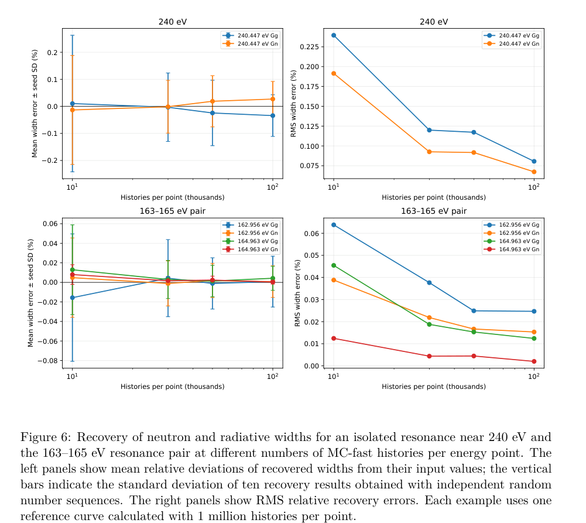

# 中子共振俘获：快速多次散射校正及统计误差

> R. M. Djilkibaev，arXiv:[2610.20435v1](https://arxiv.org/abs/2610.20435)，2026-10-14 提交，15 页作者预印本；本轮未核实正式期刊版本。

## 一句话结论

MC-fast 通过加权输运快速重算样品内散射后俘获，与 SAMMY MC 在金靶模型上接近；解析 SAMMY 某个小分量的约 46% 差异仅导致总俘获量约 0.0111% 的变化，分母不能省略。

## 定义与算法

Y(E)=Y₀(E)+Y₁(E)+Y≥₂(E) 是入射中子被靶俘获的概率，无量纲；下标是俘获前散射次数。Y₀=[1−exp(−n_Aσ_tot)]σ_γ/σ_tot 解析计算，n_A 为面密度（atoms/barn）。MC 为靶内强制碰撞条件抽样，在每次碰撞计入俘获权重，再让降低权重的中子继续弹性散射；同一历史各散射阶贡献相关，求和方差包含协方差。

模型为正常入射的无限平板 ¹⁹⁷Au，测试 n_A=7.3×10⁻⁴ 和约 6.3×10⁻³ atoms/barn。Reich–Moore 截面用 ENDF/B-VIII.1 宽度参数、既有调整后的共振能量、295 K Doppler 展宽；靶核热运动未在每次碰撞另抽样。输出按入射能量归档，散射后能量只改变后续输运，不能误当探测器能量沉积分布。

## 基准：分量误差和总量误差

50–300 eV 共 50,001 能量点，每点 10⁵ 历史，与 SAMMY 8.2 MC 比较。多次散射贡献的差异除以 SAMMY 总俘获量后，RMS 约 0.12084%；不是两套完整核数据在全范围内已达到同样相对精度。SAMMY 输出缺少自身统计方差，尚不能严格分离系统偏差和 MC 噪声。

240–241 eV、标称厚度下，直接 MC 的 Y≥₂ 约为解析 SAMMY 的 54%；替换此分量对总 Y 的影响约 −0.0111%。诊断性 MC 采用 SAMMY 的二次散射后逃逸近似后，差异降到约 0.9%，支持误差来自该几何输运近似，但诊断差异未附完整统计不确定度。

## 图 6：反演精度随 MC 统计量变化

来源为作者稿第 14 页 Fig. 6。横轴是每能量点历史数（千、对数刻度）；左列为恢复宽度相对真值的平均偏差（%），误差条是十个随机种子结果的标准差；右列为相对真值的 RMS 误差（%）。上行为约 240 eV 单共振，下行为 163–165 eV 双共振，Γ_n 与 Γ_γ 分开。

单共振每点从 10⁴ 增至 10⁵ 历史，Γ_n/Γ_γ RMS 从 0.19%/0.24% 降至 0.067%/0.081%，大致符合 N⁻¹ᐟ²。参考曲线也是每点 10⁶ 历史的模拟，试探参数共享随机序列以稳定最小化；这是有限模型反演误差，不是实验共振宽度不确定度。没有加入背景或装置分辨函数，宽度限制在真值的 0.7–1.3 倍，其他共振参数固定。

## 性能与应用边界

Mac mini M4 上六个 worker 用时 338 s，SAMMY 单线程约 53 min，约 9.4 倍差异**包括并行收益**，没有等线程算法加速基准。五次与十次散射上限的比较在所测窗口和面密度内未超出统计噪声，未直接检验十次以上贡献。

适合为活化样品和俘获诊断建立分阶散射校正与预算，但当前证据限于 eV 金靶模型；不能直接外推至激光产生的 MeV 中子、真实有限靶、光核绝对产额、治疗或防护。未对真实实验重新拟合，本轮未运行 MC-fast/SAMMY。

## 全文与核验

- [本地 PDF](../pdfs/Djilkibaev%20-%202026%20-%20Fast%20neutron%20multiple%20scattering%20Monte%20Carlo.pdf)；[取得的全文来源](https://arxiv.org/pdf/2610.20435v1)；[作者稿身份](https://arxiv.org/abs/2610.20435v1)。
- 文件头、类型、SHA-256、pdfinfo、全页 pypdf 可读性与布局文本核验；首页及关键图表已目视检查。MinerU 状态逐篇记录于[当日报告](../pdf_validation.json)，仅采信与本地 PDF 相符的正文。
- PDF 与提取正文按规则仅本地保存；图表来自该 PDF，裁框/页码见[出处清单](../research/figure-manifest.json)。
