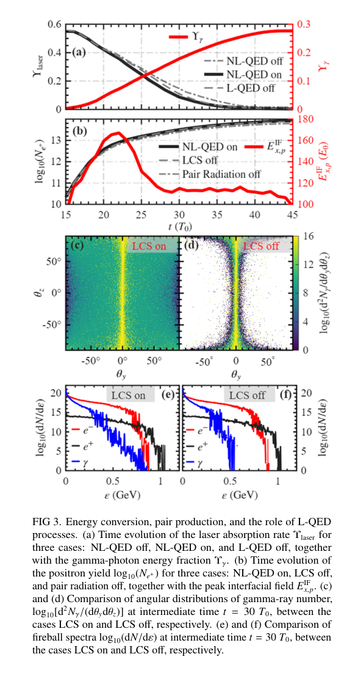

# 非线性—线性 QED 级联：偏振光子—电子正电子火球

> Zhen-Ke Dou 等；正式出版元数据为 *Physical Review E*，2026-10-16，[10.1103/xvmh-mcg7](https://doi.org/10.1103/xvmh-mcg7)。本次实际阅读 **arXiv:2603.26383v2，2026-07-03 更新，8 页作者稿**；作者稿标题含 “Overdense”，正式登记标题删去该词。六位作者及研究主题对应，但正式 PDF 返回 403/404，未验证两版逐字或数值一致性。

## 一句话结论

作者用含偏振的 QED-PIC 提出：空穴钻进腔中的电子循环加热产生致密 γ 光子浴，再由线性 Breit–Wheeler 产对和线性 Compton 散射重整火球；约 30% 的激光能量转成光子是模拟结果，尚无实验火球。

## 方法与关键参数

主文为二维移动窗口模拟：初始计算域 25 × 20 μm²、750 × 300 网格；完全电离 CH，平台电子密度 30 n_c，边缘指数梯度尺度 3 μm。驱动为 λ=1 μm、a₀=200、w₀=1.5 μm 的 p 偏振脉冲，对应 5.52×10²² W/cm²、峰值功率 1.9 PW、能量 87 J。T₀=λ/c，主要脉冲约 14T₀。文中另报告补充材料的三维一致性检查；本轮没有取得并独立审计该补充模拟。

代码把非线性 Compton 辐射、非线性 Breit–Wheeler 与偏振相关的线性 Compton（LCS）、线性 Breit–Wheeler（LBW）碰撞结合。附录用单能碰撞束检查产额、能动量守恒与偏振转移。这是所选算例的模块验证，不能代替全部网格、权重与参数收敛。

## 图 3：能量预算与线性过程的作用

来源为作者稿第 4 页 Fig. 3。图 (a) 横轴 t/T₀；黑色曲线为瞬时激光场能除以初始激光总能，红线为光子能量分数，均无量纲。图注称前者 absorption rate，但正文定义 Υ_laser=E_L/E₀，实际是**剩余场能比例**；本笔记按公式解释。关闭线性过程对整体耗尽影响较小，说明线性散射主要改变输出相空间，不能把它独立归因为激光吸收主因。

图 (b) 左轴为正电子总数的十进对数，右轴为界面纵向场峰值、以 E₀=m_ecω/e 归一化。二维总粒子数依赖第三方向归一化，不能直接当作可抽取的三维实验产额。图 (c,d) 是角分布 θ_y、θ_z（度）及对数颜色标度；(e,f) 横轴为能量（GeV）、纵轴为对数微分粒子谱。LCS 开关显著改变角展宽和谱形；图中角积分、能量阈值和输出立体角不可省略。

## 物理含义与证据边界

微鞘场反复重置电子相位、延长停留时间，使电子反复与激光相互作用并辐射；该纵向场在轨道功预算中不一定提供净能量。作者估计 γ 浴的最大平均密度约 3×10²² cm⁻³，而对等离子体约 3×10¹⁷ cm⁻³；**“过密”主要指光子浴，不能写成过临界电子正电子等离子体**。

主参数下拟合的屏蔽长度约 19 μm，与火球尺度约 20 μm 接近，集体性处于边缘；更强 a₀=300 案例才给出更小的约 9.4 μm。电子/光子谱的拟合温度分别约 16/0.86 MeV，也不代表电子、正电子、光子共同热平衡。高平均偏振须连同作者的自旋/Stokes 定义和加权方式读取，不能直接当作探测器可测偏振率。

对本项目的价值在于过程开关、轨道做功与角谱预算的联合诊断。尚未得到转换靶外部 γ 谱、光核中子、屏蔽剂量或装置效率；未在本地运行 QED-PIC 或复现文中模拟。

## 全文与核验

- [本地 PDF](../pdfs/Dou%20et%20al.%20-%202026%20-%20Polarized%20pair%20photon%20fireball.pdf)；[取得的全文来源](https://arxiv.org/pdf/2603.26383v2)；[作者稿身份](https://arxiv.org/abs/2603.26383v2)。
- 文件头、类型、SHA-256、pdfinfo、全页 pypdf 可读性与布局文本核验；首页及关键图表已目视检查。MinerU 状态逐篇记录于[当日报告](../pdf_validation.json)，仅采信与本地 PDF 相符的正文。
- PDF 与提取正文按规则仅本地保存；图表来自该 PDF，裁框/页码见[出处清单](../research/figure-manifest.json)。
