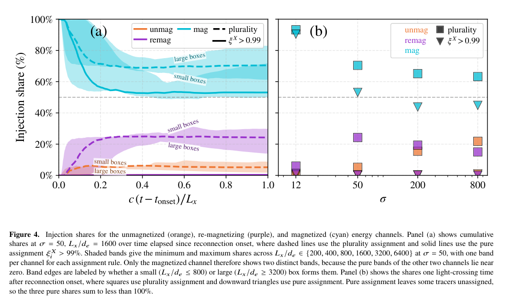

# 重联注入：经过 E>B 区域与在那里获得能量是不同统计

> Omar French 等，arXiv:[2610.22118v1](https://arxiv.org/abs/2610.22118)，2026-10-15 提交、PDF 标记 Preprint 16 October，10 页。MNRAS 模板保留 Accepted XXX，不能据此视为已接收或正式发表。

## 一句话结论

二维、无辐射、近零导引场对等离子体中，按首次越过注入阈值前的逐粒子做功分账，多数粒子由“磁主导区域”通道贡献最多；这既不等于 E>B 对所有后续加速无用，也未证明唯一的 Fermi 机制。

## 数值配置与统计定义

VPIC 解相对论 Vlasov–Maxwell，σ=B₀²/(4πn₀m_ec²)=12、50、200、800，n₀ 为电子与正电子总数密度；每格 100 对粒子，初温 0.36m_ec²。Δx=Δz=0.25d_e，ω_peΔt=0.16，b_g=10⁻⁵；空间仅 x–z 两维，保留三分量场/动量。固定盒长 1600d_e 扫 σ，在 σ=50 扫 200–6400d_e，共九组；每组跟踪 6.4×10⁵ 个电子。

首次满足 γ>γ_inj=σ/4 作为注入。累计 qv·E 的三类净功：E>B 区内、离开后累计至一圈回旋相位的区间、其余 B>E 区间。E>B 使用 Gaussian 场单位的比较；在 SI 表达应比较 E 与 cB。回旋相位窗口只是分类规则，不证明绝热回旋。能量份额可为负或大于 1，因为各通道存在净减速；份额和为 1 由归一构造，不能充当独立能量守恒测试。

## 图 4 与表 2：分母是被注入的示踪粒子数

来源为作者稿第 6 页 Fig. 4，数值另对照第 5 页 Table 2。左图横轴是重联起始后的时间、以 L_x/c 归一，纵轴 injection share（%）；右图横轴 σ、纵轴同左。橙/紫/青分别为未磁化、再磁化、磁主导区域通道。方块按最大净功通道分配（plurality）；倒三角要求单通道份额超过 99%（pure），有粒子不被分配。

| σ | 未磁化 plurality | 再磁化 plurality | 磁主导 plurality | 注入前从未进入 E>B |
|---|---:|---:|---:|---:|
| 12 | 0.53% | 6.0% | 93% | 90% |
| 50 | 5.2% | 24% | 70% | 50% |
| 200 | 15% | 19% | 65% | 39% |
| 800 | 22% | 15% | 63% | 43% |

表中是论文 Table 2 的取整数值；摘要约称 95%→65%，此处以表格 93%→63% 为准。份额按人数计，不是全体粒子的能量总占比。plurality 只要求三者中最大，未必超过 50%；pure 各列和则不必为 100%。

## 选择效应与限制

只挑末态高能粒子会偏向注入后加速更快的通道，把“曾进入 E>B”的相关性读成注入因果。增大盒子时部分高能筛选相关性减弱；初始电流层的起始前注入者被剔除，这一选择实际上有利于 E>B 假设。σ=800 的早期队列纳入后，磁主导 plurality 会增加到约 75%。

这里按场大小和时序划分，没有直接把电场分成运动电场与非理想场，也没有干预粒子动力学；因此不能断言磁主导做功完全来自 Fermi、pickup 或理想 MHD。结果限于温初态、周期边界、二维、无辐射、近零导引场；不能直接推广到三维、强辐射 QED 或电子—离子靶。

对本项目的启发是把阈值、入选总体、通道净功和末态谱分别定义，再比较机制。未测量激光束流或次级辐射源；本轮未运行 VPIC 或重算注入统计。

## 全文与核验

- [本地 PDF](../pdfs/French%20et%20al.%20-%202026%20-%20Reconnection%20particle%20injection%20channels.pdf)；[取得的全文来源](https://arxiv.org/pdf/2610.22118v1)；[作者稿身份](https://arxiv.org/abs/2610.22118v1)。
- 文件头、类型、SHA-256、pdfinfo、全页 pypdf 可读性与布局文本核验；首页及关键图表已目视检查。MinerU 状态逐篇记录于[当日报告](../pdf_validation.json)，仅采信与本地 PDF 相符的正文。
- PDF 与提取正文按规则仅本地保存；图表来自该 PDF，裁框/页码见[出处清单](../research/figure-manifest.json)。
