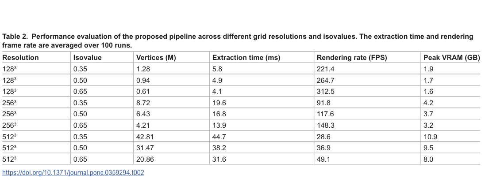

# GPU 等值面与粒子轨迹：等离子体数据的交互可视化

> Jong-Hyun Kim、Mintae Na、Junho Kim、Sejin Yun、Jung Lee、Sun-Jeong Kim，*PLOS One* 21(10):e0359294，2026-10-16，正式 VOR，[10.1371/journal.pone.0359294](https://doi.org/10.1371/journal.pone.0359294)，20 页。

## 一句话结论

分块一致索引和两遍精确分配解决所测固定缓冲 Marching Cubes 的遗漏/溢出；512³ 数据的交互可视化已经演示，但帧率不是 PIC 求解加速，VR 也尚无用户效果对照。

## 方法与输入

输入为聚变等离子体模拟的电磁势标量网格，以及粒子 ID/位置随时间的轨迹。标量逐数据集 min–max 归一到 [0,1]，阈值 τ 是归一化值，没有电势单位；图形外观不能单独建立物理不稳定性。正文未给出足以复现原等离子体求解的装置、平衡与运行输入，本笔记不把图像当作数值物理验收。

第一遍统计单元三角形/顶点数并前缀和，第二遍按确切容量写出。包含边界的 slab 索引保证交界处单元覆盖；CUDA–OpenGL 共享缓冲支持独立渲染路径免去中间 CPU 拷贝。Unreal Engine 采用单独的 staging 接口，不能把整个引擎集成笼统称为全链路零拷贝。

## 表 2：提取、显示和显存应分开

来源为第 9 页 Table 2。表列依次为网格分辨率、无量纲 τ、顶点数（百万）、完整等值面提取耗时（ms）、生成几何后的显示帧率（FPS）和峰值显存（GB）。硬件为 RTX 3090 24 GB、Threadripper PRO 3955WX、256 GB 系统内存；20 次预热后平均 100 次。

512³、τ=0.35 时为 42.81 百万顶点、44.7 ms、28.6 FPS、10.9 GB。提高 τ 至 0.65 后，顶点数减至 20.86 百万、提取 31.6 ms、显示 49.1 FPS、8.0 GB。差异主要反映输出几何复杂度，不能仅按输入网格估计成本。显示 FPS 在网格已生成后测量，不能用 1/44.7 ms 与其直接互换，也不是模拟每秒步数。

## 有用性与限制

固定容量单遍基线在相同 512³ 输入出现缺面；论文没有因此证明所有既有 VTK/ParaView/Flying Edges 方法都不安全。单 GPU 内存、经典 MC 的拓扑歧义和尖锐特征仍有限制。预平滑是在标量场上作 3³ box 滤波、λ=0.35、五次迭代后重提取，可能改变顶点数和局部拓扑；不能把平滑后的细节衰减当作物理耗散。

展示的轨迹数据只有 100 条。正文指出大量动态管线网格还需 GPU 生成、降采样与批处理；不能据此宣称百万宏粒子实时分析。VR 与反应堆模型只是交互形态展示，未做正式比较用户研究，且定量探测、分布式处理弱于成熟科学工具。

适合作为本项目三维场/轨迹浏览的实现参考。没有提出新的 PIC 推进器、训练代理模型或证明更准确的等离子体动力学。本轮未运行源代码、GPU 性能测试或 VR。

## 全文与核验

- [本地 PDF](../pdfs/Kim%20et%20al.%20-%202026%20-%20GPU%20plasma%20visualization.pdf)；[取得的全文来源](https://journals.plos.org/plosone/article/file?id=10.1371/journal.pone.0359294&type=printable)。
- 文件头、类型、SHA-256、pdfinfo、全页 pypdf 可读性与布局文本核验；首页及关键图表已目视检查。MinerU 状态逐篇记录于[当日报告](../pdf_validation.json)，仅采信与本地 PDF 相符的正文。
- PDF 与提取正文按规则仅本地保存；图表来自该 PDF，裁框/页码见[出处清单](../research/figure-manifest.json)。
