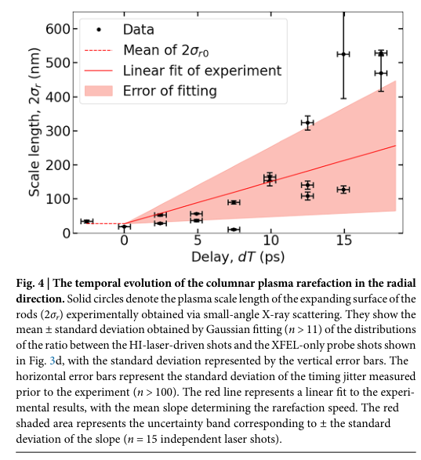
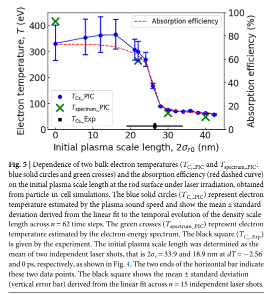

# 无挡束器 SAXS：从纳米预等离子体到皮秒稀疏化

> Masato Ota 等，*Communications Physics* 9, 303，2026-10-16，正式 VOR，[10.1038/s42005-026-02872-5](https://doi.org/10.1038/s42005-026-02872-5)，9 页。

## 一句话结论

分层铝滤片把强直束及低角散射衰减到探测器动态范围内，使同一曝光保留多个 q 尺度；SACLA 实验测到 Si 棒阵列的密度梯度演化，而预等离子体如何改变吸收主要由二维 PIC 解释。

## 装置与观测量

探针为 SACLA 7.1 keV（λ=0.175 nm）、小于 10 fs 的 XFEL；泵浦为 800 nm、40 fs、靶上 0.6 J、5.2×10¹⁸ W/cm² 的激光。Si 棒直径 500 nm、中心间距 1000 nm、高 10 μm，阵列为 15×30。泵浦相对棒轴有 17° 入射角，XFEL 横穿阵列。

每层 100 μm Al 在 7.1 keV 的透射率约 0.161；按已知空间透射函数恢复强度，最高有效动态范围超过 10⁶，获得至第 14 阶的散射峰。q=4πsinθ/λ，其中散射角为 2θ。**无挡束器不等于不衰减**；滤片散射、几何标定和直束/超小角散射分离仍要处理。

## 图 4：实测结构参数及拟合

来源为 VOR 第 5 页 Fig. 4。横轴泵浦—探针延迟 dT（ps），纵轴径向密度梯度尺度 2σ_r（nm）。黑点来自各时延的 SAXS 峰比值 Gaussian 拟合，竖误差由拟合给出；横误差为到达时序抖动约 ±0.4 ps。15 个独立炮次作线性拟合，红带是斜率标准差。该曲线是多炮次时间扫描，不能写成一次曝光测完整时间轨迹。

拟合给出的向内稀疏化前沿速度为 12.4±7.5 km/s。2σ_r 是本文误差函数密度边缘的尺度，不等于常见指数梯度长度；由结构模型、声速及 FLYCHK 推断的约 11 eV 和 Z≈4 不是独立温度计实测。初始尺度约 26.4 nm 来自两次近零时延测量的均值。

## 图 5：吸收效率变化来自模拟

来源为第 5 页 Fig. 5。横轴初始 2σ_r0（nm）；左轴电子温度（eV），右轴激光吸收效率（%）。蓝圈为二维 EPIC3D 的声速推断温度，绿叉为模拟能谱温度；红虚线是模拟吸收率，黑方点为实验辅助推断的温度与初始尺度。

模拟在约 25 nm 附近出现转折：吸收从初始尺度 0–20 nm 时约 60–70%，降至 30–50 nm 时约 15–20%。解释是预等离子体缩窄棒间通道，限制激光向深处穿透。不能把这条红线描述成直接测得的激光量热效率。模拟的电离态固定 Z=5，二维化、17° 三维入射差异和电离/平衡过程可解释残余温度差。

## 研究价值与边界

这项诊断把初始靶边缘、预脉冲对比度和后续稀疏化连接起来，有助于结构靶吸收与次级辐射源研究。单曝光覆盖多个空间尺度是已演示能力；完整随机湍流或丝化实验仍是应用前景。本文没有给出电子束打转换靶的 γ/中子产额或治疗剂量。本轮未复跑 EPIC3D、FLYCHK，也未独立核查补充材料数据。

## 全文与核验

- [本地 PDF](../pdfs/Ota%20et%20al.%20-%202026%20-%20Beamstop%20free%20HED%20plasma%20SAXS.pdf)；[取得的全文来源](https://www.nature.com/articles/s42005-026-02872-5.pdf)。
- 文件头、类型、SHA-256、pdfinfo、全页 pypdf 可读性与布局文本核验；首页及关键图表已目视检查。MinerU 状态逐篇记录于[当日报告](../pdf_validation.json)，仅采信与本地 PDF 相符的正文。
- PDF 与提取正文按规则仅本地保存；图表来自该 PDF，裁框/页码见[出处清单](../research/figure-manifest.json)。
