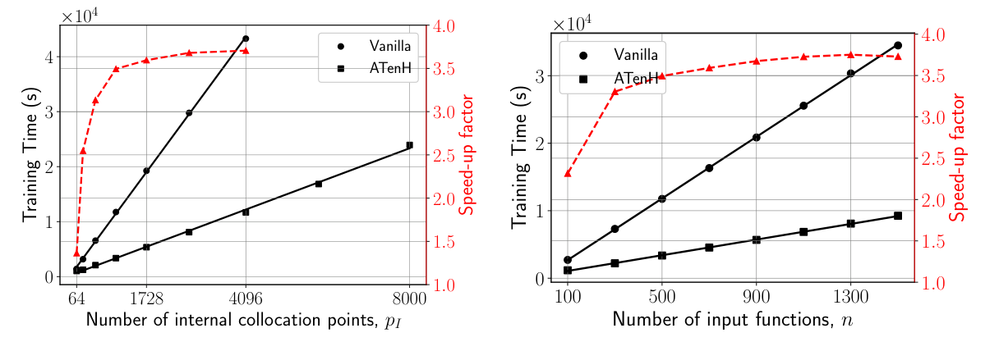

# PI-DeepONet 的张量处理：减少 Branch 重复求值为何能降低训练成本

## 0. 论文信息与阅读范围

- 原题：*The importance of tensor handling and implementation of physics-informed DeepONets*。
- 作者：Nahum Banks、Gustavo A. M. de Almeida、Sergio Maldonado；University of Southampton。
- 版本：[arXiv:2610.22157v1](https://arxiv.org/abs/2610.22157v1)，2026-10-15 提交；PDF 首页署稿 2026-10-16。**本轮收入官方预印本，未核实正式期刊发表。**
- 方向：科学机器学习、物理约束神经算子、实现与计算性能；对 PIC/HEDP 的价值是算法实现参考。
- [本地完整 PDF](../pdfs/Banks%20et%20al.%20-%202026%20-%20Efficient%20physics%20informed%20DeepONet%20tensors.pdf)；[官方全文来源](https://arxiv.org/pdf/2610.22157v1)。
- 阅读依据：已成功获得 MinerU `pipeline` 全文，按原 PDF 逐节核对公式与表格；本笔记按论文摘要、引言、方法、结果、讨论、结论的顺序展开。原文图 6 在首次讨论处保留，其余图在相应位置说明。本文报告的训练均使用 NVIDIA A100，**不把模型成本估算、实测训练时间和推理性能混为同一证据**。

## 1. 摘要：核心结果及其分母

摘要先说明 PINN 可以借助控制方程减少解场标签需求，PI-DeepONet 则进一步学习输入函数到解函数的映射。然而，物理残差的自动微分和高维配点仍然昂贵，算子网络“训练后可快速预测”并不能消除训练瓶颈。

作者的改动 ATenH（Accelerated Tensor Handling）来自一个具体冗余：同一个边界输入函数在多个查询点上完全相同，却被 Vanilla 实现反复送入 Branch 子网。ATenH 每个函数只编码一次，再把编码与各配点的 Trunk 输出收缩。两种网络表达同一个算子近似，区别在计算组织方式。

摘要的最大 **3.75×** 来自 **2D 线性平流的训练参数扫描中，Vanilla 训练时间除以 ATenH 训练时间**；标准配置表 3 的 2D 加速为作者报告的 3.49×。它们不是相对于传统 PDE 求解器的速度，也不是推理加速。3D 中 Vanilla 在该 A100 实验设置下内存不足，因此只有 ATenH 的完成时间；原文约 580× 是成本模型预测，不能写成实测。

## 2. 引言：算子表示和实现成本是两个问题

引言前两段从 PINN 的约束方式出发：普通 PINN 输入坐标，边界和初值进入损失，因此通常学到特定条件下的一次解。改变条件可能需要重新训练。神经算子的目标则是从一族边界/初值函数映射到一族解，可在训练后处理多个条件。

接着，作者回顾 DeepONet 的 Branch–Trunk 分工。Branch 接收输入函数在传感器点的离散值，Trunk 接收输出查询坐标；两者潜在向量的内积给出预测值。单输入情形对应原文式 (1)：

$$
\widehat G(u)(y)=\sum_{\ell=1}^{s}b_\ell\big(u(\xi_1),\ldots,u(\xi_m)\big)\,\tau_\ell(y),\qquad y=(\mathbf x,t).
$$

这里，输入函数记为 u，传感器点为 ξ，传感器数为 m，潜在维数为 s；b 为 Branch 编码，τ 为 Trunk 基函数。式子将“具体输入是什么”与“在哪里求值”分开。输出场的物理单位取决于应用；本文基准采用归一化的平流变量，未给出 SI 场量标定。

**式子的计算含义。** 对某个固定输入，只要网络参数尚未更新，Branch 编码就不依赖查询坐标。因此可以先算一次整个潜在向量，再对多个坐标分别做内积。这不是新增加物理约束，也没有提高潜在空间的表达能力，而是复用本来就相同的中间结果。

原文图 1（p3）把这一表示接到 PDE、边界、初值以及可选观测数据损失。对查询坐标求导时，导数沿 Trunk 路径传播；Branch 在坐标求导中保持常数，但训练参数更新仍须对 Branch 求梯度。不能把后者误解为冻结 Branch 网络。

引言随后讨论维数增加的问题：若每个时空方向采用同等采样密度，总配点数会随维数指数增加。分离型 PI-DeepONet 尝试减少 Trunk 求值，但依赖合适的分离结构。本文选择保留普通表示，直接减少 Branch 冗余；目标包含降低训练与推理成本，但后面的定量计时证据集中于训练。

## 3. 方法（原文第 2 节）

### 3.1 通用 PI-DeepONet：不用解场标签，仍然需要边界函数

原文 §2.1（p4）把 PDE、边界算子和初值组合为训练目标，式 (2)–(5) 可写成：

$$
\mathcal N[\widehat G(u)] =0,\qquad
\mathcal B[\widehat G(u)] =0,\qquad
\widehat G(u)(\mathbf x,0)=v_0(\mathbf x),
$$

$$
\mathcal L=\mathcal L_{\mathrm{PDE}}+\mathcal L_{\mathrm{BC}}+\mathcal L_{\mathrm{IC}}+\mathcal L_{\mathrm{data}}.
$$

微分算子 N 指定控制方程，B 指定边界，初值为 v₀。残差在内部配点评估，边界和初值分别在相应位置评估。本文所有实验去掉最后的数据项，所以没有使用带标签的完整 PDE 解进行训练；输入边界函数、方程和初值仍是已知信息。“无标签训练”不能改写为“无需任何数据或先验”。

下面统一用 n 表示训练输入函数样本数，p 表示每个样本的配点数，m 表示每个输入函数的离散自由度，d 表示**空间加时间的总维数**。因此文中 1D/2D/3D 平流是空间维数，其 d 分别为 2/3/4。多入口情形的每个样本包含一组独立边界函数，Branch 子网数量另记为 M。

### 3.2 Vanilla：把函数和配点展平，会重复编码相同输入

原文 §2.2、算法 1（p4–5）把每个函数重复 p 次，与每个配点逐行配对。这样容易用相同行数的 Branch/Trunk 输出做内积，也允许不同函数使用不同配点数；但 Branch 的输入函数并没有随配点发生变化。

| 张量 | Vanilla | ATenH |
|---|---|---|
| Branch 输入 | `(n*p, m)` | `(n, m)` |
| Branch 输出 | `(n*p, s)` | `(n, s)` |
| Trunk 输入 | `(n*p, d)` | `(n, p, d)` |
| Trunk 输出 | `(n*p, s)` | `(n, p, s)` |
| 最终预测 | `(n*p, 1)` | `(n, p, 1)` |

该表对应原文表 2（p6）。Trunk 的配点总数在两种实现中都没有减少；节省来自 Branch 输入、激活和相关求导路径，不是把全部网络计算都减少 p 倍。

### 3.3 ATenH：广播编码，保留同一个函数–配点映射

原文 §2.3、算法 2（p5–6）让 Branch 每样本只产生一条编码，输出与 Trunk 张量沿潜在维收缩：

$$
G_{jk}=\sum_{\ell=1}^{s}B_{j\ell}T_{jk\ell},\qquad
B\in\mathbb R^{n\times s},\quad T\in\mathbb R^{n\times p\times s}.
$$

下标 j 是输入样本，k 是该样本的查询点，ℓ 是潜在分量。实现可用 `einsum('js,jps->jp', B, T)` 表达；不必显式物化一份重复 p 次的 Branch 编码。

**等价性的推导。** Vanilla 在展平后同一样本的每一行都等于同一编码，因此代回内积所得正是上式。再对 Branch 参数求梯度，各配点的贡献相加：

$$
\frac{\partial\mathcal L}{\partial\theta_B}
=\sum_{j,k,\ell}
\frac{\partial\mathcal L}{\partial G_{jk}}
T_{jk\ell}\frac{\partial B_{j\ell}}{\partial\theta_B}.
$$

这说明复用编码不会漏掉来自其他配点的梯度。这里是为解释原文等价性补写的链式法则，不是作者另做的数值实验；实际复现仍须核对相同参数、精度、采样与反向传播。本文使用普通 tanh MLP；若换成具有逐行随机性或批统计的层，不能直接假设相同的逐样本等价性。

ATenH 在本文实现中要求同一批次的每个函数有相同的配点**数量**；这些坐标不必处处相同。物理约束训练中可自由生成配点，因此此限制通常容易满足；带标签观测若每样本点数不同，则需额外分组等处理，本文未验证该类扩展。

### 3.4 完整训练步成本：推导的是主导乘加量

原文 §2.4.1（p7）用输入–权重乘积计数近似计算成本。全连接层的输入宽度乘输出宽度给出主要乘加量，逐层求和得到单样本前向成本。记 Branch 和 Trunk 的单次成本为：

$$
S_B=\sum_{l=1}^{L_B}r_{l-1}r_l,\qquad
S_T=\sum_{l=1}^{L_T}e_{l-1}e_l.
$$

其中 L 是层数，r、e 是各层宽度，首层输入宽度分别为 m 与 d。偏置、激活、数据搬运等常数和开销没有纳入该计数。反向传播既传播误差信号又计算权重梯度，因此作者取参数反向成本约为前向的两倍；仅计算坐标导数时不需要全部权重梯度。

原文 §2.4.2–2.4.3（p8–9）把一次前向、一次一阶物理导数，以及最终损失对参数的反向传播加起来，得到式 (17)、(23)：

$$
C_V\sim3MnpS_B+6npS_T+4nps,
$$

$$
C_A\sim3MnS_B+6npS_T+4nps.
$$

**系数如何出现。** Branch 前向加参数反向构成约 1+2 份成本，所以为 3；Trunk 还处在物理导数路径上，按作者的图结构估计变为 6；内积相关工作合计为 4 份。两式的唯一主要差别是 Branch 项少了 p 倍。该模型针对本文一阶方程、Dirichlet 边界且以内部配点为主的设置；没有把边界计算完整计入，不能不经修改就当成高阶 PDE、复杂边界或任意自动微分实现的精确 FLOP 公式。

由两式相除，得到更容易看清机制的加速公式（对应原文式 (26)）：

$$
\phi\sim\frac{p\left(3MS_B+6S_T+4s\right)}{3MS_B+p\left(6S_T+4s\right)}.
$$

若 p 为 1，两者没有编码复用收益；随着 p 增加，不能节省的 Trunk 和内积开始主导，因此加速不会无限增长：

$$
\lim_{p\to\infty}\phi
=1+\frac{3MS_B}{6S_T+4s}.
$$

n 在该理想成本比中消去，所以理论加速与样本数无关；实际小批量的硬件占用、框架固定成本会让测得的比值随 n 变化。固定网络时，Vanilla 成本与配点数成正比，ATenH 是“Branch 固定项加配点线性项”；两者均有配点线性主导趋势，并且都对 n 线性增长。

若两子网等深，除输入层外等宽为 e，则可进一步代入：

$$
S_B=me+(L-1)e^2,\qquad S_T=de+(L-1)e^2.
$$

这解释为什么输入函数离散自由度很高时，减少 Branch 重复尤其有效；但它仍保留时空配点总量，未消除高维问题本身。

### 3.5 数值基准：高斯入口的线性平流

原文 §2.5（p9–12）只测试常速线性平流：

$$
\frac{\partial f}{\partial t}+\mathbf c\cdot\nabla f=0,
\qquad(\mathbf x,t)\in[0,1]^{d-1}\times(0,1].
$$

场量 f 随速度 c 平移，没有自洽场、碰撞、反应、非线性流体耦合或粒子噪声。坐标和时间均为本文单位区间中的归一化变量，各速度分量设为 1；不能把图中时间直接解释成秒。

初值为零，各流入面施加中心在时间 0.5、其余空间坐标 0.5 的高斯脉冲：

$$
f(\mathbf x,0)=0,
\qquad
f\big|_{x_i=0}
=A_i\exp\left[-\frac{(t-0.5)^2}{2\sigma_t^2}\right]
\prod_{\substack{j=1\\j\ne i}}^{d-1}
\exp\left[-\frac{(x_j-0.5)^2}{2\sigma_j^2}\right].
$$

幅度 A 在 0.1–1 均匀抽样，不同入口幅度独立；时空标准差均固定为 0.07。训练/测试改变的主要是幅度，未改变高斯形状、中心、宽度、平流速度或方程。作者也明确承认不能据此声称推广到性质不同的边界函数族。

**特征线真值的推导。** 沿轨道向过去回溯时，位置与时间同步变化，平流方程意味着场量沿轨道不变。由当前位置回到流入面 i 需要时间 xᵢ/cᵢ，因此到达该面的时刻为：

$$
S_i=t-\frac{x_i}{c_i},\qquad
i^*=\operatorname*{arg\,max}_{1\leq i\leq d-1}S_i.
$$

取最大回溯时刻，等价于选择从当前点向后走时首先遇到的入口。若所有回溯时刻均为负，则先碰到零初值面，场值为零。否则把入口时刻及其余坐标的平移量代回高斯，得到原文式 (32)–(34)：

$$
f(\mathbf x,t)=
\begin{cases}
0,&\max_iS_i<0,\\
f_{i^*}(\mathbf x,t),&\text{其他情况},
\end{cases}
$$

$$
f_i=A_i\exp\left[-\frac{(S_i-0.5)^2}{2\sigma_t^2}\right]
\prod_{\substack{j=1\\j\ne i}}^{d-1}
\exp\left[-\frac{(x_j-0.5-c_jx_i/c_i)^2}{2\sigma_j^2}\right].
$$

这里的入口高斯和特征线解给出解析真值，不依赖另一个数值求解器的网格误差。最后乘积中的排除条件按 PDF p10 核对补全；MinerU 对该处排版的识别并不完整，不能直接照抄提取式。

原文图 2（p11）横轴为训练 epoch 数，纵轴是对数刻度损失。1D/2D 的训练损失下降，验证曲线有明显振荡；作者根据下降趋缓和未观察到持续性验证恶化，选择约 50,000/100,000 epochs。它支持本次有限验证样本中未出现明显过拟合，不能证明任意输入族上的泛化。

每个标准设置有 500 个训练输入和 50 个测试输入。入口每个时空方向用 50 个传感器离散；单入口总自由度随维数为 50、2,500、125,000。内部配点等效于每个时空方向 10 点的总数，但实际坐标独立均匀抽样，不是规则网格。2D 的内部配点为 1,000，两个入口和初值面各 100 点；多个入口采用 MIONet 的独立 Branch，再与 Trunk 组合。

图 3（p12）横轴为子网宽度，纵轴为深度，颜色是 MRRMSE（1D 色标为线性，2D 为对数）。作者选择四个隐藏层，1D/2D 宽度分别为 40/60；3D 没有同样的网格搜索，宽度 80 是启发式外推。全部模型用 PyTorch、Adam、学习率 0.0001 和 tanh，在 NVIDIA A100 上训练；本文没有据此开展跨硬件性能基准。

**复现需保留的原文不一致。** §2.5 p10 写 3D 为 **200,000 epochs**，§3.3 p13 写 **300,000 full-batch epochs**；本文未提供足以消除此矛盾的运行日志。本笔记不擅自统一二者，3D 总时长不能在轮数尚未确认时换算成确定的每步性能。

测试指标对应式 (35)：

$$
\mathrm{MRRMSE}
=\frac{1}{n_{\mathrm{test}}}
\sum_{i=1}^{n_{\mathrm{test}}}
\frac{\|\widehat u_i-u_i\|_2}{\|u_i\|_2}\times100\%.
$$

u 是解析参考场，带帽的是网络场，范数在离散时空评估点计算。该比值可视为各样本的相对 RMSE，因为分子分母中的同一归一化点数相消。**作者只在真值非零区域计算指标**，所以指标不直接衡量零解区域的虚假背景；图中的全域绝对误差仍然需要单独检查。

## 4. 结果（原文第 3 节）

### 4.1 1D 平流：性能收益较小，精度无明确退化

原文 §3.1（p12–13）分别训练十个随机初始化的模型，各 50,000 epochs。图 4 横轴为空间坐标、纵轴为归一化时间，三幅场图比较 Vanilla、ATenH 和解析解；脉冲沿特征线斜向传播。两幅绝对误差图的色标为千分量级，不是相对误差百分数，也不是同一张色标下的定量显著性检验。

表 3 给出 Vanilla 314 s、ATenH 276 s，训练时间约减少 12.1%，作者报告 1.14× 加速；理论为 1.64×。MRRMSE 分别为 0.471±0.293% 和 0.308±0.078%。这里的离散度反映不同随机训练实例，不能当作实验诊断误差或置信区间。均值看似改善，并不足以说明张量变换提高了数学表达能力；作者的主张是精度可比。

### 4.2 2D 平流：标准配置与最大扫描加速分开

原文 §3.2（p12–14）分别训练十个实例，各 100,000 full-batch epochs。图 5（p14）在归一化时间 0.48 和 1.00 展示两个空间方向上的解析场、ATenH 预测与绝对误差；入口脉冲随着恒速输运进入区域。场值色标约 0–0.9，绝对误差在图示样本为千分量级，不能把两个时刻不同的误差色标直接比较为倍数关系。Vanilla 图因视觉上接近而未列出，不代表作者没有计算其测试误差。

标准设置下 Vanilla 为 11,800 s，ATenH 为 3,360 s；原文正文报告 71.4% 时间下降和 3.49× 加速，而表中展示数直接相除约 3.51。该小差异可能来自舍入或计时口径，未附原始计时数据，不能确定原因。MRRMSE 分别为 2.094±0.846% 与 1.524±0.513%，离散范围重叠；理论加速 7.46× 明显大于实际值。

### 4.3 图 6：配点与输入数扫描对应怎样的缩放

**来源与坐标。** 原文 PDF p14 Fig. 6，保留原图，未重绘数据。左图横轴为每个输入的内部配点数，右图横轴为输入函数样本数；均为计数。两图黑色左纵轴都是训练时间，单位 s，标有 10⁴ 倍率；黑圆点为 Vanilla，黑方点为 ATenH，黑实线为线性回归。红色右纵轴为无量纲时间比，红三角虚线表示加速。

**趋势与机制。** 左图固定输入数，增大内部配点数时两种实现计时总体近线性增加，ATenH 斜率更小。右图固定配点数，增大输入数时也有相同趋势。红线从小样本/少配点端较低值上升，在大参数端趋于约 3.7–3.75；这与 Branch 复用收益最终被 Trunk 成本限制的机制相符。正文的理论大配点极限约为 7.5，是给定网络配置的预测，不是红线已经达到的实测平台。

**缺点与误差定义。** 左图最大两个配点设置没有 Vanilla 数据，原因为内存不足；这些位置不存在可直接计算的实测加速比，不能将 ATenH 完成训练解释为某个确定倍数。图中没有误差条；表 3 称计时标准差可忽略，但本笔记没有原始重复计时或运行日志可独立重建不确定度。红轴的倍数只针对图中训练任务，不能外推到所有网络、批量、A100 显存型号或推理批次。

**3.75× 的位置。** 摘要给的是该 2D 参数研究的最大观测倍数，与表 3 标准配置的 3.49×属于不同配置口径。本文没有附可供逐点复算的原始数据表，因此不从曲线像素自行制造“精确最佳参数点”。图像出处、裁框和 SHA-256 见[图表清单](../research/figure-manifest.json)。

### 4.4 3D 平流：首先是内存可行性结果

原文 §3.3（p13–15）报告五次实例均值。ATenH 平均训练约 140,000 s，即 38.9 h，MRRMSE 为 5.438±1.108%；Vanilla 在相同研究设置下因内存不足失败。该结果表明作者所用实现及配点/输入配置在 A100 上可由“无法完成”变为“能够完成”，并不能证明任意 Vanilla 实现或小批量版本在 A100 上都无法处理 3D 平流。

图 7（p15）固定第三空间坐标为 0.44，展示时间 0.44 和 1.00 的二维切片。场值随时刻和切片变化，绝对误差上排色标为百分量级、下排为千分量级；这些截面与单个输入只是代表性可视化，不能代替全时空 MRRMSE。由于不存在 Vanilla 成功计时，理论约 580× 不能通过本文 3D 运行直接验证。

| 空间维数 | Vanilla 训练时间/s | ATenH 训练时间/s | Vanilla MRRMSE/% | ATenH MRRMSE/% | 作者报告实测加速 | 理论成本比 |
|---|---:|---:|---:|---:|---:|---:|
| 1D | 314 | 276 | 0.471±0.293 | 0.308±0.078 | 1.14× | 1.64× |
| 2D | 11,800 | 3,360 | 2.094±0.846 | 1.524±0.513 | 3.49× | 7.46× |
| 3D | 内存不足 | 140,000 | 无 | 5.438±1.108 | 无法实测 | 约580× |

表据原文表 3（p15）和结果正文整理，误差项是训练实例间标准差。1D/2D 为十次实例，3D 为五次；不把跨维度时间比解释为同等难度任务的性能比，因为配点数、入口数、传感器维数、宽度及轮数均发生变化。

## 5. 讨论（原文第 4 节）

讨论先把“减少重复 Branch 求值”与 PI-DeepONet 的原有能力分开：ATenH 保留无解场标签训练和输入函数条件化，主要增加的是计算效率。其代价是统一配点数量，在物理配点可自由生成的场景较容易处理，但仍应针对具体采样和批处理方式判断。

随后作者强调内存收益：高维输入离散自由度很大，避免复制和反复编码可同时减少运算与所需张量。这正是 3D 任务能够完成的原因；本文没有给出逐项峰值显存分解，所以不能自行声称节省了固定 GB 或固定百分比。

最后，作者解释理论与实测的差距：成本模型忽略内存分配、激活函数、数据搬运、自动微分图构造和优化器更新等，而这些会影响计时。数据支持“主导缩放趋势相符”，不支持“理论倍数已经精确预测硬件速度”。结论中关于其他实现和硬件也应受益的说法是有计算结构依据的预期，本研究的实际基准仍限于所报告的 PyTorch/A100 配置。

## 6. 结论（原文第 5 节）及对本库方向的价值

作者结论是：同一个 PI-DeepONet 数学表达式，张量组织足以改变训练成本乃至任务能否完成；未来还可继续优化，并非提出了最终架构。本轮能够确认的定量证据是 1D/2D 的有限配置训练计时与精度、2D 参数扫描，以及 3D 单一硬件配置下的内存可行性。

对激光等离子体、HEDP 和 PIC 代理模型，值得迁移的是“同一边界、初值或材料输入在多个查询坐标上复用编码”的实现检查。若已有 DeepONet 接口把同一条激光脉冲、靶密度或材料参数场在每个坐标上完整重复编码，可先检查张量尺寸、重复次数和梯度等价性，再做有界性能试验。上述具体对象是本笔记的应用推想，**原文没有进行 PIC、Vlasov–Maxwell、强场 QED、激光靶或核反应验证**。

本文训练集主要变化是高斯幅度，且 PDE 本身线性。复杂边界、强非线性、间断、守恒误差、长期稳定性以及零场背景误差均需要重新验收。不能把本文较小 MRRMSE 当作这些物理任务的精度保证，也不能把模型推理速度视为已完成的端到端模拟加速。

## 7. 开放问题与复习线索

理论上，收益取决于 Branch 相对于 Trunk 的成本占比，而不是只看总维数。若高阶坐标导数主导成本，或输入已由高效编码器预压缩，原文的收益倍数可能改变；是否还可跨函数共享 Trunk 也取决于查询坐标与自动微分组织，本文没有提供相应性能比较。

数值上，复现应先解决 3D 训练轮数冲突，取得代码版本、批量和精度、A100 型号与显存、计时同步方式、随机种子及峰值显存记录；再在相同采样和参数下验证前向值与梯度。本文对其他硬件、编译优化、混合精度、小批量和更丰富输入族的表现仍需独立测试。本轮是文献阅读，未训练网络或复算性能曲线。

复习时只需抓住两点：同一函数的 Branch 编码在一个训练步中可以复用；总加速仍受不能复用的 Trunk/物理导数与框架开销限制。3.75× 是 2D 训练扫描的最大观测值，580× 是 3D 理论估计，二者证据等级不同。

## 8. 全文与核验记录

- 官方预印本的题名、作者、arXiv 版本与本地 PDF 首页对应；署稿日期与提交日期分别记录，没有将其标记为正式发表。
- MinerU 本篇解析状态为 `done`，模型为 `pipeline`，任务 ID 为 `03d015f2-13b6-4ec5-b6fe-1bdbcd971ba7`。读取完整正文后，使用本地布局文本和原 PDF 校对关键公式；式 (34) 的排除下标以原 PDF 为准。
- 本轮目视检查 PDF p1、p9–15：覆盖首页、成本公式、边界/特征线解、训练设置、图 2–7、表 3 和 3D epoch 冲突所在页。保留图 6 的最终裁图另做完整坐标轴、图例和单位检查。
- 文件签名、页数、SHA-256、PDF 可读性和逐篇解析状态见[当日验证报告](../pdf_validation.json)；原图页码、PDF 点坐标裁框及图片哈希见[图表出处清单](../research/figure-manifest.json)。PDF 和提取正文按本地保存规则管理。
- 证据边界：本文是线性平流算例的神经算子实现研究，非等离子体实验。训练时间、OOM 和误差均为作者报告，本轮未独立重跑。3D 轮数矛盾、推理计时、跨硬件性能及对 PIC/HEDP 的实际增益尚未闭环。
