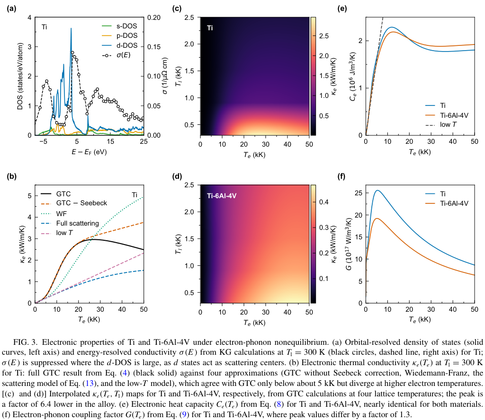

# Ti 与 Ti-6Al-4V 的第一性原理电子输运：为何热导差很多，晶格峰值温度却接近

## 0. 论文信息与阅读范围

- **原题**：First-principles electronic transport properties of Ti and Ti-6Al-4V for modeling ultrashort-pulse laser ablation
- **作者**：Korbinian Hobmaier、Guillaume E. Allemand、Alberto Marmodoro、Matthieu J. Verstraete、Ján Minár、Heinz P. Huber、David Redka。
- **发表**：*Physical Review Materials* **10**, 105002 (2026)，正式发表版（Version of Record），2026-10-16；2026-07-17 收稿、2026-09-21 接收。
- **DOI**：[10.1103/6sn3-ltl4](https://doi.org/10.1103/6sn3-ltl4)。[APS 正式全文](https://harvest.aps.org/v2/journals/articles/10.1103/6sn3-ltl4/fulltext)。
- **分类**：超短脉冲激光与材料相互作用／非平衡电子输运／第一性原理材料参数／双温模型。
- **许可**：PDF 首页声明 CC BY 4.0；下文保留原文图 3，署名、题名、期刊和 DOI 见本节。
- **阅读与提取**：阅读全文 14 页（正文至第 11 页，后续为参考文献），以 MinerU `pipeline` 成功提取的正文为主，并与本地布局文本交叉核对；已查看 PDF 首页及图 3 所在第 7 页。MinerU 任务 `594cec60-2e1a-4358-8866-22b782617e78`，状态 `done`。此篇未使用本地提取作为 MinerU 失败替代。
- **证据性质**：本次论文贡献是第一性原理输运计算与一维 TTM 模拟；文中电阻率、烧蚀阈值的实验数值来自既有文献，不能写成本次新增实验。本地完成阅读、图像核对和文献归档，**未复跑 DFT、KKR、ABINIT 或 COMSOL TTM**。

## 1. 摘要：结果必须连同补偿机制一起理解（第 1 页）

摘要首先指出参数缺口：超短脉冲烧蚀计算需要随电子温度和晶格温度变化的电子热导率、电子—声子耦合和热容；纯金属已有较多数据，Ti-6Al-4V 这类工程合金却常直接使用纯 Ti 参数。作者针对 hcp Ti 和理想替位无序 Ti-6Al-4V，用 KKR—CPA 电子结构、Kubo—Greenwood 线性响应及热无序模型，把化学无序和晶格热无序纳入同一计算框架。

摘要的第一组结果是输运参数的显著差异：非平衡电子热导率先随电子温度增加，再饱和并下降；Ti 与合金各自峰值约为 2.97 和 0.47 kW/(m·K)，作者报告峰值差约 6.4 倍。它们的峰值出现在不同电子温度，因此这不是所有温度下的固定倍数，更不是电导率、电阻率或烧蚀阈值的统一倍率。

第二组结果是宏观响应的接近：300 fs 条件下，完整参数的两种材料晶格峰值温度仅相差约 1.4%。较小电子—声子耦合减慢晶格获能，较小电子热导又减少能量向深部扩散，二者相互补偿。这个结论依赖脉宽；在亚皮秒最强，向 1–10 ps 过渡时减弱。

第三组结果是模型形式的重要性：把完整第一性原理热导替换为低温 Drude 线性形式，纯 Ti 的晶格峰值温度可偏高约 19%。这里的 19% 是特定同通量 TTM 比较结果，不是所有脉宽、所有合金、所有烧蚀观测量的普适误差。

## 2. I. Introduction：问题从加工需求收敛到非平衡热导（第 1–2 页）

引言第 1 段从 Ti-6Al-4V 的高比强度、耐蚀性、生物相容性和热稳定性说明应用背景，举出航空、骨科和牙科植入物。激光微加工与表面织构既要求加工精度，也影响润湿性、骨整合和细胞响应；因此材料参数是否可预测，比单纯拟合某一条温度曲线更重要。

第 2 段说明双温模型的适用动机。脉冲短于皮秒量级的电子—声子平衡时间时，电子和晶格暂时不能用同一个温度描述；模型分别计算两套能量守恒方程。需要电子热容、晶格热容、电子热导和电子—声子耦合等参数；晶格导热通常较小，但作者后续方法仍保留其参数化项。

第 3 段回顾纯金属和不锈钢的已有参数工作，指出最缺的是电子与晶格远离平衡时的合金电子热导。常见低温近似把热导取成与电子温度成正比、与晶格温度成反比；如果沿用纯 Ti 参数又沿用该函数形式，材料选择误差和模型误差便混在一起。

最后一段给出本文路线：先计算 hcp 电子结构和输运，用独立 ABINIT 方法核对纯 Ti 电阻率，再建立完整温度参数并代入一维 TTM，最后随脉宽做参数敏感性分析。其问题是“哪些参数差异会改变瞬态温度和阈值代理量”，不是直接模拟材料飞出、坑形或辐射产额。

## 3. II. Methods：电子结构、输运与热响应的连接（第 2–4 页）

### 3.1 A. Electronic structure calculations

方法首先采用 SPR-KKR 的全相对论格林函数，交换关联用 PBE-GGA，角动量保留到 f 分量，电子结构布里渊区积分网格为 60×60×33。Ti-6Al-4V 的名义 6 wt.% Al、4 wt.% V 对应原子分数 Ti 0.862、Al 0.102、V 0.036；CPA 把每个晶格位置视为平均占据，因此这是**理想 hcp 替位无序参考合金**，并未逐一建模工程材料的 α/β 两相组织、析出、晶界和加工缺陷。

下一段处理结构输入：纯 Ti 的晶格常数为 a=2.95 Å、c=4.68 Å，合金为 a=2.93 Å、c=4.68 Å。两者的机械 Debye 温度均取 385 K，热力学有效 Debye 温度均取 415 K；二者承担不同角色，前者用于热位移，后者用于耦合和晶格热容，不能混成一个拟合温度。

热无序通过 alloy-analogy model（AAM）处理：把原子热位移映射成有效替位组分，采用保持晶体对称性的 18 个各向同性方向。作者引用的分子动力学和第一性原理测试显示均方位移各向异性小于 5%；该数值是模型依据，并非本地重新做出的收敛测试。

原文式 (1) 的 Debye 均方位移为：

$$
\langle u^2\rangle=\frac{9\hbar^2}{k_B\Theta_D^{\mathrm{mech}}M}
\left[\frac14+\left(\frac{T_l}{\Theta_D^{\mathrm{mech}}}\right)^2
\int_0^{\Theta_D^{\mathrm{mech}}/T_l}\frac{x}{e^x-1}\,dx\right].
$$

其中平均原子质量为 M，晶格温度为 T_l，机械 Debye 温度为 Θ_D，k_B 和 ℏ 分别为 Boltzmann 常数、约化 Planck 常数。推导直觉是对 Debye 声子态密度加权求和，每一声子模的位移由零点能和热占据决定；式中 1/4 对应零点贡献。**作者实际计算省略零点项**，因此不能把上述完整表达式误当成所有计算均含零点散射。升温会增加热位移、展宽谱函数，从而缩短载流子的相干传播长度。

最后几段说明简化：作者测试后固定室温晶格参数，采用无畸变结构的自洽势；有限电子温度通过 Fermi 占据和保持电子数的化学势移动进入后续计算，不逐温度重算自洽势。作者用 ELK 做过 DOS 形状变化很小的核对；本地未获取并独立审查所有补充材料与输入文件，因此这里按论文报告记载。

### 3.2 B. Electronic transport properties

Kubo—Greenwood 方法给出能量分辨电导张量（原文式 2）：

$$
\sigma_{\mu\nu}(E)=\frac{\hbar}{\pi N\Omega}
\operatorname{Tr}\left\langle
\hat j_\mu\operatorname{Im}G^+(E)\hat j_\nu\operatorname{Im}G^+(E)
\right\rangle_c.
$$

这里 E 是能量，N 为原子位置数，Ω 为晶胞体积，μ、ν 为方向指标，电流算符为 j，推迟格林函数为 G⁺，下标 c 表示含顶角修正的 CPA 构型平均。物理上电导是电流响应的关联函数；谱函数的展宽携带无序散射，因而无需给所有能量硬设同一个弛豫时间。作者保留 Kubo—Bastin 的费米面项，输运积分网格为 56×56×30。

接着区分双温进入方式：晶格温度由 AAM 控制无序，电子温度由占据控制积分窗口。能量分辨电导在离散晶格温度上计算至 2100 K，再线性外推至 2500 K；能量窗口覆盖最大电子温度 50 kK 对应的费米能附近正负 6 倍热能，共 50 个能量采样点。这些离散采样和外推是参数表的边界。

为了把电流与热流统一起来，定义 Onsager 广义输运矩（原文式 3–4，省略单一纵向方向上标）：

$$
L_{ij}=(-1)^{i+j}\int_{-\infty}^{\infty}
\sigma(E)(E-\mu_c)^{i+j-2}
\left(-\frac{\partial f}{\partial E}\right)dE,
\qquad
\kappa_e=\frac{1}{e^2T_e}
\left(L_{22}-\frac{L_{12}L_{21}}{L_{11}}\right).
$$

其中 f 为 Fermi—Dirac 分布，μ_c 为由电荷守恒决定的化学势，e 为元电荷，T_e 为电子温度，κ_e 单位为 W/(m·K)。推导可分三步理解：零阶能量矩 L₁₁ 描述电导；一阶交叉矩描述温度梯度引起的电流及电场引起的热流；在净电流为零的条件下消去感生电场，便从纯热流项扣去交叉乘积。这个 Seebeck 修正不是可随意忽略的常数，尤其当热窗口变宽、电子和空穴响应不对称时会很大。

这里“完整 GTC”指保留能量依赖和热电交叉项的 Onsager 输运积分，不表示显式包含所有电子相互作用散射。按本文方法，电子温度只经占据及化学势进入积分；不能把它写成已自洽求得温度依赖电子—电子散射自能的完整多体输运。后文带电子—电子散射率的 Drude 曲线属于另一种比较模型。

独立检验使用 ABINIT 10.5.8 的电子—声子模块，迭代求解 Boltzmann 输运方程；采用含自旋轨道耦合的 PseudoDojo PBE 赝势、40 Ha 截断、10×10×10 k 网格和 5×5×5 声子 q 网格，散射势插值至 40×40×40 q 网格。ABINIT 参考晶胞充分弛豫后的 a=2.943 Å、c=4.640 Å，与 SPR-KKR 的实验晶格输入存在小差异；两者的独立性支持交叉检验，但不意味着所有假设完全相同。

### 3.3 C. Two-temperature model

作者采用法向深度 z 上的一维双温模型，初始温度均为 300 K，电子吸收能量后通过耦合传给晶格（原文式 5–6）：

$$
C_e(T_e)\frac{\partial T_e}{\partial t}
=\frac{\partial}{\partial z}\left[\kappa_e(T_e,T_l)\frac{\partial T_e}{\partial z}\right]
-G(T_e)(T_e-T_l)+S(z,t),
$$

$$
C_l(T_l)\frac{\partial T_l}{\partial t}
=\frac{\partial}{\partial z}\left[\kappa_l(T_l)\frac{\partial T_l}{\partial z}\right]
+G(T_e)(T_e-T_l).
$$

C_e、C_l 为体积热容，单位 J/(m³·K)；κ_e、κ_l 为热导率；G 为电子—声子耦合，单位 W/(m³·K)；S 为体积吸收功率，单位 W/m³。推导来自两子系统局域能量守恒加 Fourier 热流；相加时正负耦合项消去，说明耦合只转移能量。晶格峰值温度用于烧蚀阈值的**代理量**，本文不显式求解应力、流体运动或真实材料移除，熔化潜热仅通过热容参数化纳入。

源项使用时域高斯脉冲和深度 Beer—Lambert 衰减（原文式 7）：

$$
S(z,t)=\frac{(1-R)F}{d_{\mathrm{opt}}}
\sqrt{\frac{4\ln2}{\pi\tau_p^2}}
\exp\left(-\frac{z}{d_{\mathrm{opt}}}\right)
\exp\left[-4\ln2\frac{(t-t_0)^2}{\tau_p^2}\right].
$$

F 为表面峰值入射能量面密度，R 为反射率，d_opt 为光学穿透深度，τ_p 为强度半高全宽，t₀ 为脉冲中心。两个指数分别做深度和时间归一化，先对时间再对半无限深度积分，得到吸收面能量 (1−R)F，保证能量输入一致。两种材料均采用 1030 nm、R=0.614、d_opt=20.4 nm；由消光系数 k=3.99 和 d_opt=λ/(4πk) 得到后者。共同固定的光学常数与忽略瞬态光学变化，会限制材料差异结论的适用范围。

电子热容与电子—声子耦合分别由 DOS 积分给出（原文式 8–9）：

$$
C_e(T_e)=\int_{-\infty}^{\infty}(E-\mu_c)
\frac{\partial f(E,\mu_c,T_e)}{\partial T_e}n(E)\,dE,
$$

$$
G(T_e)=\frac{\pi\hbar k_B\lambda\langle\omega^2\rangle}{n(E_F)}
\int_{-\infty}^{\infty}n^2(E)\left(-\frac{\partial f}{\partial E}\right)dE.
$$

n(E) 为态密度，E_F 为费米能，λ 为无量纲电子—声子耦合常数，频率二阶矩为平均平方声子角频率。热容由电子内能随温度导数得到，化学势随温度移动以保持电子数；耦合则对电子散射相空间做热窗口加权，其 DOS 平方使谱峰展宽对 G 比对 C_e 更敏感。作者以 Debye 谱近似二阶矩，并用组分加权参数给出纯 Ti 的 λ=0.38、合金 λ=0.388。ABINIT 独立算出的 Ti λ=0.548 看似不同，但真正进入 G 的乘积对应能量平方为 216.4 与 243 meV²，约差 11%；不能只比较 λ 判定耦合不一致。

晶格热容和热导由既有实验参数化。计算域厚 1 μm、网格 1 nm，两端零热流，COMSOL 6.4 积分。作者明确指出 KKR/AAM 严格面向晶体；高于约 1.3 倍熔点时超出严格适用域，尽管用近密堆积金属熔化前后 DOS 变化较小作为一阶近似依据，仍不能据此宣称液相输运或相爆炸已完整验证。

## 4. III. Results and discussion：沿原文结果顺序解读

### 4.1 A. Equilibrium electronic transport in Ti（第 4–5 页）

作者先比较纯 Ti 的电阻率。300 K 时，SPR-KKR 为 54.3 μΩ·cm，ABINIT 为 45.3 μΩ·cm，既有实验为 47.5 μΩ·cm。两种计算在中温区均合理，约至 700 K 彼此接近；更高温时 ABINIT 的常规扩散散射图像继续上升，而 KG 曲线出现与实验一致的饱和趋势。

实验在约 1155 K 附近的 hcp→bcc 相变伴随电阻率约 5% 的下降，本文没有计算 bcc 相。因此“KG 重现饱和”指相变前逐渐失去准粒子相干性造成的输运饱和，不是重现全部相变曲线，也不能把相变归因于平均自由程极限。

为验证机制，作者从 Bloch 谱函数积分构造动量占据，再用多个双曲正切台阶拟合各费米面片（原文式 10–11）：

$$
n(\mathbf{k})=\int_{-\infty}^{E_F}A_B(\mathbf{k},E)dE,
\qquad
n(k)=\sum_{i=1}^{N}\frac{c_i}{2}
\left[1+\tanh\left(\frac{4\xi_i(k-k_{F,i})}{a}\right)\right]+C.
$$

A_B 为谱函数，c_i 为第 i 个占据台阶的幅度，k_F,i 为其费米交叉位置，ξ_i 控制台阶锐度，a 为晶格常数，C 为背景。理想晶体的费米面跳变很锐；无序使动量分布变钝，实空间相干长度随之缩短。作者沿七个特殊方向平均得到各面片平均自由程，约 1100 K 后饱和在晶格常数的约 3 倍，接近但并非精确等于 Mott—Ioffe—Regel 极限。0 K 的有限自由程来自谱函数计算所用 1 mRy 虚部，是数值展宽伪影，不是零温真实散射预测。

最后用各费米面面积建立弛豫时间估计（原文式 12）：

$$
\sigma_i=\frac{e^2}{12\pi^3\hbar}\ell_{\mathrm{mf},i}A_i,
\qquad
\rho=\left(\sum_i\sigma_i\right)^{-1}.
$$

这里 A_i 为费米面片面积、ℓ_mf,i 为该片平均自由程，不同面片作为并联电导求和。作者从三维谱函数重建四个面片，估计曲线与 KG 的饱和趋势相符，使“无序→自由程受限→电阻率饱和”形成内部解释链。该机制核对比单纯把曲线拟合到实验更有信息量，但仍是同一理论框架内的分析。

### 4.2 B. Comparison of resistivity in Ti and Ti-6Al-4V（第 5–6 页）

本节先比较 0 K Bloch 谱函数。纯 Ti 的能带锐利，合金由于 Ti、Al、V 随机占据而明显展宽，但主要 d 带与低能 sp 带拓扑仍可辨认，说明合金化并非彻底重建电子结构。

随后作者把主要变化归因于 Al：少一个价电子及 sp–d 杂化使占据态向费米能下方延伸约 1 eV，并重塑附近 d 带；含量仅 3.6 at.% 的 V 更主要增加无序散射。DOS 对应表现为峰降低、谷被填平，整体形状仍接近 Ti。

低温电阻率的合金差异却很大，化学无序产生 120.3 μΩ·cm 的残余电阻率。温度升高后，两种材料平均自由程都接近几个晶格常数，新增化学散射的相对作用减弱，电阻率曲线差距缩小。原文所述高温合金实验没有纯 Ti 那么尖锐的相变下降；hcp 模型仅解释总体趋势，不包含完整组织演化。

### 4.3 C. Electronic transport under electron-phonon nonequilibrium（第 6–8 页）

本节从费米能附近单点电导转向整个热窗口。图 3(a) 显示，在费米能附近 d 态密度很大时电导反而较低，d 态在这里更多为移动 sp 电子提供散射通道；费米能上方约 5 eV、d 权重较小的区间电导达到峰值，费米能下方 −7.5 至 −2.5 eV 也较高，而上方约 15 eV 后又下降。因而温度展宽不只改变载流子数，还会选择不同输运能力的能量区间。

**原图来源与读法**：原文图 3，PDF 第 7 页（105002-7），完整保留六面板与原图注。图 (a) 横轴为相对费米能的能量，单位 eV；左轴 DOS 为 states/(eV·atom)，右轴电导为 1/(μΩ·cm)，两轴不能混读。图 (b) 横轴电子温度为 kK，纵轴热导为 kW/(m·K)，晶格固定 300 K；黑实线为含热电修正的完整 GTC，橙虚线去掉该修正，绿点线为 Wiedemann—Franz，蓝点划线为含电子—电子及电子—声子散射的 Drude，粉虚线为低温极限。图 (c)、(d) 横轴为电子温度、纵轴为晶格温度，均为 kK，颜色为热导 kW/(m·K)；**两图色标不同**，不能用颜色深浅直接比较。图 (e) 热容轴单位为百万 J/(m³·K)，图 (f) 耦合轴单位为 10¹⁷ W/(m³·K)，横轴均为电子温度 kK。

**图像的物理含义与边界**：图 (b) 的完整热导在约 27 kK 达到峰值再回落，热电修正到 50 kK 已不可忽略；图 (c)、(d) 显示合金的化学无序大幅压低热导；图 (e)、(f) 则显示热容接近、耦合差异中等。全部曲线与热图属于作者计算，热图由四个晶格温度的输运结果插值，2500 K 端含外推。该图没有实验误差棒，亦未检验微结构、流动和真实相变。

图 3(b) 的 Ti 室温电子热导为 13.5 W/(m·K)。完整 GTC 先线性增长，在约 27 kK 达到宽峰，随后下降；热窗口继续展宽进入低电导能区，抵消了更高电子能量带来的热流。若只保留 L₂₂ 而省掉开路热电修正，50 kK 时高估约 50%；使用常数 Lorenz 数的 Wiedemann—Franz 估计则接近完整结果的两倍。这说明由室温电导简单换算热导，不能保证在高电子温度仍正确。

作者进一步分析 Drude 散射模型（原文式 13）：

$$
\kappa_e=\frac13\frac{C_ev_F^2}{\nu},
\quad C_e=\gamma_eT_e,
\quad \nu=A_{ee}T_e^2+B_{ep}T_l,
\quad
\kappa_e=\kappa_{e0}\frac{B_{ep}T_e}{A_{ee}T_e^2+B_{ep}T_l}.
$$

v_F 为费米速度，ν 为总碰撞频率，γ_e 为 Sommerfeld 热容系数，A_ee 与 B_ep 分别表征电子—电子、电子—声子散射，κ_e0 为近室温平衡热导。由随机游走的动理学热流表达式代入低温热容和散射率，再用平衡热导固定 B_ep，得到最后一式。忽略电子—电子项时就回到线性低温极限；保留该项会在更高温时出现回落，但因其假设自由电子和近常数 DOS，仍不能代替 d 带材料的能量分辨输运。

原文式 (14) 用 Quinn—Ferrell 屏蔽寿命估计：

$$
A_{ee}=\frac{(\pi k_B)^2}{2}K_{ee},
\qquad
K_{ee}=\frac{\sqrt{r_s}}{2\cdot3.98\hbar E_F},
\qquad
r_s=\left(\frac{9\pi}{4}\right)^{1/3}
\frac{\hbar}{a_0\sqrt{2m_eE_F}}.
$$

其中 r_s 为以 Bohr 半径 a₀ 为单位的 Wigner—Seitz 半径，m_e 为电子质量。二次温度依赖来自费米液体中可散射相空间，根号 r_s 项来自 Coulomb 屏蔽近似。作者使用 E_F=8.1 eV、r_s=2.49，得到 A_ee=1.36×10⁶ K⁻²·s⁻¹，γ_e=318 J/(m³·K²)，κ_e0 约 14 W/(m·K)。这不是为每一电子温度重新拟合的经验率。

两类 Drude 模型在约 5 kK 以下与完整 GTC 接近；更高温时它们偏低，因为忽略了热窗口扩展到高电导 sp 态的增益。含完整散射率的 Drude 在所绘范围最高仅约完整 GTC 峰值的一半，其自身拐点约 70 kK，已超出图示范围。低温线性模型在 5–20 kK 可低估热导，但不随温度有界；不能笼统说它在所有高温均低估。

最终用于 TTM 的双温图中，Ti 低晶格温度下约 27 kK 电子温度的热导峰值为 2970 W/(m·K)，合金在约 43 kK 达到约 470 W/(m·K)，论文以未舍入数据报告约 6.4 倍差异。合金热导对晶格升温更不敏感，因为已有强化学散射，新增热散射的相对影响较小。

末段比较另外两个参数。两种材料电子热容在约 12 kK 达峰，分别为 2.29 和 2.19 MJ/(m³·K)，随后下降，已偏离线性 Sommerfeld 形式。电子—声子耦合峰值分别约为 25×10¹⁷ 和 19×10¹⁷ W/(m³·K)，约差 1.3 倍；G 的绝对幅度比 Lin 等既有参数低约 1.5 倍，原因是所用声子耦合二阶矩不同。因此所谓“热容接近”不等于全部电子动力学接近。

### 4.4 D. Two-temperature model（第 8–10 页）

首先定义温度代理阈值。等容均匀熔化起始取 1.3 倍熔点，但因熔化潜热被平滑放进晶格热容，要达到有效完全吸收潜热的阈值，作者实际取 1.4 倍熔点。相爆炸代理取临界温度的 0.9 倍，纯 Ti 临界温度为 8980 K。这里用温度准则标签区分状态，不代表求解出显式相爆炸、喷射或剥落过程。

300 fs 时先用纯 Ti 完整模型确定入射通量：熔化代理为 0.058 J/cm²，相爆炸代理为 0.246 J/cm²，再把相同通量用于合金和低温热导模型。这样比较的是**固定激光输入下的温度响应**，不是分别拟合三套自由阈值。

| 300 fs 同通量比较 | Ti 完整参数 | Ti-6Al-4V 完整参数 | Ti，低温线性热导 |
|---|---:|---:|---:|
| 熔化条件晶格峰值 / K | 2722 | 2683 | 2914 |
| 熔化条件电子峰值 / K | 5585 | 6127 | 本文此处未逐值列出 |
| 熔化条件平衡时间 / ps | 1.72 | 1.99 | 本文此处未逐值列出 |
| 相爆炸条件晶格峰值 / K | 8091 | 7980 | 9638 |
| 相爆炸条件电子峰值 / kK | 15.5 | 17.1 | 约 16.8 |
| 相爆炸条件平衡时间 / ps | 1.80 | 2.27 | 本文此处未逐值列出 |

在熔化条件下，两种完整材料参数的晶格峰值约差 1.4%；合金电子峰值更高、平衡更慢，体现较小 G 和 κ_e 的作用。相反，低温线性热导使纯 Ti 晶格峰值偏高 7.1%，原因是此温区热导偏低，能量较多留在近表层。

相爆炸条件也呈现相同方向：两种材料的晶格峰值仍差约 1.4%，但低温热导模型达到 9638 K，比纯 Ti 完整值 8091 K 高 19.1%。相爆炸标签下的晶格温度远超晶体输运严格有效域；这些数值可用于受控模型比较，不能当作真实高温材料状态已充分标定。

接着作者联系既有实验：Ti 在 775 nm、150 fs 下为 0.28±0.02 J/cm²，Ti-6Al-4V 在 790 nm、130 fs 下为 0.272±0.021 J/cm²，名义差约 3%，小于各自不确定度。它们来自不同波长与脉宽的文献，并非本文同条件对照实验；理论的峰值晶格温度接近，只与这一现象定性相容。定量检验仍需显式剥落、应力或材料移除判据，不能把 0.058 J/cm² 的熔化代理通量直接等同于这些实测烧蚀阈值。

随后扫描 300 fs–50 ps 的熔化代理阈值。两种完整材料参数在约 10 ps 以内几乎重合；300 fs–3 ps 间阈值接近常数，在约 1 ps 有浅极小值，之后逐渐接近平方根脉宽趋势；50 ps 时 Ti 比合金高略多于 2%。所以摘要的补偿结论有脉宽边界，不应推广到任意长脉冲。

应力约束的估计进一步把热分析与材料移除机制分开：

$$
\max(\tau_p,\tau_{ep})<\frac{d_{\mathrm{eff}}}{c_l},
\qquad
\tau_{ep}\simeq\frac{C_e}{G}=\frac{\gamma_eT_e}{G}.
$$

这里 d_eff 为有效沉积深度，c_l 为纵向声速（此处采用液态声速），τ_ep 为电子—声子平衡时间。右边是应力释放的声传播时间，左边是能量输入及传递的慢过程；如果加热更快，应力来不及释放。作者用 d_eff≈20.4 nm、c_l=4.4 km/s 得约 4.6 ps；以电子温度约 6 kK 和室温 G 估计平衡时间约 2 ps。文中因此讨论小于约 5 ps 更利于应力约束加工，但这是结合既有机制文献的估计，不是本文直接计算得到的最佳去除率。

低温热导使熔化阈值在 2 ps 以下降低约 8%，50 ps 时可降低约 17%；这一“阈值误差”与前面“同通量温度偏差 19%”是两个不同观测量，不能混用。

为解释补偿，作者在**线性化 TTM** 上分别扰动晶格热容、光学深度、室温电子热导、Sommerfeld 系数和 G 各 ±10%，定义：

$$
S_p=\frac{d\ln F_{\mathrm{th}}}{d\ln p}
\simeq
\frac{F_{\mathrm{th}}(p_0(1+\delta))-F_{\mathrm{th}}(p_0(1-\delta))}
{2\delta F_{\mathrm{th}}(p_0)},
\qquad \delta=0.10.
$$

p 为被扰动参数，p₀ 为基准值，F_th 为熔化阈值通量；S_p 无量纲。推导是把小扰动的相对阈值变化除以相对参数变化，以中心差分减小单边偏差。它描述局部敏感性，不是所有参数同时变化时的全局不确定性传播，也未把完整温度函数形状逐点扰动。

图 4(d) 中 G 与 κ_e0 的敏感性符号相反：减小 G 使晶格获能更慢、提高达到温度阈值所需的通量；减小 κ_e 则让热量滞留表面、降低所需通量。因此合金同时减小二者时近似抵消。长脉冲中电子与晶格在脉冲内趋于平衡，G 的敏感性趋近零，热扩散的作用增强，50 ps 时热导敏感性约 0.29；晶格热容和光学穿透深度在所有脉宽都很重要，不能只围绕电子参数讨论误差来源。

原文最后把数值敏感性与两个解析极限比较。瞬时表面吸收的理想短脉冲极限为（原文式 15）：

$$
F_{\mathrm{th}}^{\mathrm{Well}}=
\left(\frac{128}{\pi}\right)^{1/8}
\left(\frac{\kappa_{e0}^{2}C_l^{5}T_m^{3}}{\gamma_eG^{2}}\right)^{1/4}.
$$

T_m 为熔点。对数后直接读出晶格热容、光学深度、热导、电子热容系数和耦合的指数依次为 5/4、0、1/2、−1/4、−1/2。该极限把吸收深度取为零，自然不给光学深度敏感性；本文有限 20.4 nm 深度却使其敏感性约 0.62，并削弱电子扩散参数的相对敏感性，故不能把解析指数直接套入有限深度 TTM。

长脉冲时变成近单温扩散：

$$
F_{\mathrm{th}}\propto\sqrt{\kappa_{e0}C_l\tau_p}.
$$

因为热扩散深度随时间平方根增长，需加热的体积也随之增加，热导和晶格热容敏感性最终各趋近 1/2，G 不再控制最终响应。作者按熔化范围平均平衡热导得到 Ti/合金比 1.19，由平方根估计几百 ps 至 ns 的远长脉冲极限可能使 Ti 阈值高约 9%；这属于解析极限推断，**不是已经完成的该脉宽全模拟或新增实验验证**。

## 5. IV. Conclusion 与数据可用性（第 10–11 页）

结论重申：在 hcp 参考体系中，化学无序保留 Ti 的主要带结构却显著展宽谱，产生大残余电阻率；完整热输运在高电子温度下有峰值和下降，而非无限线性增加。热导峰值的大差异不会自动转化为晶格温度的大差异，必须连同耦合、吸收深度和时间尺度一起分析。

作者给出的可用成果是合金专属、随温度变化的第一性原理材料参数及其 TTM 应用。结论最后提出将其与相变、力学、流体和分子动力学模型耦合，以进一步预测材料移除效率与加工质量；这些是后续方向，不能写成本文已经实现的功能。

数值数据和分析脚本据论文存放于 [Zenodo 数据集，DOI 10.5281/zenodo.23043355](https://doi.org/10.5281/zenodo.23043355)。本轮记录该公开入口，未下载、运行或逐项验证该数据集及补充材料；引用数据可用性与确认本地可复现是两项不同工作。

## 6. 对本论文库的价值、限制与可接续问题

本篇适合用于超短脉冲转换靶、表面加工和高能量密度前沿物性模型的背景：它展示“电子结构→电导谱→非平衡热输运→热响应”的参数传递链，以及参数抵消如何掩盖模型错误。对 PIC 或多物理模型，较可迁移的是保持能量守恒、区分电子与晶格温度并核对热导函数形式的做法。

本篇**没有计算相对论束流转换、韧致辐射/伽马产额、强场 QED、光核中子或同位素产额、剂量与屏蔽**；1030 nm 的近阈值材料加工 TTM 也不能直接外推到这些辐射源场景。真实工程 Ti-6Al-4V 的多相组织、光学常数差异、非局域/弹道电子输运、液相及机械响应都可能改变定量结果。若将参数用于独立模拟，应先检查适用相态、温区、源项尺度和局域热平衡假设。

后续可检验的问题包括：在真实 α/β 相比例和缺陷下补偿是否保留；两种材料独立测量的瞬态反射率能否保持当前 1.4% 接近；将相变和剥落显式耦合后，温度代理与真实去除阈值是否仍一致。本地未完成这些检验，也未复跑作者的 DFT/TTM。

## 7. 复习用速记与本地证据

**速记**：Ti-6Al-4V 的化学无序把电子热导峰值压低约 6.4 倍，但较低热导与较低电子—声子耦合在亚皮秒 TTM 中相互补偿，使晶格峰值仅差约 1.4%；把热导函数改成低温 Drude 形式引起的温度偏差反而可达 19%。这是一组有模型和脉宽边界的计算结论，实验仅为既有文献对照。

- [本地正式 PDF](../pdfs/Hobmaier%20et%20al.%20-%202026%20-%20Titanium%20alloy%20electronic%20transport.pdf)
- [当日 PDF 验证记录](../pdf_validation.json)
- [原图来源、页码、裁框与 SHA-256 清单](../research/figure-manifest.json)

页码导航：摘要／引言 1–2；方法 2–4；纯 Ti 平衡输运 4–5；合金电阻比较 5–6；双温电子输运 6–8（图 3 在 7）；TTM 与敏感性 8–10（图 4 在 9）；结论／数据可用性 10–11。PDF 验证由本轮主流程生成；该验证确认文档身份与可读性，不代表已经独立复现论文的数值结果。
