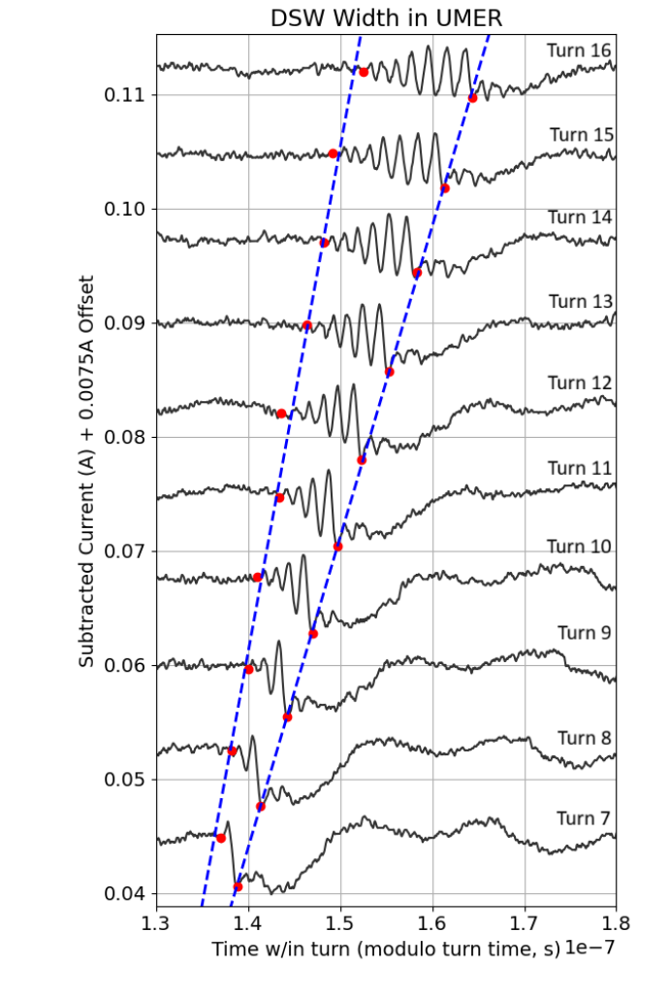

# 电子束负扰动如何形成扩展的色散激波列

> H. McCright、I. G. Abel、I. Haber、P. G. O’Shea、B. L. Beaudoin。[APS 接受稿记录](https://journals.aps.org/prab/accepted/10.1103/2hhy-jfcd)，2026-10-16 接受，[DOI](https://doi.org/10.1103/2hhy-jfcd)。实际阅读为 [arXiv:2510.19786v1](https://arxiv.org/abs/2510.19786v1)，2025-10-22 提交、首页署 2025-10-23，4 页。Crossref 给出 2026-10-16 出版日期，但本轮 APS 页面仍为 Accepted Paper；尚未验证 VOR，不能把本笔记称为正式版全文笔记。

## 摘要与研究问题

空间电荷主导的电子束可支持类似流体的纵向集体波。作者在 UMER 中施加局域速度扰动，观察到负密度扰动发展为领先大峰和尾随小振荡列，并用峰宽、幅值、速度与波列展开率检验色散激波解释。直接证据是电子束电流时间波形；WARP PIC 和 KdV 解用于机制支持。

前言将这项结果与此前正电流峰引发的孤子区分：孤子维持局域形状，色散激波则有越来越宽的振荡区。相同装置中的可控传播有利于观察长时演化，但尚不意味着高能激光束线中也已确认此过程。

## 理论：非线性陡化与色散正则化

在随背景传播的坐标中，密度扰动 u 满足 KdV 形式：

$$
\partial_tu+\alpha u\partial_zu+\beta\partial_z^3u=0.
$$

α 控制振幅依赖传播，β 表示色散。对行波令 ξ=z−vt 并在无穷远取零扰动，积分一次可得：

$$
\beta U''-vU+\frac{\alpha}{2}U^2=0.
$$

代入局域解可得到：

$$
U=A\,\operatorname{sech}^2(\xi/L),\qquad
v=\frac{\alpha A}{3},\qquad L^2=\frac{12\beta}{\alpha A}.
$$

这里 v 是相对背景的速度，L 是空间宽度，A 为扰动幅值，要求系数符号允许局域解。由此可知速度随幅值线性变化、宽平方与幅值成反比；转为墙电流监测器的时间宽度还需要束速映射。这个推导是对文中标度的补充说明，不是从原始实验数据重新拟合。

负扰动可形成扩展振荡区；论文用归一化 KdV 的前后缘速度差说明宽度与传播时间近似线性。其归一化边缘公式不能不经 α、β 与单位映射就套入实际 s、m/s 或电流值。

## 实验和 PIC 设置

UMER 周长 11.52 m，电子能量 10 keV。实验注入约 100 ns 矩形束团，用感应腔施加速度调制，在下游 7.67 m 的墙电流监测器逐圈记录。图示基准电流约 30 mA；背景扣除使用未主动施加扰动的束流，作者说明没有施加 Fourier 截止滤波。

WARP 模拟采用 1600 万宏粒子、1 ns 步长、64 径向与 2048 轴向单元，轴向周期、径向导体边界。模拟和实验是两个证据层次，数值图中逐圈电流人为加 0.0075 A 偏移便于观察；偏移并非束流每圈真实增流。

## Fig. 3：直接测得的是波列展开

原作者稿 PDF 第 3 页 Fig. 3。横轴为圈内时间、单位 s，显示缩放为 10⁻⁷；纵轴是扣背景电流（A）叠加每圈 0.0075 A 显示偏移；曲线从下到上为圈次增加。红点定义波列两端，蓝虚线为端点演化的线性拟合。领先端较快、尾端较慢，振荡区随圈次扩展；不能将叠放高度解读为实际电流增益。

作者将定量标度分析限于第 10–16 圈：更早尚未形成清晰波列，更晚束流损失和相空间稀释降低信噪比。领先峰满足孤子式标度；其 FWHM 是单个峰的宽度，与两端之间的总波列宽度不同。

## 拟合、文内标注差异与结论

Fig. 4 的实际图轴显示：(a) 速度与振幅的线性关系，约化 χ²=1.16；(b) 逆振幅与峰宽平方，约化 χ²=0.51；(c) 圈次与波列时间宽度，约化 χ²=0.297。图注却交换了 (a)/(b) 的说明，正文的对应也混杂，本笔记以图轴及图内拟合标签为准。小于 1 的约化 χ²支持数据与线性拟合相容，但不单独证明误差模型正确或机制唯一。

基准条件的波列时间宽度展开率为 (6.02±0.31)×10⁻³ s/s；较小扰动时为 (4.04±0.33)×10⁻³ s/s。它们是观测时间宽度相对传播时间的变化，不是以 m/s 表示的物理激波速度。论文称初始幅值比约 0.75，但两个展开率的中心比约 0.67；目前只能按有限测量的趋势一致讨论，不能宣传为高精度的通用比例律。

该实验为受控束流非线性波提供平台。向激光加速束输运迁移时，需要重新核对能量、空间电荷、发射度、束长和传播距离等相似参数；本文没有转换靶 γ 产额、中子产额或临床/屏蔽结果。本轮没有重放电流波形或运行 WARP/KdV。

## 版本关系与核验

APS 与 arXiv 标题和五位作者匹配，摘要物理场景相同，因此记录为一篇作品。harvest 官方全文端点 404，期刊 PDF 路径为代理 403/直连 404；已取得可匹配作者稿，所以不新增“全文缺失”重试条目，但保留正式版差异待核查。

[本地作者稿 PDF](../pdfs/McCright%20et%20al.%20-%202026%20-%20Electron%20beam%20dispersive%20shock%20waves.pdf)与[官方 PDF 来源](https://arxiv.org/pdf/2510.19786v1)已通过文件头、类型、哈希、pdfinfo、全页 pypdf 和布局文本检查，MinerU pipeline 成功；首页及关键图页已目视检查。[逐篇核验](../pdf_validation.json)；[原图出处](../research/figure-manifest.json)。
