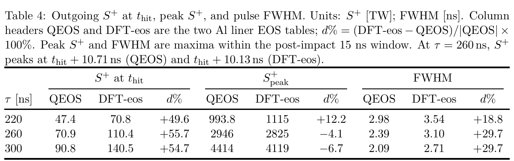

# 铝状态方程改变动态黑腔的碰撞路径与辐射时序

> Cong Wang、Zi Li、Weijie Li、Xianjue Peng，2026-10-15，[arXiv:2610.21107v1](https://arxiv.org/abs/2610.21107v1)，13 页官方作者预印本。本轮未找到匹配正式期刊版本。

## 摘要与第 I 节：不能只比较辐射峰值

作者构造宽范围铝 EOS，并在相同的一维圆柱辐射磁流体模型中与 QEOS 比较。撞击时间和峰值衬套动能相近，但膨胀密度、撞击接触态、撞击时出射辐射功率和脉宽较敏感。这是两套 EOS 的数值敏感性分析，不是对 50 MA 动态黑腔的新实验验收。

引言强调铝衬套从固态经历膨胀、熔化、汽化和碰撞升温。只在某一条高压 Hugoniot 上表现好的模型，不一定能正确描述这一长段低密度飞行路径。论文关注的对象因此包括轨迹和接触瞬间，而不止末态最大值。

## 第 II 节：宽范围 EOS 的组成

固体只保留 fcc 相，以 Vinet 冷曲线、Debye 离子热项和混合确定性—随机有限温 DFT（mDFT）电子项构造自由能。基准密度 2.70 g/cm³，凝聚能 −3.36 eV/atom；稀薄单原子蒸气设为能量零点。液体—等离子体分支以 QMD 约束冷/离子项，电子热项继续使用 mDFT，并用 Maxwell 共存条件连接相区。

$$
F(V,T)=F_c(V)+F_{\mathrm{ion}}(V,T)+F_e(V,T),\qquad
P=-\left(\frac{\partial F}{\partial V}\right)_T,\qquad
E=F-T\left(\frac{\partial F}{\partial T}\right)_V.
$$

F 是每原子自由能，V 为每原子体积，T 为温度；压力来自体积方向自由能斜率，内能由熵项回补。更换电子项会同时改变压力、内能与可压缩性，因此可能改变稀疏化、焦耳加热后的轨迹及撞击能量分配。论文也更换固体凝聚与相区处理，不能把全部差异归因于一个孤立的“电子壳层开关”。

Fig. 1 的熔化/Hugoniot 比较使用既有参考数据，不是本次新增实测。DFT-eos 与 QEOS 的差异还包含模型组成；这篇工作未给出能把 EOS、输运和维度误差全部分离的实验约束。

## 第 III 节：加载与观测量定义

模型采用一维 Lagrange 圆柱辐射 MHD、隐式流体、多群扩散输运和指定电流。峰值 50 MA，上升时间 220、260、300 ns；铝内半径 4 cm，线质量 20 mg/cm，100 个径向区；CH 泡沫外半径 0.5 cm，初始密度 0.015 g/cm³，120 区。电流波形为 sin⁴ 形状。

两组使用相同泡沫 QEOS、不透明度表及 Lee–More 电导，只变铝 EOS。因而这是固定输运条件下的受控比较；并没有同时验证这些固定输运模型。

内侧铝密度和电子温度是最内五分之一区域的质量加权平均；辐射温度和出射功率在泡沫外界面取值。碰撞后峰值统一在 15 ns 内找；FWHM 定义为该窗内首次与末次越过半高的时刻之差。热转换率是泡沫峰值热内能除以衬套峰值动能，排除了泡沫动能，不能当成辐射转换率。

## 第 IV 节：飞行、接触与辐射

三种上升时间的撞击时刻变化不超过约 0.3%，峰值衬套动能变化约 +3.1% 至 +4.0%。但在碰撞前 50 ns，Table 2 的 DFT-eos 衬套平均密度比 QEOS 高 48–65%。**分母需保持 QEOS：**讨论段写成“QEOS 低 48–65%”并不等价；本笔记采用表中明确定义，反向百分比约为低 32–39%。

接触瞬间差异也不能由事后峰值替代。260 ns 时内侧铝密度为 0.09149→0.155 g/cm³，电子温度 192.6→150.1 eV，外界面辐射温度 122.6→137.4 eV。峰值窗口中这些加权量的差距缩小，但局部网格温度峰值仍可不同；局部峰值和质量加权平均不是同一个统计量。

摘自 PDF 第 9 页 Table 4。行变量是电流上升时间 τ（ns），前三列比较撞击时外界面功率（TW），中三列比较 15 ns 内峰值（TW），后三列为脉宽（ns）；百分比均以 QEOS 为分母。本文部分曲线图在 PDF 渲染中缺少数字刻度或图例文字，所以不从这些图估数，保留可读原表作为定量依据。

260 ns 情形，撞击时功率 70.9→110.4 TW，增加 55.7%；峰值却从 2946 降至 2825 TW，减少 4.1%；FWHM 从 2.39 增至 3.10 ns，增加 29.7%。因此“EOS 使辐射提高约 50%”只适用于接触时刻，不能泛化为峰值或积分辐射能。220 ns 的峰值差为 +12.2%，也不能把三个工况一概写成几个百分点。

泡沫热化率的 QEOS 范围为 34.2–39.9%，DFT-eos 为 33.5–36.1%，并未统一提高。泡沫峰值动能约为其热内能的 97–120%，说明未计入热化率的整体运动仍很显著。

## 第 V–VI 节：机制解释与限制

相同物质状态下，电子自由能处理改变压力和内能；相区、凝聚和飞行稀疏化又改变接触速度与温密度。作者用辐射温度四次方解释接触时功率差的量级：

$$
\frac{S_2^+}{S_1^+}\approx\left(\frac{T_{r,2}}{T_{r,1}}\right)^4,\qquad
\left(\frac{137.4}{122.6}\right)^4-1\approx0.58.
$$

这里面积和辐射边界条件近似相同，温比无量纲；这个估算与表中约 56% 的量级相符。它是边界热辐射的机制解释，不等于完整多群输运可被黑体公式替代，也不推出总辐射能一定增大。

一维对称模型不能描述 MRT 不稳定性、三维混合、实际电流耦合与全部辐射逃逸几何。没有网格/时间步收敛序列和跨装置实测，不能把两 EOS 差值解释成已量化的实验误差棒。对激光结构靶的启示是按热力学路径选表、同时看时序与积分量；本文并非激光转换靶或光核源研究。

本轮未重跑 DFT、QMD 或辐射 MHD。[本地 PDF](../pdfs/Wang%20et%20al.%20-%202026%20-%20Aluminum%20EOS%20dynamic%20hohlraum%20sensitivity.pdf)与[官方全文](https://arxiv.org/pdf/2610.21107v1)已通过独立文件/文本核验，MinerU pipeline 成功；首页、关键图页和原表已目视对照。[逐篇检查](../pdf_validation.json)；[原表出处](../research/figure-manifest.json)。
