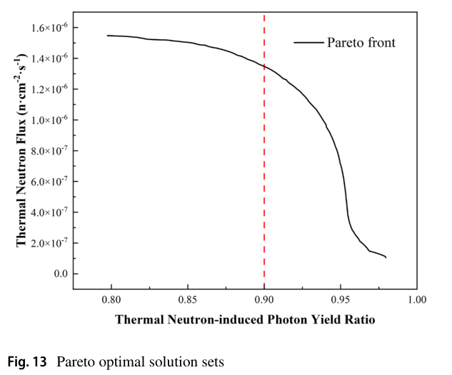

# 用自适应响应面减少中子慢化器—准直器的输运调用

> Chen-Xiao Yang、Si-Ze Chen、Lian-Xin Zhang、Chuan Peng、Dan Xiao，*Nuclear Science and Techniques* 37, 248，2026-10-16 在线发表，正式 VOR，13 页。[DOI](https://doi.org/10.1007/s41365-026-02068-0)。论文 2025-07-03 已接受；新近正式发表不表示实验刚完成。

## 摘要与引言：昂贵的是每次输运评价

HRG-MCO 把拉丁超立方采样（LHS）、多项式响应面（RSM）、遗传算法（GA）和 Geant4 中子输运连接起来。先用有限输运样本拟合代理，再在代理上搜索，最后把最优几何回送输运计算。本文提供数值设计与算法比较，没有建成慢化器的实验验收。

引言区分了两类成本：枚举直接调用大量 Monte Carlo；直接 GA 虽减少设计点，却仍可能反复进行昂贵输运。响应面能便宜求值，但其误差和未采样区域的行为决定搜索是否可信。本文的收益来自减少输运调用，而不是加速单条粒子历史。

## 第 2 节：方法与两参数检验

输运使用 Geant4，并借助 GAMOS 的几何重要性采样。LHS 采用 maximin 空间填充准则；随后拟合三阶至十阶多项式，以另一组 LHS 点的输运结果验证。未达阈值就补点、重拟合；达标后选误差最小的模型运行 GA，并重新计算选出的最优点。这里的“验证”是对同一个输运模型的交叉检验。

二次响应面的基本形式为：

$$
\widehat y(\mathbf x)=\beta_0+\sum_i\beta_i x_i+\sum_i\beta_{ii}x_i^2+\sum_{i<j}\beta_{ij}x_ix_j.
$$

其中编码变量 x 表示厚度或源能量，y 是探测位置的响应，β 是回归系数。常数、一次、平方和交叉项依次描述基线、斜率、曲率和变量耦合；本文实际还拟合更高阶项。它不是满足输运方程的物理闭合，高阶数也不能保证域外可靠。

模型误差按预测值与 MC 值之差除以 MC 值计算。二维、三维、四维问题的阈值分别放宽为 1%、3%、5%；这些是作者选择的代理精度门槛，不是 Monte Carlo 统计误差、制造误差或总体物理准确度。

两参数基准使用直径 40 cm 的 W 倍增层和聚乙烯层，厚度各在 1–20 cm 内变化；14 MeV 单能中子沿轴入射，在慢化层后 20 cm 的点探测器统计低于 0.5 eV 的响应。作者称其为慢化效率，不能直接当作全空间热中子数占源中子数的比例。

Table 1 中，0.1 cm 网格枚举需 40,000 次 MC 模型计算；HRG-MCO 三次试验需 50、60、60 次，最终响应相对枚举差 0.21%、0.27%、0.39%。等调用预算的直接 GA 误差 7.17%，增加到 157 次后为 0.50%。这是模型调用数比较；没有给出足以核实完整墙钟加速倍数的同硬件计时，也没有证明任意高维问题的全局最优。

## 第 3.1 节：源能量与层厚一起优化

应用模型增加侧向倍增层、石墨反射层、Cd 准直通道衬层和外侧 B₄C 屏蔽。源被简化为直径 20 mm 的平面源，靶室细节被省略，L/D=10；径向/轴向石墨厚度固定为 20/39 cm。前侧倍增层、侧层、聚乙烯层及 1–14 MeV 源能量构成四变量问题。

W 情形的八阶模型验证误差为 4.96%，满足设定的 5% 门槛；再按 0.5 MeV 间隔搜索各能量的层厚。最佳探测响应随能量呈宽 V 形：低能端所需慢化碰撞少，高能端倍增反应逐渐补偿漏失。侧层在倍增阈值以下也可能有益，因为重金属还能反射泄漏中子；前层较明显的收益多在倍增反应开启后出现。

W、Pb、贫化铀的比较是给定几何与源模型内的输运结果。贫化铀的裂变/倍增通道提高模型响应，不能据此宣布其为考虑全部工程、防护、活化和成本后的最佳材料。本文没有进行激光离子谱到产中子靶的上游耦合。

## 第 3.2 节：热中子数与转换屏光输出是两种目标

固定 14.1 MeV D–T 源后，作者把已有研究的 ⁶LiF/ZnS 屏光产额响应与中子能谱折叠，分成热、超热、共振、快中子四组。组平均权重分别为 368.29、35.69、1.43、0.56；这是特定屏响应的粗分组近似，不能移作其他闪烁体、剂量或屏蔽指标。

$$
R_\gamma=\frac{w_1\Phi_1}{\sum_{i=1}^{4}w_i\Phi_i}.
$$

Φ 是各组中子通量率，w 是该组每中子光产额权重。每组光输出与通量率乘响应成正比，将热组光输出除以四组之和即得该比值。它不是“γ 射线纯度”，也不是热中子通量份额。NSGA-II 同时最大化热通量和这个比值，三种厚度约束为 0–20 cm。

原文第 10 页 Fig. 13。横轴为热中子诱发的转换屏光产额占比，无量纲；纵轴为热中子通量，图标单位 n·cm⁻²·s⁻¹。曲线是代理模型优化前沿，没有实验误差条；给定源强的绝对归一化仍需随源模型核对。超过约 0.90 后，为进一步净化屏光信号需牺牲更大热通量。结论给出 90% 光份额附近约保留最大热通量的 85%，是该数值场景的权衡点。

回送 MC 的选点厚度为前层 3.8 cm、侧层 5.6 cm、聚乙烯 19.4 cm。Fig. 14 中热中子仅占总通量 8.2%，却贡献光输出 90.1%；非热中子对应 91.8% 和 9.9%。这正说明用粒子数份额替代响应折叠会导致错误判断。

## 结论、应用价值与接续

可复用的是“采样—代理验证—优化—输运回算”的工作流，以及把源强、能谱和探测器响应分开定义。迁移到激光驱动宽能谱源时，需要重新输入角能分布、时间结构和源归一化，并补充统计误差、核数据/物理列表敏感性与独立实测。作者也承认高阶多项式在稀疏区域的局限和 GA 局部最优风险。

本轮未运行 Geant4、GAMOS、GA 或 NSGA-II。已验证[本地正式 PDF](../pdfs/Yang%20et%20al.%20-%202026%20-%20Adaptive%20neutron%20moderator%20collimator%20optimization.pdf)及[官方 PDF 来源](https://link.springer.com/content/pdf/10.1007/s41365-026-02068-0.pdf)。MinerU pipeline 返回 `parsing failed, please try again later`，笔记使用已验证的本地布局文本、全页可读性检查与首页/原图目视回退；这不影响 PDF 已取得的事实。[逐篇检查](../pdf_validation.json)；[原图出处](../research/figure-manifest.json)。
