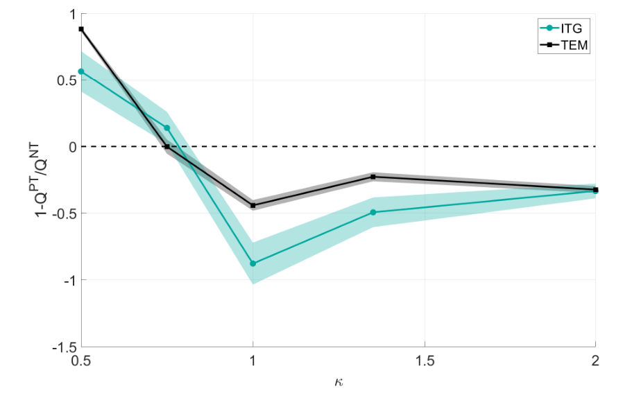
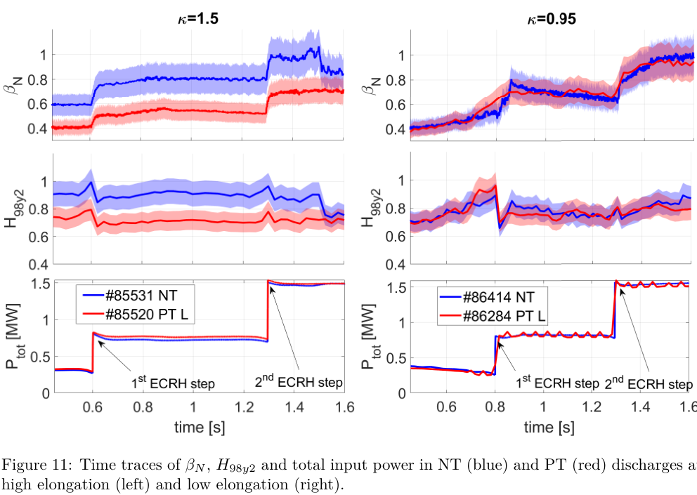
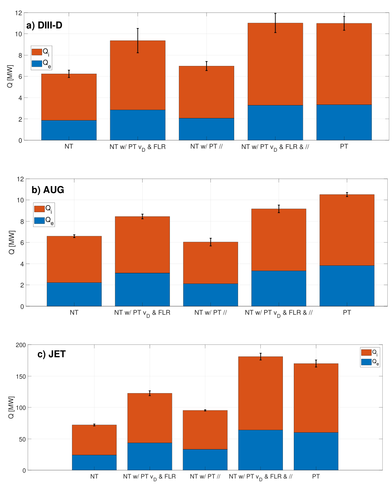

# 负三角形的收益何时消失：几何代理、TCV 实验与多装置 GENE 对照

> Alessandro Balestri、Justin Ball、Stefano Coda 等及 TCV 团队，arXiv:[2610.17974v1](https://arxiv.org/abs/2610.17974v1)，2026-10-13 提交，28 页作者预印本。PDF 首页仍为 IOP 投稿模板，不能称为已核实期刊 VOR；精确标题 Crossref 前三结果未找到同篇正式版本。

## 一句话结论与证据分层

TCV 配对放电中，LCFS 拉长比约 1.5 时负三角形（NT）的 βN、H98y2 约为正三角形（PT）的 1.5 倍，而约 0.95 时差异不明显；局域 GENE 模拟进一步预测更低拉长比可使 NT 劣于 PT。DIII-D、AUG、JET 的 1.8、1.6、2.1 倍热通量差别是固定剖面的模拟比较，不能写成三台装置均直接测得的实验增益。

## 1. 物理问题：三角形参数不足以解释完整几何

引言指出 NT 有望保持类似 H-mode 的约束并避免台基与 ELM，但收益取决于拉长比、磁剪切、三角形剪切和形状上下不对称。只按三角形正负分类，会把局部磁几何的重要差别压缩掉。

第 2 节用三个从磁平衡直接计算的代理量：极向平均的双法向磁漂移 ⟨vDy⟩、其极向变化 ⟨|dvDy/dz|⟩，以及反映有限 Larmor 半径效应的 ⟨gyy⟩。这里的“代理”是有物理解释的几何指标，并非训练得到的机器学习网络。定义为带 Jacobian 权重的有限角域平均：

$$
\langle A\rangle=
\frac{\int_{-1}^{1} A(z)J(z)\,dz}{\int_{-1}^{1}J(z)\,dz}.
$$

z 是 GENE 的直磁力线极向角，积分范围为外中平面附近 ±1 rad，并非完整 2π 平均。该范围是作者为捕捉 ballooning 模结构选取的近似。

漂移更快且沿极向变化更强，可让粒子与波的共振耦合减弱；更强 FLR 对应更大的 k⊥ρ，回旋平均 J₀(k⊥ρ) 抑制小尺度扰动。在常见 kx≈0 模中，k⊥²≈gyy ky²，因此 gyy 可作简单指示。它们指示趋势，不是保证所有工况准确的热输运闭合。

GENE 采用五维 Eulerian 回旋动理学、局域 flux-tube、碰撞及动理学电子；对称平衡用 Miller 模型，上下不对称平衡用 Fourier 形式。局域近似要求湍流径向尺度远小于平衡变化尺度，不能自动延伸到 LCFS 附近。

## 2. 图 6：拉长比扫描中的数值反转

原文第 10 页 Fig. 6。横轴局部拉长比 κ；纵轴为 **1−QPT/QNT**，无量纲，正值意味着 NT 热通量更大、表现更差，负值意味着 NT 较好。黑线为 TEM、青线为 ITG。必须保留该分母与符号，不能读成 1−QNT/QPT。

模型从 TCV #68145 的 ρtor=0.8 面出发，翻转三角形及其剪切、人工改变拉长比和剪切，保持相应剖面梯度。κ≈0.5 时 NT 更差；κ≈0.75 附近过渡；κ≈1 附近优势最明显，随后有所减弱。图带阴影，但相关正文未明确把它定义成标准误差，不能据阴影反推置信度。线性增长率和准线性权重只提供机制线索，非线性饱和热通量才是这项比较的主要结果。

线性分辨率为 (nx,nz,nv,nμ)=(48,48,40,12)；该段非线性箱宽约 Lx=180ρi、Ly=250ρi，256 个 kx、48 个 ky 模及 48 个平行点，nv=42、nμ=12。作者称做过分辨率检验，本轮没有重跑。数值中 κ 是局部磁面参数，实验中的 κLCFS 是最外闭合磁面值，两者不能逐数相等比较。

## 3. 图 11：TCV 的直接实验支持及未达到的区域

原文第 13 页 Fig. 11。左右列分别是 κLCFS≈1.5、0.95；每列纵轴依次为 βN、H98y2（无量纲）和 Ptot（MW），横轴时间 s。蓝为 NT、红为 PT；总功率含 Ohmic 和 ECRH，不能把约 1.5 MW 平台直接称为 1.5 MW ECRH。

高拉长比用 #85531/#85520，低拉长比用 #86414/#86284。ECRH 分为 0.5、1 MW 两级，NT/PT 在给定拉长比下保持相近输入功率及相同供气条件，让密度、温度剖面自由演化；TS 和 CXRS 提供密度/温度信息，TORAY 用于吸收检查。高拉长比的 βN 与 H98y2 约高 1.5 倍，低拉长比两条曲线接近。βN 是归一化压力指标、H98y2 是相对于经验约束标度的因子，这两个“1.5 倍”都不是聚变功率或 Q 值。

约 1.5 s 后高拉长比 NT 性能下降，作者归因为 NTM，最终引发快速 VDE/破裂；不能截取较好平台便宣称全时段稳定运行。第 14 页压力及温度剖面表明，高拉长比改善主要伴随离子温度与密度提高。

实验为内壁限制放电，尚无匹配的偏滤器扫描。更小 κ 的放电难以稳定控制，因此 **κ≲0.75 时 NT 反而更差目前是模拟预测**；实验只支持从 1.5 到 0.95 时优势减弱，未直接观测到预测的反转。

## 4. 图 23：多装置系数交换只在模型中隔离机制

原文第 23 页 Fig. 23。三排为 DIII-D、AUG、JET，横轴比较原 NT、将 PT 的漂移/FLR 项置入 NT、只替换平行动力学、全替换与 PT；纵轴热通量 Q（MW），蓝/橙为电子/离子静电分量。JET 的纵轴范围远大于另外两台，不能据柱高比较装置效率。误差条由原作者绘制，其统计定义在相关段落未充分交代。

第 22 页报告总热通量 QPT/QNT 约为 1.8、1.6、2.1。替换漂移和 FLR 的作用通常强于只替换平行动力学，全替换可接近 PT，支持作者的机制解释；这是人为修改系数的数值实验，不是可直接实现的磁平衡控制动作。图显示静电分量，本文沿用正文的约数，不从柱图重新推导精确倍数。

DIII-D 参考 #171421（2.8 s）并构造人工 PT；AUG 用 NT #43493 的剖面与 PT #36157 的形状对照，q 和磁剪切也不同；JET #105835 的 PT 则由翻转并对称化边界构造。作者明确说 AUG/JET 缺乏匹配 PT 实验，因而不能写成三装置配对实测。

JET 基准不含杂质，模拟热通量高于实验估计；加入 Be 的额外计算可降低到可比范围，但多组分敏感性不在本研究主范围。模型尚未在接近 LCFS 的区域验证，也不能据代理在该区域的翻转解释全部装置性能。

## 5. 价值、限制与接续

本文提供“几何指标预判—线性/非线性验证—可实现实验—系数交换”的证据链，可用于筛选磁平衡和构建有物理解释的低成本特征。它未取代非线性输运计算，也未提供通用反应堆优化保证。下一步应扩展稳定低 κ/偏滤器工况、杂质/全局效应，并报告代理对不同湍流类型的失败条件及不确定性。

本轮未运行 GENE、TORAY、平衡重构或放电数据拟合。[本地 PDF](../pdfs/Balestri%20et%20al.%20-%202026%20-%20Geometric%20proxies%20for%20negative%20triangularity.pdf)及[官方 v1 PDF](https://arxiv.org/pdf/2610.17974v1)通过文件头、类型、哈希、28 页一致和全页文本检查；MinerU pipeline 成功并与原 PDF 比较，目视核查第 1、10、13、23 页。[逐篇检查](../pdf_validation.json)；[原图出处](../research/figure-manifest.json)。
