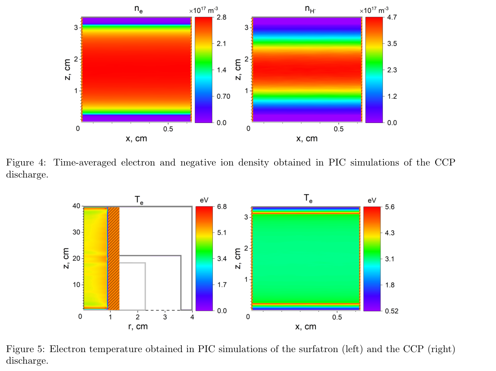

# 隐式守恒 PIC 中的负氢离子：冷体电子与高能尾要同时保留

> Denis Eremin，arXiv:[2610.16257v1](https://arxiv.org/abs/2610.16257v1)，2026-10-12 提交，10 页作者预印本。精确标题的 Crossref 前三结果未找到对应正式版本；这不是不存在期刊版的证明。

## 一句话结论与方法范围

ECCOPIC 隐式能量/电荷守恒 PIC–MCC 模拟预测：5 Pa 氢气中，surfatron 的负离子峰密度约为电子峰密度的 23%，CCP 体区的负离子密度可接近电子的两倍；关键在于较冷体电子减少解附着，同时高能尾继续激发分子振动。这里比较的是放电内局域密度，未测提取束流、电流、亮度或能效。

## 1. 为什么使用隐式 PIC

引言讨论高密度、低压、非局域放电：传统显式动量守恒 PIC 的 Debye 长度/等离子体周期约束很昂贵，随意缩放密度或质量又可能改变碰撞反应和不稳定性。

本文采用 ECCOPIC 系列：使用相容的电流沉积和场插值，逐次记录宏粒子跨格以保持电荷连续性；Crank–Nicolson 隐式推进耦合当前时间步内粒子与场。能量守恒算法的有限网格稳定性仍有平均漂移速度相对热速度等条件，不能写成任何粗网格都准确。隐式稳定也不取消轨道精度、迭代收敛和物理时间尺度要求。本文未给出足以核实整体加速倍数的显式/隐式同输入计时基准。

## 2. 两种几何与化学闭合

surfatron 使用二维轴对称电磁 Maxwell 模型，微波从同轴端口进入，在石英管附近转换为表面波；边界允许未吸收波离开。CCP 使用二维笛卡尔静电模型，另一方向平移不变，上下电极施加正弦驱动和接地，侧边为介电壁。两者不是同一个几何或相同输入功率下的单变量实验。

两种计算均取氢气 300 K、5 Pa。surfatron 为 2.45 GHz、吸收功率目标 4 kW；CCP 为 200 MHz、电压幅值 1.5 kV。surfatron 管半径约 9 mm，CCP 介电壁间宽度约 6.25 mm。

负离子主要通过振动激发氢分子的解离附着产生：

$$
e+\mathrm H_2(v)\rightarrow \mathrm H^-+\mathrm H.
$$

Table 3 给出两类振动激发、解离附着，以及电子解附着 e+H⁻→2e+H 和结合解附着 H+H⁻→e+H₂。电子解附着阈值 1.55 eV、截面在约 17.8 eV 达峰；维持约 20 eV 以上尾部又可支持经高电子态的振动激发。故只用一个平均温度替代 EEDF 会丢掉生成和损失分别受不同能区控制的事实。

振动态布居采用 reduced linear model（RLM），并非全部逐振动态的自洽粒子求解。RLM 假设电子激发与壁面退激平衡，从高态 v′ 到低态 v 的重布居概率约为 1/v′，忽略可能的流出损失。作者用约 3 mm 的分子平均自由程与毫米量级装置尺度接近来解释该近似；壁面反射/退激和气体更新仍是迁移到别的装置时的重要敏感项。

## 3. 图 3—5：比较的是局域密度和温度

第 6 页 Fig. 3 显示 surfatron 的电子与负离子密度沿径向、轴向明显不均匀。电子峰约 4×10¹⁸ m⁻³，负离子峰约 9.4×10¹⁷ m⁻³，对应约 23%；两幅色标倍率分别为 10¹⁸ 和 10¹⁷，不能只比较颜色。这里是峰值之比，不是体积分数、全装置电负性或出束效率。

原文第 7 页 Figs. 4、5。上排为 CCP 的时间平均 ne 与 nH⁻，横轴 x（cm）、纵轴 z（cm），两幅色标单位均为 10¹⁷ m⁻³，但上限分别约 2.8 和 4.7。体区负离子多于电子，靠近电极的鞘层附近则电子占优；同色不能表示同密度。

下排为 surfatron（左，r–z）与 CCP（右，x–z）的 Te，坐标 cm、色标 eV，两个几何尺度和色标范围都不同。作者从体区得到约 5 eV 与 3 eV 的差别。CCP 由鞘边产生高能电子并输送进体区，体区多数电子可保持较冷；这削弱 H⁻ 的电子解附着，而高能尾仍驱动振动激发，形成较高负离子密度。以上是模型对图的机制解释，没有误差条或新测得的 H⁻ 诊断数据来独立闭合。

## 4. 结论与适用边界

工作有助于离子源设计者把 EEDF、壁面分子振动闭合和负离子损失联系起来，也提供守恒 PIC 在碰撞放电中的应用实例。局域 nH⁻/ne≈2 不表示等离子体失去准中性：准中性体区应由正离子补偿电子和负离子的总负电荷。

本文未提供提取电极、束流输运、中性化、束流相空间或同等驱动成本下的优化，因此不能据此宣布 CCP 整体优于 surfatron，更不能换算为激光加速离子或核反应产额。后续应做网格/时间步/每格粒子数扫描、反应截面及 RLM 壁参数敏感性，再与绝对密度、EEDF 和提取电流诊断比较。本轮没有运行 ECCOPIC、MCC 或化学反应求解器。

## 全文核验

[本地 PDF](../pdfs/Eremin%20-%202026%20-%20Implicit%20PIC%20hydrogen%20negative%20ions.pdf)；[官方 v1 PDF](https://arxiv.org/pdf/2610.16257v1)。文件头、类型、哈希、10 页 pdfinfo/pypdf 一致、全页正文及布局文本通过；MinerU 显式 pipeline 得到匹配正文，结合第 1、6、7 页目视核查，公式以原 PDF 为准。[逐篇检查](../pdf_validation.json)；[原图出处](../research/figure-manifest.json)。
