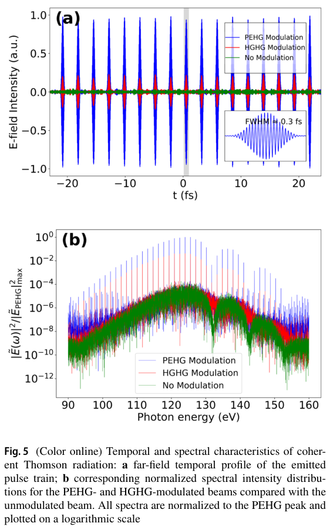
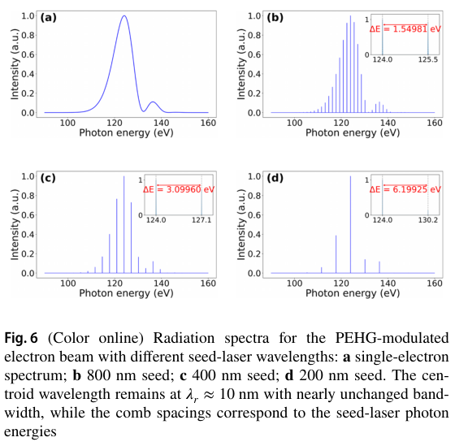

# 密度调制电子束的相干 Thomson 频梳：齿距可锁定，绝对频率仍受束流影响

> Zhen-Hong Wang、Si Chen、Hai-Xiao Deng，*Nuclear Science and Techniques* 37, 250，2026-10-16 在线发表，正式 VOR，11 页。[DOI](https://doi.org/10.1007/s41365-026-02075-1)。2026-04-24 接受；正式发表日期不能当作新实验日期。

## 一句话结论与证据类型

解析推导和经典逐电子轨迹/辐射场计算表明，周期性微聚束电子与长波驱动场迎头相遇，可在约 124 eV 形成由调制种子锁定齿距的 EUV 频梳；约 0.3 fs 脉冲列依赖理想微聚束和极低发射度。本文没有源实验、PIC 自洽等离子体计算或光核/中子产额测量。

## 1. 从单电子辐射到周期束片干涉

引言将频梳的光学腔限制与短波辐射需求联系起来。方案先用 PEHG（相位合并增强谐波产生）将电子束纵向压成周期束片，再让束片与毫米波长激光对撞。HGHG 作为较弱聚束的对照。PEHG 的 dogleg 色散和横向梯度波荡器帮助合并相位，但并不意味着任意真实加速器束流已具备所需微结构。

第 2 节把相邻束片当作相同辐射波形的时间平移：

$$
\Delta T=\frac{\lambda_{\rm seed}}{c(1+\beta)}(1+\cos\theta),\qquad
\widetilde E_N(\omega)=\widetilde E_1(\omega)
\sum_{n=0}^{N-1}e^{-in\omega\Delta T}.
$$

这里 θ 为观察方向与电子轴夹角，βc 为电子速度，N 为束片数。有限等比级数给出干涉因子

$$
\frac{|\widetilde E_N|^2}{|\widetilde E_1|^2}
=\frac{\sin^2(N\omega\Delta T/2)}{\sin^2(\omega\Delta T/2)}.
$$

轴上且 β≈1 时，ΔT≈λseed/c，所以谱齿间距 Δω≈ωseed。束片内部还要求纵向尺寸小于辐射波长，电子才可近似同相辐射；单片内理想强度随电子数平方增长。实际束片数不相等会改变包络，周期位置关系决定齿距。

这与仓库已有的 [Zhang 等硬 X 射线频梳](../../2026-10-16/notes/Zhang%20et%20al.%20-%202026%20-%20Programmable%20hard%20X%20ray%20spectral%20comb.md)是不同物理场景：已有方案利用激光子脉冲列产生单电子波包干涉，并在不同电子之间非相干求和；本篇依赖电子束密度微聚束和跨电子相干增强，不能混用其束长条件或光子产额。

## 2. 设计点与数值方法

第 3 节用四阶 Runge–Kutta 积分约化 Hamilton 方程，再按 Heaviside–Feynman 场公式在远场叠加。驱动场横向按平面波处理、时间为 Gaussian 包络；量子反冲很小，采用经典 Thomson 近似，未计入强场 QED 反冲。

电子能量 100 MeV、rms 能散 50 keV、束长 0.2 ps；驱动波长 **1.42 mm**、rms 空间长度 6 mm、a₀=0.5。调制种子为 800、400、200 nm，并假定在 10 nm 处聚束因子均大于 0.05。原文归一化发射度为 **0.5×10⁻¹⁰ mm·mrad**，是极端理想输入，已直接核对第 7 页，不能按常规实验束流参数引用。文中后续明确承认真实发射度高数个数量级。

## 3. 图 5：场脉冲列与相对谱强

原文第 7 页 Fig. 5。上图横轴 t（fs），纵轴电场任意单位，并非强度；插图的约 0.3 fs 是作者给出的单微脉冲 FWHM，不能由主图的正负电场峰直接当作能量。PEHG 蓝线形成明显周期波列，HGHG 和未调制束弱得多。

下图横轴光子能量 eV，纵轴为谱场模平方相对 PEHG 峰值的归一化量，采用对数尺度。PEHG 的窄齿显著高于未调制背景，显示微结构带来的相干选择。图未给出实际总电荷、探测器响应和绝对光子数归一化，因此这些峰高不能换算成转换效率、亮度或可用光子通量。

## 4. 图 6：种子控制齿距，散射包络控制覆盖

原文第 7 页 Fig. 6。(a) 是单电子谱；(b–d) 分别对应 800、400、200 nm 种子。横轴光子能量 eV，纵轴任意单位谱强，各面板不能据峰高比较绝对光子数。种子越短，齿距由约 1.55 增至 3.10、6.20 eV，而中心仍约 124 eV（约 10 nm）；约 136 eV 的蓝侧寄生结构与驱动包络的非线性散射有关。

文中用 Ncomb≈Δωr/ωseed 估算 FWHM 内的有效齿数为 7.63、3.82、1.91，是包络尺度估计，不能当作整数实测谱线计数。展宽单电子包络或使用更长波长种子可增加可容纳的谱齿。

第 4 节把中心近似写为 ωcenter≈4γ²ω₀/(1+a₀²/2)。种子主要固定齿距；电子能量、片内能散和驱动强度仍会引起包络漂移、展宽和齿位置变化。因此“锁齿距”不等于获得经实测标定的绝对频率稳定度。

## 5. 应用价值、限制与接续

可复用的是把微聚束相位、单电子包络和整个束流的远场叠加分开审查。真正接入 LWFA/常规电子源时，需要真实纵向相空间、发射度、角度接受度、有限焦斑、空间电荷、时序抖动及完整误差传播。本文将工程容差留待未来，没有证明既有 LWFA 束流能直接实现这一理想设计，也未讨论转换靶、伽马或中子链路。

作者给出[数据入口](https://doi.org/10.57760/sciencedb.j00186.01076)，本轮未下载复算该数据，未运行作者轨迹或辐射程序。

## 全文核验

[本地正式 PDF](../pdfs/Wang%20et%20al.%20-%202026%20-%20Mode%20locked%20coherent%20Thomson%20radiation.pdf)及[官方 PDF 来源](https://link.springer.com/content/pdf/10.1007/s41365-026-02075-1.pdf)已经通过头部、类型、SHA-256、pdfinfo/pypdf 页数和全页文本检查。MinerU pipeline 返回 `parsing failed, please try again later`，使用本地布局文本和第 1、7、8 页目视回退；未把解析失败写成全文缺失。[逐篇检查](../pdf_validation.json)；[原图裁框与哈希](../research/figure-manifest.json)。
