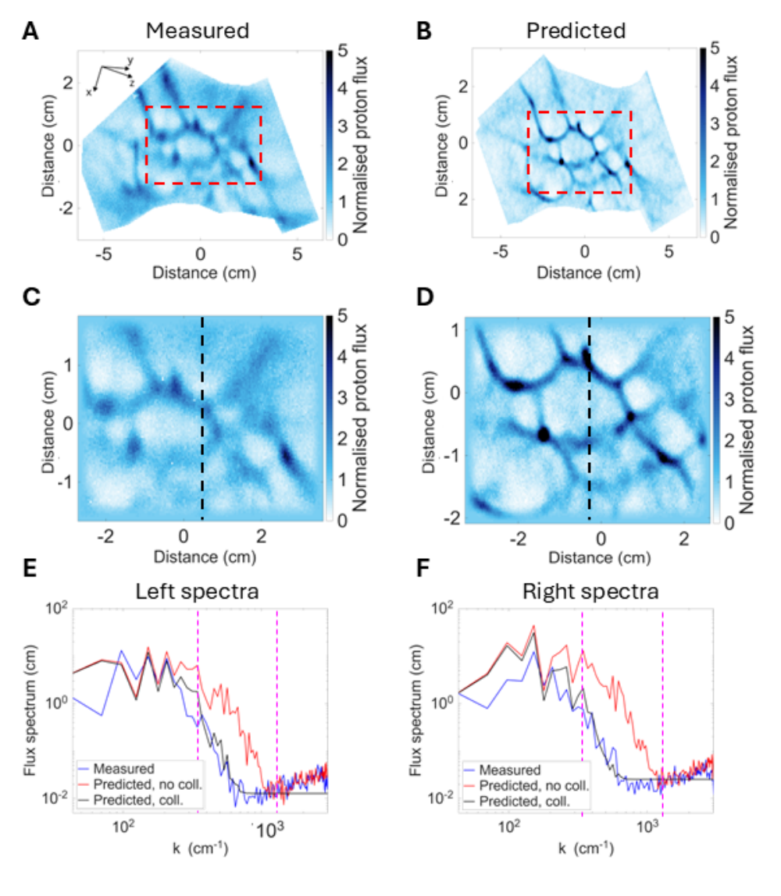
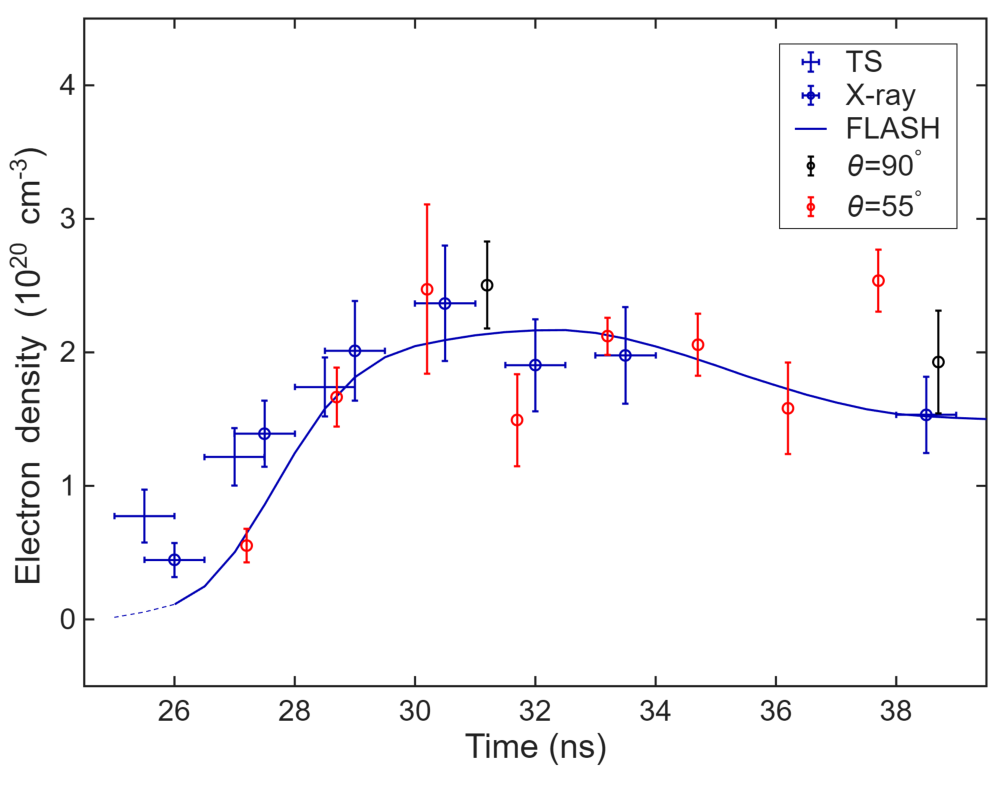

# 用质子照相同时反演低密度激光等离子体的电子密度与电磁场

## 0. 论文信息与证据边界

- **原题**：Measuring electron density and electromagnetic fields in low-density laser-driven plasmas using proton radiography
- **作者**：Joshua Ting Yu Chu、Gianluca Gregori、Archie F. A. Bott、Petros Tzeferacos；Oxford / Rochester。
- **版本**：[arXiv:2610.22605v1](https://arxiv.org/abs/2610.22605v1)，页面侧栏标注 2026-10-15，PDF 正文首页日期为 2026-10-19。当前以官方作者预印本收录；本轮正式版检索未确认同题期刊版本，不把 arXiv DOI 当作期刊发表证明。
- **全文**：[本地 PDF，12 页](../pdfs/Chu%20et%20al.%20-%202026%20-%20Proton%20radiography%20electron%20density.pdf)；[PDF 验收记录](../pdf_validation.json)。PDF SHA-256：`e7e533d453e44c92afb17349e2ce1e2f989f197064344675f3bb5da4f2a0e981`。
- **阅读方法**：MinerU `pipeline` 全文转换成功后通读正文、图注和数据声明，并以本地布局文本交叉核对公式、指数及参数；目视核对 PDF 第 1、3、7、8、9、10 页及下方两张原图裁剪。提取稿有指数和图注错误，以下以 PDF 为准。第 11–12 页为参考文献，正文至第 10 页。
- **类型**：诊断理论 + 测试粒子合成诊断 + OMEGA 既有实验数据重分析 + FLASH MHD 辅助校正；不是 PIC 模拟论文，也不是新建激光质子源或新型转换靶实验。
- **去重辨识**：本文研究随机场中焦散的碰撞展宽，不是已收录的 arXiv:2607.06946 线圈磁场论文。

**核心结论**：低能质子图像中的磁焦散提供尖锐的空间结构；碰撞散射抹去其中的高波数功率。用无焦散的高能质子图像重建同一磁场，预测低能质子的未碰撞展宽图像，再拟合两者的谱差，可以反演一个与路径电子密度相关的散射量。作者在 OMEGA 湍流发电机数据上得到约 10²⁰ cm⁻³ 量级的密度，与其他诊断和模拟大致相容。**直接测量的是质子通量图；密度、磁场和路径内外贡献均经过模型反演，且不同诊断的视线、时窗和权重并不完全一致。**

## 1. 摘要

摘要先把问题设为“在已有质子电磁场诊断上增加密度信息”。当磁场梯度使质子轨迹交叉时，探测器上出现窄而强的焦散（caustics）；质子在等离子体内的多次小角库仑散射使这些结构展宽。散射率含有电子与离子的密度，因此展宽不只是需要消除的分辨率损失，也能成为密度信号。

摘要的验证对象是 OMEGA 湍流发电机实验，密度约 10²⁰ cm⁻³；比较对象为 Thomson 散射、自发射 X 射线与 FLASH 模拟。所谓“同时测场和密度”指同一组多能质子数据、同一视线可承载两类反演信息，不表示电场与磁场全部分量、局域三维密度都被唯一重建，也不表示所有比较诊断在同一发次同步工作。

## 2. I. Introduction：为什么从焦散中找密度

**第 1 段：实验诊断的空间时间困难。** 激光与脉冲功率装置能产生大于 1 Mbar、温度大于 10 eV 的高能量密度等离子体；亚微秒、亚立方厘米的演化使基本参量测量困难。背景包括 ICF 和实验室天体物理，并非只针对聚变压缩芯。

**第 2 段：补充既有密度诊断。** 作者主要关心 10¹⁸–10²¹ cm⁻³ 区间，通常可用 Thomson 散射或干涉。探针加热、条纹跳变、机械振动、几何遮挡或设备不可用，都可能使单一诊断失效；因此新方法的价值是增加独立约束。论文举出的诊断适用范围是背景概述，不能据此认定任意该区间实验都适用本文算法。

**第 3 段：质子照相与反演歧义。** 高能质子经 Lorentz 力偏转后形成非均匀通量图。场可通过前向传播或解析/数值反演求取；当轨迹交叉形成焦散时，图像与场不再一一对应。本文专注随机磁场情形，不能把焦散轮廓直接认作磁力线或局域密度边界。

**第 4 段：与以往质子密度诊断的区别。** 作者回顾 ICF、冲击压缩中利用质子能损或密度梯度的工作，典型密度大于约 10²² cm⁻³；这些工作往往需辨别电场、核散射和库仑散射。本研究改为利用较低密度下的焦散碰撞展宽，并与磁场诊断共用图像。

**第 5–6 段：贡献及文章安排。** 工作继承 Bott 等此前关于质子碰撞散射与面密度的想法，将其发展成双能图像和谱截断的具体流程。论文按随机场重建、焦散识别、碰撞理论、谱模型、实验限制、合成验证和 OMEGA 重分析展开；以下保持这一顺序。

## 3. II. Theory：反演链条与假设

### 3.1 II A. 随机场重建

**几何映射。** 作者采用多 MeV 质子、磁偏转占主导、近轴和点投影近似：等离子体横向尺寸远小于源到等离子体距离，纵向厚度远小于等离子体到探测器距离。质子初始横向位置经几何放大，再叠加偏转后自由漂移的横向位移：

$$
\mathbf{x}_{\perp}^{(s)}(\mathbf{x}_{\perp0})
\simeq \mathcal M\mathbf{x}_{\perp0}
+\frac{r_s}{v_0}\mathbf w(\mathbf{x}_{\perp0}),
\qquad \mathcal M\simeq\frac{r_i+r_s}{r_i}.
\tag{原文 1}
$$

这里 rᵢ、rₛ 分别为源到等离子体、等离子体到探测器距离，v₀ 为质子速度，w 为横向速度增量。推导只需把通过等离子体后的漂移时间近似为 rₛ/v₀，再乘以横向速度；在磁偏转近似下，w 与沿轨迹积分的横向磁场有关。因此反演首先得到路径积分场，而非单个深度切片。

**通量守恒与焦散来源。** 一小束质子的数目在映射前后守恒；初始面积经映射 Jacobian 放大或压缩。一个探测器位置可能对应多条初始轨迹，故必须把所有分支相加：

$$
\Psi(\mathbf x_{\perp}^{(s)})
=\sum_{\text{preimages}}
\frac{\Psi_0}
{\left|\det\left[\nabla_{\perp0}
\mathbf x_{\perp}^{(s)}(\mathbf x_{\perp0})\right]\right|}.
\tag{原文 2}
$$

当 Jacobian 接近零时，有限初始面积被压成很小的成像面积，理想几何通量上升；轨迹交叉后，唯一场反演失效。这说明“亮且窄”首先是轨迹聚焦的几何结果，不能直接解释成高密度。

**对比参数。** 典型偏转位移与放大后的磁场相干尺度之比定义成：

$$
\mu\equiv\frac{r_s\delta\theta}{\mathcal M\ell_B},
\qquad
\delta\theta_{\rm rms}
=\frac{eB_{\rm rms}}{m_pc v_0}\sqrt{\ell_z\ell_B}.
\tag{原文 3–4，Gaussian 单位制}
$$

磁偏转角是横向速度变化除以纵向速度；一般随机场偏转方差来自沿路径两点磁场相关函数的积分，相干长度决定这些增量如何相加。μ 小时成像弱调制，μ 达到约为 1 的临界量级后可出现焦散。**原文式 (4) 前把适用条件写作纵向长度远小于相干长度；本轮未从其引用的重建理论文献独立复核这一条件与相干长度定义及近似分支，故照录定义，不自行反转不等号，也不用常见长路径随机游走直觉替代作者的完整推导。** 非相对论能量下，由所列公式得到 μ 随质子能量的负二分之一次方变化；若使用能量标度，应以公式换算，不把原文“反比于初始能量”的概述直接当作反一次方。

### 3.2 II B. 焦散识别：双能互相预测

**第 1 段：为什么低能场值会偏低。** 当 μ 超过临界值，图像映射多值化，不同场可以给出同一通量图。作者引用的重建理论指出，重建偏转场 RMS 为真实偏转 RMS 的下界；因此有焦散时，PROBLEM 等单值重建会低估磁场强度。图像中结构的位置、强度、形貌不再直接对应产生它们的场结构。

**第 2 段：判据不是“看上去模糊”。** 先确认高能质子处于线性/非线性但仍单值的成像区间，再用其重建场前向传播低能质子；如果低能图像的主要形貌能预测，而反过来用低能重建场预测高能图像失败，就支持低能图像有焦散。D–³He 胶囊产生 3.3、15.0 MeV 两能组；源距 1 cm 时到达等离子体的时间差约 200 ps，小于该长脉冲实验约 ns 的动力学时标。这个“近似看见同一场”的条件在更快演化的系统里必须重新核对。

### 3.3 II C. 碰撞散射：从角扩散到密度

**随机游走方差。** 大量、弱耦合、小角碰撞使横向速度增量累积。以质子对各离子组分和电子的横向扩散率求和，得到：

$$
\frac{d\langle\Delta v_\perp^2\rangle}{dt}
=\left(\sum_s\nu_\perp^{p|i_s}+\nu_\perp^{p|e}\right)v(t)^2.
\tag{原文 5}
$$

这里扩散率单位为 s⁻¹。作者采用快测试粒子极限，质子能量用 eV、粒子数密度用 cm⁻³，库仑对数记作 λ：

$$
\nu_\perp^{p|i_s}
=1.8\times10^{-7}\epsilon_p^{-3/2}
\langle Z_{i_s}\rangle^2n_{i_s}\lambda_{p|i_s},
\qquad
\nu_\perp^{p|e}
=1.8\times10^{-7}\epsilon_p^{-3/2}n_e\lambda_{p|e}.
\tag{原文 6–7}
$$

系数依赖这些指定单位，不应在 SI 密度与 MeV 能量下原样代入。离子贡献受电荷平方加权；测得电子密度仍需组分、电离度和电荷中性关系，并非只数“质子碰到了多少电子”。温度通过库仑对数、离化状态及快粒子近似进入；公式未显含温度幂次不等于温度完全无关。

**积分推导。** 若能损足够弱，令速度近似不变，把交互时间写成路径长度除以速度；将上式沿程积分，再除以初速平方，得到角方差：

$$
\langle\Delta v_\perp^2\rangle
\simeq\nu_\perp\ell_n v_0,
\qquad
\Delta\theta_C^2
\simeq\frac{\nu_\perp\ell_n}{v_0},
\qquad
\nu_\perp\equiv\sum_s\nu_\perp^{p|i_s}+\nu_\perp^{p|e}.
\tag{原文 8–9}
$$

直觉是：密度增加或路径变长都会增加独立散射次数，因而角宽按次数平方根增长。对非均匀路径，更合适的解释是积分散射权重：

$$
\Delta\theta_C^2\simeq
\int_{\rm path}\frac{\nu_\perp(s)}{v(s)}\,ds.
\tag{由原文 5 的路径积分解释}
$$

此式是对方法的推导说明，不是作者新增测量。它揭示可辨识对象首先是带组分、温度、电离和能量权重的柱量；只有权重近似固定且路径长度已知时，才能把它解释成简单路径平均电子密度。

### 3.4 II D. 焦散功率谱：从高波数衰减求散射角

**原始谱与展宽。** 焦散通量具有约为波数负二次方的特征功率谱。小角碰撞近似为图像与 Gaussian 核的卷积，论文给出探测器平面展宽 FWHM 及对应物平面谱截断参数：

$$
a_{\rm res}\simeq2.2r_s\Delta\theta_C,
\qquad
k_{\rm res}\simeq\frac{4.4\mathcal M}{a_{\rm res}}.
\tag{原文 10 及紧随定义}
$$

两个系数应作为原文的散射角和谱宽约定成套使用，不能把其中一个替换成另一种 Gaussian RMS/FWHM 定义。探测器平面的宽度在与物平面波数对应时需要放大率。

**拟合模型。** 卷积在 Fourier 空间变成乘法；Gaussian 卷积核使振幅呈 Gaussian 衰减，功率乘以核变换的模平方。将这些约定吸收到截断波数，得到：

$$
E_{\delta\Psi}(k)
=\widehat E_{\delta\Psi}(k)
\exp\!\left[-\left(\frac{k}{k_{\rm res}}\right)^2\right]
+E_{\rm noise}.
\tag{原文 11}
$$

帽号谱是由高能重建场前向生成的低能**未碰撞展宽**谱；它仍可含焦散。实测谱相对它在高波数下降的幅度用于拟合截断尺度，极高波数处的平尾由计数噪声控制。不能把一个任意高频衰减都归因于碰撞，也不能仅凭拟合函数可收敛就证明参考场正确。

**密度反演的显式形式（本笔记推导）。** 对完全电离、碳氢原子数相等的 CH，电中性给出每 7 个自由电子对应一个 C 离子和一个 H 离子。定义把电荷组分和库仑对数集中起来的系数：

$$
n_C=n_H=\frac{n_e}{7},
\qquad
C(\epsilon_p,T,Z)
=1.8\times10^{-7}\epsilon_p^{-3/2}
\left[\lambda_{p|e}
+\frac{36\lambda_{p|C}+\lambda_{p|H}}7\right],
\qquad\nu_\perp=Cn_e.
$$

将展宽和波数关系代入角方差，依次可解出散射角与密度：

$$
\Delta\theta_C\simeq\frac{2\mathcal M}{r_sk_{\rm res}},
\qquad
n_e\simeq
\frac{4\mathcal M^2v_0}
{r_s^2k_{\rm res}^2C\ell_n}.
$$

这使退化关系一目了然：路径长度增加一倍，同一展宽对应的平均密度减半；拟合截断波数的小相对误差会以约两倍量级传播到密度。忽略库仑对数缓慢变化时，非相对论速度与快粒子扩散率的能量标度共同给出：

$$
\Delta\theta_C\propto\frac{\sqrt{n_e\ell_n}}{\epsilon_p},
\qquad a_{\rm res}^2\propto n_e\ell_n\epsilon_p^{-2}.
$$

所以低能质子的碰撞展宽更明显；这不同于磁偏转角随能量负二分之一次方变化，双能信息可帮助区分过程，但仍需满足共同场和参考图像单值性。

### 3.5 II E. 实验限制

**1. Poisson 噪声。** 每像素平均计数为 NΨ 时，计数涨落标准差为计数平方根；不相关噪声产生近似平坦的谱底。原文一维谱的归一化给出：

$$
E_{\rm noise}=\frac{\delta x}{2\pi N_\Psi}.
\tag{原文 12}
$$

像素边长 δx 的单位必须与谱坐标一致。若参考合成图没有匹配实测计数噪声，高波数两谱重新相交的位置会改变，进而改变拟合窗和密度。增加粒子数能降低统计谱底，但不能消除源尺寸或模型偏差。

**2. 有限源尺寸。** D–³He 胶囊源典型尺寸约 40–50 μm，TNSA 源约 10 μm。即使相对源距很小，它们仍使成像模糊。原文式 (13–14) 把这种效应写成源分布导出的 PSF 卷积：

$$
\widetilde\Psi(\mathbf x)
=\int d^2\mathbf x'\,\Psi(\mathbf x')S(\mathbf x-\mathbf x'),
\qquad
S(\Delta\mathbf x)=\frac{v^2}{r_s^2}
P\!\left(\frac{v\Delta\mathbf x}{r_s}\right),
\qquad a_s\simeq d_s\mathcal M.
\tag{原文 13–14 及后续说明}
$$

速度分布到位置分布的变量变换带来前因子；胶囊源的 PSF 被近似为 Gaussian。若各核均为独立 Gaussian，其方差相加，源尺寸、碰撞、探测器分辨率等可产生相似展宽；没有独立 PSF 约束时，密度反演存在退化。作者要求碰撞宽度显著大于源宽度，以避免把源模糊误作散射。

**3. 有限能宽。** 胶囊源能宽可到约 3%；TNSA 的宽谱则由 RCF 各层的约 0.2 MeV 响应带宽取样。由磁偏转角与速度反比，对速度做一阶微分：

$$
\Delta\delta\theta_E\sim\delta\theta\frac{\Delta v}{v_0},
\qquad\frac{\Delta v}{v_0}\simeq\frac{\Delta E}{2E_0},
\qquad
\frac{a_E}{a_s}\simeq
\frac{\mu\ell_B}{d_s}\frac{\Delta v}{v_0}.
\tag{原文 15–16}
$$

推导是把能量与速度平方关系线性化，再将角宽乘以漂移距离。作者取 μ 约 1、相干长度 100 μm 时得到能宽展宽约为源尺寸展宽的 3%；此处“可忽略”依赖该参数组，不能直接推广至强磁偏转、大能宽或不同 RCF 响应。

## 4. III. Validation of Method：先检验合成数据，再看实验

### 4.1 III A. 合成数据验证

**第 1 段：已知真值的测试粒子实验。** 每组 10⁷ 个 3.3/15.0 MeV 质子从球面膨胀点源出发，飞行 1 cm 后穿过边长 2 mm 的均匀碳等离子体。静态随机 Gaussian 磁场具有三维近 Kolmogorov 谱、RMS 100 kG、相干长度 0.5 mm；电子温度 100 eV、完全电离碳的平均电荷 6。Boris 推进与随机小角碰撞耦合，出等离子体后自由飞行 27 cm，探测器宽 6 cm、放大率 28，再做像素化和 Poisson 噪声。这是给定场的测试粒子前向模拟，不是自洽 PIC 或实验测得的密度。

**第 2 段：场重建与双能分工。** PROBLEM 对 15.0 MeV 图像恢复 100 kG，而对低能图像只恢复约一半，符合低能焦散导致重建低估的预期。用高能重建场传播 3.3 MeV 粒子，生成未碰撞展宽的低能参考；边缘加余弦窗，再做 Fourier 变换、归一化和谱拟合。

**原图 1–2（PDF 第 5–6 页）的定量结果。** 输入密度 10¹⁹ cm⁻³ 时，拟合截断波数 1270 cm⁻¹、回推密度 1.05×10¹⁹ cm⁻³；输入 10²¹ cm⁻³ 时，截断波数 144 cm⁻¹、回推密度 9.6×10²⁰ cm⁻³。这分别比输入偏高约 5%、偏低约 4%，是两组规定模型下的真值回收，不是实验密度的通用误差上界。图中 A/B 为双能图像，C 为低能未碰撞展宽参考，D 为对参考施加拟合展宽后的图像，E 为通量谱；原图面板/图注的 A/B 能量文字存在不够一致之处，应按面板标签和流程辨认，不能只抄提取图注。

**第 3 段：图像闭环检查。** 对参考低能图施加由谱拟合得出的 Gaussian 展宽后，宽结构与含碰撞合成图相似。这比仅比较一个标量密度更有诊断意义；但本节有利条件包括点源、均匀温度组分、已知真场和完全电离，未覆盖真实实验全部系统误差。

### 4.2 III B 1. OMEGA 实验装置与比较诊断

**第 1–2 段：湍流发电机靶。** 两片相向 CH 箔被背面激光驱动产生反向超声速等离子体流；Biermann battery 产生种子场，错位网格给入流加密度扰动，碰撞剪切和 Kelvin–Helmholtz 不稳定性促进湍流与磁场放大。原图 3（第 7 页）给出装置：CH 箔直径 3 mm、厚 50 μm；每箔 10 束 500 J、351 nm 激光，焦斑 800 μm、10 ns 错时平顶脉冲。这些是被重分析的实验设置，不表示本文新报告了一套独立重复实验。

**第 3 段：双能质子视线。** D–³He 胶囊距相互作用区中心 1 cm，CR-39 距中心 27 cm，放大率 28，两能组止于不同探测层。两次实验配置为 55° 倾斜视线和 90° 侧视；它们没有同时布设。原图 3 图注与正文对角度参考轴写法不一致，本文按作者的“55° / 90°配置”及侧视/倾斜名称记录，不凭此重建绝对三维方向。

**第 4 段：自发射 X 射线。** 针孔为 50 μm，针孔距中心 9 cm，MCP 距 27 cm，薄聚合物/Al 滤片选择约大于 100 eV 的软 X 射线；成像放大率约 2。此诊断沿与 90° PRAD 相同视线，但**不同时测量**。在完全电离、自由–自由辐射主导且仪器响应内温度依赖较弱时：

$$
I_X\propto\int_{\rm LOS} n_e^2 f(T_e)\,ds.
$$

所以相机直接测辐射强度，电子密度来自发射率、响应、温度与路径假设的推断；它是密度平方加权，不能与散射柱量不加处理地视为同一个平均值。

**第 5 段：Thomson 散射。** 30 J、526.5 nm 探针以 63° 散射角取样中心圆柱区域，长度 1.5 mm，论文文字给出的横截面积为 50 μm²，积分时窗约 1 ns。用包含密度涨落的修正动态结构因子拟合电子等离子体波双峰，峰位约束密度。它直接记录散射谱，密度也来自谱模型；空间体积和时窗与沿程质子积分不同。横截面积表述照原文保留，未据此重新计算探针焦斑。

### 4.3 III B 2. 实验图像里有焦散的证据

**第 1 段：互预测。** 原图 4（第 7 页）选 30.2 ns：A/B 为低/高能实测图，C/D 为对应路径积分场，E 用高能场预测低能图，F 用低能场预测高能图。A 与 E 形貌较近，而 B 与 F 定性不同、预测结构过宽，支持低能图像焦散化和低能重建场偏弱。判断依赖高能参考本身可可靠重建，并不是直接观察到等离子体内每条质子轨迹。

**第 2 段：磁场时间序列。** 原图 5（第 8 页）给出由双能数据重建的 RMS 磁场：约 28.7–33.2 ns 低能结果明显低于高能结果，高能峰值约 90 kG，正是焦散较强的阶段。磁场从路径积分场的一维谱转换而来，另含均匀、各向同性假设。误差条用相互作用区分成 3 个子区后的场值标准差估计，主要反映空间差异，不是完整系统误差预算；原图图注对实心/空心的角度标签也有重复笔误，不能依据该句单独编码角度。

### 4.4 III B 3. 由实测/预测通量谱提取密度

**参考图的构造。** 假定高能重建场是低能质子经历的同一场，依初始通量分布传播低能测试粒子，再施加有限源尺寸模糊和计数噪声。此参考的角色是隔离**额外碰撞展宽**，并不意味着移除磁焦散。作者正文有一处将该参考描述为“没有焦散结构”，但图像、方法和前文实际需要的是“没有碰撞展宽的焦散参考”；此处按物理流程区分。

#### 原图 6：密度提取的完整可视流程（PDF 第 8 页）

**图源与坐标。** 直接裁剪作者 PDF 原图 6；A 为 30.2 ns 的实测 3.3 MeV 图像，B 为由高能重建场生成的低能参考。A–D 横纵坐标均为探测器平面距离（cm），不能当作等离子体本体的 cm 尺寸；需要除以 28 才对应物平面。色标为归一化质子通量、范围约 0–5，不是电子密度或磁场。C/D 是红框 ROI，中央虚线为左右划分轴。

**谱的归一化与拟合范围。** E/F 分别为左右半区的双对数谱，横轴波数单位 cm⁻¹，纵轴通量谱单位 cm；这是一维相对通量谱约定。蓝线为实测，红线为未碰撞展宽参考，黑线为加入拟合碰撞衰减后的参考。参考的平均通量被归一到实测值；它不是一条绝对产额曲线。洋红虚线限定最小二乘拟合窗，约从实测谱开始变陡处到两谱在噪声尾部重新靠拢处，不能把整条谱平等纳入拟合。

**物理趋势与意义。** 同样的大尺度结构背景下，实测蓝谱在中高波数比红谱低，表明窄结构被抹平；Gaussian 谱衰减将参考谱压到接近实测谱，提供散射宽度的可量化估计。图像中红参考的尖锐焦散仍存在，正好解释为什么这里必须把“焦散”与“碰撞展宽”区分开。

**限制。** 图中仅为一个时刻和所选 ROI；低波数随机结构、边缘窗函数、噪声匹配和高能场重建误差都影响结果。图注把 A 交叉引用到图 2A，但实验图像实际在图 4A；这属于原文交叉引用问题，不是另一组模拟数据。

**预处理逐步说明。** 裁取矩形 ROI，宽度约为 ROI 10% 的余弦窗使边缘趋零，减轻 Fourier 周期边界产生的谱泄漏；再把区域分成左右两半并镜像拼接，改善边界连续性。代价是谱分辨率下降：作者数值估计附加谱宽约 25 cm⁻¹，认为小于、但与波数分辨率同量级。对各半区取一维谱、拟合截断波数，按碰撞率回推密度并求平均。相同窗函数处理应同时施加于实测和参考，不能只优化其中一边。

**密度组分与空间分辨率。** 本实验以近似完全电离、等原子数 CH 处理，使用上文的碳/氢散射权重。作者提出未来可在包含足够焦散的局部区域做不规则密度图；这是方法展望，本文结果主要为较大 ROI 的路径平均量，不能称已实现高分辨三维密度成像。原文还称 40 μm 源对应最小可测密度约 10¹⁶ cm⁻³；该值属于作者给出的装置估计，本轮未按完整库仑对数、路径和可分辨标准独立复算，也未以这一密度开展实验验证，不把它用作本库已验证的灵敏度指标。

#### 原图 7：电子密度时间演化与独立诊断比较（PDF 第 9 页）

**图源、坐标与分组。** 直接裁剪作者 PDF 原图 7。横轴为激光驱动开始后的时间（ns，约 25–39 ns），纵轴电子密度单位为 10²⁰ cm⁻³，未按自身最大值归一化。红色空心点为 55° PRAD，黑色空心点为 90° PRAD；蓝色符号对应 TS 和 X 射线，蓝线是 FLASH 模拟。PRAD 误差条由两个半图密度的标准差构造；不能据此把未显示的路径、温度、组分、PSF 或校正模型误差视为零。蓝色横向误差条表示比较数据的时间范围/误差，具体定义需回到原实验文献，本文未完整重述。

**趋势。** 密度从约 26–28 ns 的低值上升至约 30–33 ns 的 2×10²⁰ cm⁻³ 附近，此后逐渐下降。90° 侧视结果与其他方法总体相容；55° 经入流校正后在焦散最明显的 30.2–33.2 ns 附近大体一致，但不是所有点都落在同一曲线上。约 37.7 ns 的倾斜视线点明显偏高，是作者主动讨论的偏离。

**验证强度。** 这张图支持在该靶、该视线和该密度区间下的跨诊断相容性；它不是每个点的同发次、同体积、同权重直接比对。特别是 X 射线为密度平方加权、TS 为小体积且约 1 ns 时间积分，而 PRAD 是沿程散射反演。FLASH 既作为比较曲线，又参与倾斜视线校正，所以 55° PRAD 与 FLASH 相符不能完全算作相互独立验证。

**侧视路径长度。** 90° 视线的相互作用区厚度约 3 mm，几何较清楚，可把散射柱量转换成路径平均密度。离开这一已知厚度条件，角展宽本身不能分辨“低密长路”与“高密短路”。

**倾斜视线的入流污染与原图 8（PDF 第 10 页）。** 55° 质子还穿过相互作用区外的入流射流，贡献不能忽略。作者用 FLASH 的三维密度、温度和电离状态沿锥形射线束采样，计算相互作用区贡献占整条路径散射量的比例；对 24.5–37 ns 的 6 个时刻求校正因子，再线性插值到实验取样时刻。原图 8A 是 32 ns、密度 10²⁰ cm⁻³ 的等值面与射线路径，B/C 分别显示 32/37 ns 在探测器坐标上的贡献比例及 ROI。比例是模拟计算量，不是从 CR-39 独立测出的局域密度。

**晚时偏差。** 37.7 ns 的 55° 点偏高，作者提出焦散减弱与入流校正误差两种可能，没有唯一判定根因。由角扩散理论应沿程累加方差/扩散量；论文叙述采用“累加散射角贡献”的简略说法，没有在文中公开这一校正的全部数值实现，因此复现时应核对实际积分变量，不能照文字直接线性加 RMS 角。

## 5. IV. Conclusion：论文真正证明了什么

**结论第 1 段。** 作者提出不用另加密度探针、通过已有多能质子图像同时约束路径积分场与电子密度的技术。必要条件是至少两组能量：低能组有焦散，高能组仍处在可重建的单值区间；常规胶囊源或合适的 TNSA/RCF 能量采样可能满足，但本文实证为 OMEGA 胶囊源数据。合成数据能回收已知密度，OMEGA 反演与既有诊断大致一致。

**结论第 2 段。** 目标应用是磁重联、湍流、射流、激波等 10¹⁸–10²¹ cm⁻³ 实验室天体物理等离子体。其吸引力在于密度与场的同视线关联，减少跨视线比较的不确定性；本文没有演示在所有这些现象、所有该密度范围或同时强电/磁场条件下的通用精度。

## 6. 数据、代码与可复现性

作者声明质子通量图和重建路径积分场已公开于 [Figshare 数据 DOI](https://doi.org/10.6084/m9.figshare.34516278)。本轮阅读核对了论文的数据声明，未下载全部原始数据重新拟合，因此这里不声明数值结果已独立复现。

FLASH 可依许可申请，论文称所用版本受版本控制；EOS/opacity 由专有 PROPACEOS 生成。本文没有给出足以独立重跑全部 FLASH 校正的完整开放输入和物性表；“数据公开”不等于完整计算链无访问限制。PROBLEM 场反演和 Boris+小角散射合成测试均是论文方法，本次未运行这些代码。

若把此法接入自己的束流/靶诊断，至少需要保存：两能组 CR-39 原始计数与能量响应、源空间/时间/能谱标定、ROI/窗函数/镜像规则、像素到物平面坐标转换、计数噪声生成方式、谱拟合窗与残差、组分与电离/库仑对数、路径几何，以及入流校正前后结果。应同时报告散射柱量和假设路径长度后的体密度，避免把几何假设隐藏在单一密度数字里。

## 7. 开放问题与个人理解

1. **可辨识性**：单个 Gaussian 截断参数同时受碰撞、源 PSF、探测器响应、能宽和参考场误差影响。对自己的装置，应先独立约束 PSF，再扫描路径、温度和组分；左右半区标准差无法覆盖这些共同系统偏差。
2. **温度与电离**：热等离子体下库仑对数可能只缓变，但冷入流或部分电离高 Z 区的离子权重会改变。完全电离 CH 的公式不能直接移用于金属转换靶、固体厚靶或强停止层。
3. **焦散窗口**：低能必须有足够焦散、高能必须仍可唯一重建，且两能取样间场近似不变。晚时焦散减弱或更快瞬态系统可能破坏方法核心条件。
4. **误差与模型独立性**：合成数据的约 4–5% 回收误差、实验半图标准差、跨诊断差异、FLASH 入流校正不确定度应分开报告。特别不能把模拟辅助校正后的与模拟一致当成完全独立的实测验证。
5. **与关注方向的关系**：这是一种 HED 等离子体和多能质子束的联合诊断方法；可借鉴其“前向参考 + 散射核 + 独立 PSF”的思路服务束流品质/靶设计，但它未测量中子产额、光核反应、辐照疗效或转换靶能量效率。
6. **原文待澄清处**：式 (4) 的路径/相干长度条件、40 μm 源对应 10¹⁶ cm⁻³ 下限、角度参考轴、部分图号/能量/实空心图注，以及倾斜路径校正的积分变量均需回到作者代码或询问作者后闭环。它们不否定本轮记录的实验趋势，但限制将方法参数直接照搬的可靠性。

## 8. 复习速记

**焦散是磁轨迹聚焦提供的尖锐参考，碰撞把它模糊；高能质子重建参考场，低能图像谱截断给散射柱量。** 得到体密度还要知道路径、温度/电离、组分和 PSF；最清楚的实验支持来自几何干净的侧视与焦散较强的时间窗，晚时与倾斜视线仍存在模型依赖。
