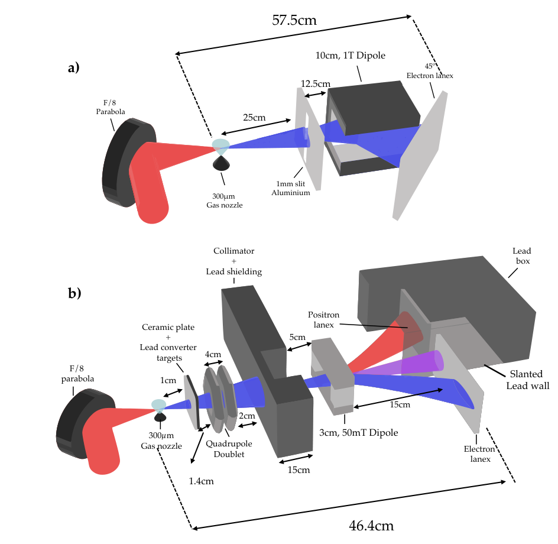
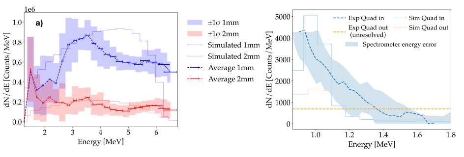

# mJ 级激光—铅转换靶正电子源：10 Hz 已测，kHz 仍受靶损伤限制

> T. Foster、D. Papp、C. McAnespie 等，*High average flux positron sources driven by a mJ-class laser*。[官方 arXiv v1](https://arxiv.org/abs/2610.23243v1)，2026-10-16 提交，14 页；PDF 首页正文日期为 2026-10-19。两日期分别保留，不据此称为正式发表。精确标题 Crossref 前三条未找到同篇正式版。

## 摘要与证据类型

ELI-ALPS eSYLOS 实验用约 9 mJ 焦斑内激光能量产生 LWFA 电子，经毫米级铅靶和磁输运后，在 10 Hz 下累计 100 发测得约 **(1.0±0.2)×10³ 个、0.8–1.7 MeV 正电子**。这是经闪烁屏响应标定的探测端能段产额，不能当成靶后总正电子数。

电子源在 100 Hz 和 1 kHz 也做了表征，但正电子高重频测量被铅靶烧蚀、碎屑污染聚焦镜限制。题目中的高平均通量前景不能替代 kHz 正电子源稳定运行的实验。FLUKA 为谱形、接受度和背景解释提供模型支持；没有测量正电子湮没寿命谱、材料缺陷或临床性能。

## 1. 引言：转换靶机制与应用目标

文章先从高重频 LWFA 的紧凑性引出二次源。电子在高 Z 靶内发出韧致辐射，随后光子在核场中经 Bethe–Heitler 过程产生电子—正电子对；这是物质转换靶链路，不能等同于激光场中 Breit–Wheeler 对产生或真空非微扰 QED 的观测。

材料正电子湮没寿命谱（PALS）希望兼顾低单发粒子数、高平均计数率和短到达时间分布，以减小堆积并积累统计。常规可调 keV 源主要探测近表层，MeV 正电子提供更深植入的可能性。但本篇只验证源与输运，尚未完成植入深度标定、样品谱学或仪器响应验收。作者的“first”表述按其声明保留，本轮没有独立开展全球优先权检索。

这与仓库既有 [LWFA 晶体 γ/正电子/中子源方案](../../2026-10-02/notes/Sytov%20et%20al.%20-%202026%20-%20LWFA%20crystal%20gamma%20positron%20neutron%20source.md)是不同作品：本篇为低能量、高重频平台上的铅靶实测，不应借用晶体方案的计算产额或中子结论。

## 2. 实验设置：源、靶与探测接受度

原文第 4 页 Fig. 1。(a) 为电子谱表征，(b) 才是插入转换靶、双四极透镜、铅屏蔽及正电子谱仪后的配置；示意长度单位 cm、气嘴直径 μm，并非按等比例绘图。两配置顺序使用，不能把电子源表征的所有重频都当作正电子测量条件。

激光压缩前 36 mJ、压缩后约 25 mJ，中心波长 836 nm、14 fs、f/8 聚焦；10/100/1000 Hz 时焦斑内分别约 9.5/9.0/9.2 mJ。约 2.15×10¹⁸ W/cm² 的峰强度按 Gaussian 时空形状估计，三配置间标准差约 0.15×10¹⁸ W/cm²。气嘴直径 300 μm，纯氮等离子体密度约 10¹⁹ cm⁻³。焦斑约 7 μm 的拟合误差与重频间强度差异不是同一种统计量。

转换组件位于气嘴下游 1 cm，由 1 mm 陶瓷片和 0.5、1、1.5、2 mm 铅片组成；陶瓷片倾斜约 15°，用来缓解激光直接烧蚀与返光，仍未解决高重频碎屑。双四极梯度分别为 26.23 和 12.9 T/m，相距 4 cm；50 mT、3 cm 偶极分离和色散电子/正电子，50 mm 铅砖用于压低散射电子及韧致辐射背景。

方法节写每幅图像曝光 10 s、10 Hz，即累积 100 发。图 4a 的电子谱图注另写 averaged over 10 shots；这两个计数口径不混用。正电子绝对数使用正文及表 1 明确给出的 100 发累积定义。

## 3. 电子束表征：可达 kHz 的是驱动级

原文 Fig. 2 比较每种重频 50 个单发电子谱。能谱宽、延伸到约 30–50 MeV；1 kHz 的约 40 MeV 结构是在重新优化焦斑后出现，不能只归因于提高重频。非色散方向发散角约 20–30 mrad，作者用不同磁体在 6.5–9 MeV 的重叠区拼接谱形。

经氚源标定，电子束总电荷典型约 8 pC，其中约 5 pC 低于 5 MeV。因此“几十 MeV 尾部”不代表全部电荷都处在高能端。用于 FLUKA 的是重建的 10 Hz 全电子谱，并配 30 mrad FWHM 发散角，而非一个单能 50 MeV 束。

## 4. 正电子产生：探测谱与全靶产额要分开

FLUKA 采用 EM-CASCA 默认设置：电子/正电子动能阈 100 keV，光子 10 keV。作者累计 1000 组、每组 8×10⁶ 个初级电子，共 8×10⁹ 条初级历史。本轮没有运行该输运计算。Fig. 3 的色标为每个初级电子、每 cm² 的粒子数；不能直接当作实验每发探测计数。

按作者模型，约 2×10⁻⁷ 个正电子/初级电子能到达闪烁屏。由电荷换算初级数再乘输运概率：

$$
N_e=\frac{Q_e}{e}\simeq\frac{8\times10^{-12}}{1.602\times10^{-19}}
\simeq5.0\times10^7,\qquad
N_{+,\mathrm{det}}\simeq N_e(2\times10^{-7})\simeq10.
$$

Qe 为电子束电荷（C），e 为元电荷，输运概率无量纲。这个简单复核解释每发约十个探测正电子的数量级，不是独立模拟或靶内总对产额。更厚靶同时增加辐射/对产生、散射、吸收和探测背景；实验 0.5–2 mm 扫描中仅 2 mm 给出清晰正电子谱，不能称为全局最优转换厚度或最高能量转换效率。

原文第 9 页 Fig. 4。左图横轴 MeV，纵轴 dN/dE（Counts/MeV），左上角 10⁶ 是该面板尺度；蓝/红分别为 1/2 mm 铅靶，薄线为 FLUKA，色带为图注所述单次谱波动。右图也是能谱，但纵轴只有几千 Counts/MeV，不能与左图忽略量级地比较粒子种类总数。

右图含四极透镜的蓝色谱在 0.8–1.7 MeV 可分辨，色带表示谱仪的能量分辨误差；它不是重复发次产额的标准差。去掉透镜后角度展宽使能量分辨率比可测区间还大，橙色常值仅承载积分计数，**不是测得了平坦正电子能谱**。去掉透镜探测通量约下降 3.5 倍，说明结果强烈依赖输运接受度，不能据此把源产额改写为增加 3.5 倍。

绝对标定采用 Gd₂O₂S:Tb 屏的 545 nm 发光，量子效率、光路透过率、收集立体角和闪烁效率等参数列在第 10 页表 1，得到 **130±20 counts/positron**。其中面密度 33 mg/cm²、有效厚度 44.4 μm 是沿用参考数据的假设；约 20% 产额误差含响应传播，不是单纯的 Poisson 计数误差。由累积测量换算：

$$
\overline N_{+,\mathrm{det}}=\frac{(1.0\pm0.2)\times10^3}{100}
\simeq10\pm2\ \mathrm{shot^{-1}},\qquad
\overline R_{+,\mathrm{det}}=10\ \mathrm{Hz}\times\overline N_{+,\mathrm{det}}
\simeq100\pm20\ \mathrm{s^{-1}}.
$$

这里仅是该次累积结果的平均换算，不证明每一发正电子产额稳定，也不包含接受度之外的能量或角度。

文章预计靶后本征束长约 50 fs，引用此前计算；本实验没有直接时间分辨测量。对 46.4 cm 输运和接受的 0.8–1.7 MeV 能段，飞行时间色散可用相对论速度估算：

$$
\beta(K)=\sqrt{1-\left(1+\frac{K}{m_ec^2}\right)^{-2}},\qquad
\Delta t=\frac{L}{c}\left[\frac1{\beta(0.8\,\mathrm{MeV})}-\frac1{\beta(1.7\,\mathrm{MeV})}\right]\approx90\ \mathrm{ps}.
$$

K 是动能，mec²≈0.511 MeV，L=0.464 m；低能粒子较慢，能带越宽，到达时间越宽。90 ps 是接受能段两端的飞行时间差，不能当作测得的 RMS、FWHM 或整个 PALS 仪器响应。进一步选能会牺牲通量；“最终仅受探测器限制”需要先证明束流项充分小。

## 5. 结论、应用与未闭合项

作者提出若单发探测产额不变、转换靶能持续承受 1 kHz，则平均探测通量可到 10⁴/s 量级；这是有条件外推。带式或流动靶、碎屑防护与更高焦斑能量是后续方向，尚无高重频正电子靶寿命和连续运行验收。不能仅按激光能量从 9 mJ 放大到 60/100 mJ 来预测产额，仍须测定电子电荷、能谱与发散。

可用于本项目的是完整审查“焦斑内能量—宽电子谱—靶厚—背景—磁接受度—绝对响应”的方法。仍需直接 kHz 正电子测量、靶/光学污染寿命、样品处能谱与时间响应、植入和寿命谱验证。本文未测光核、中子/同位素、剂量分布或屏蔽合规性；已有铅砖压背景结果不能替代防护验收。

## 全文与核验

[本地官方 v1 PDF](../pdfs/Foster%20et%20al.%20-%202026%20-%20mJ%20laser%20positron%20source.pdf)来自[官方 PDF 入口](https://arxiv.org/pdf/2610.23243v1)。MinerU pipeline 成功；与本地布局文本、首页及第 4/9/10 页图表交叉核对。[PDF 文件与哈希核验](../pdf_validation.json)，[原图裁框与哈希](../research/figure-manifest.json)。本轮未重跑 LWFA、FLUKA、响应标定或 PALS 实验。
