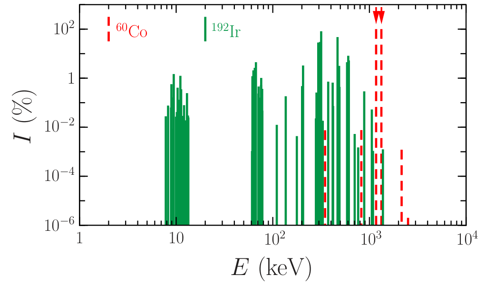
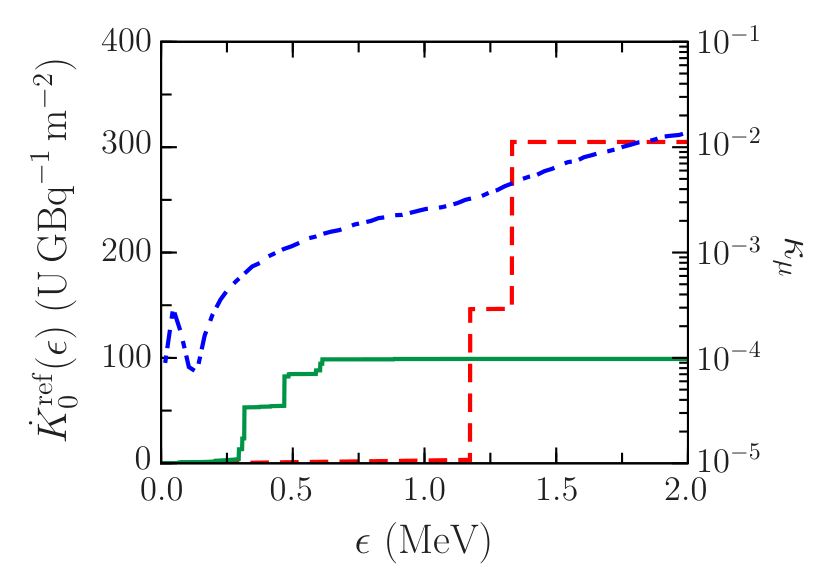

# 近距离治疗源空气比释动能强度的蒙特卡罗计算：电子、系数和谱分箱会留下亚百分比系统偏差

## 0. 论文信息与阅读范围

- **原题**：On the Monte Carlo Calculation of the Air-Kerma Strength for Brachytherapy Sources。
- **作者**：Rafael Guerrero、Julio F. Almansa、Antonio M. Lallena。
- **版本**：*Radiation* **6**(4), 41，2026-10-19 正式出版，20 页；DOI：[10.3390/radiation6040041](https://doi.org/10.3390/radiation6040041)。2026-08-27 收稿、2026-10-14 接受。PDF 首页注明 CC BY。
- **全文**：[本地 PDF](../pdfs/Guerrero%20et%20al.%20-%202026%20-%20Monte%20Carlo%20air%20kerma%20strength.pdf)；[MDPI 官方公开 CDN](https://mdpi-res.com/d_attachment/radiation/radiation-06-00041/article_deploy/radiation-06-00041.pdf)；[逐篇文件核验](../pdf_validation.json)。本轮期刊入口返回 HTTP 403，官方 CDN 下载成功；采用该正式排版全文，而非摘要替代阅读。
- **主题归属**：辐射输运、韧致辐射与特征 X 射线、医用放射源剂量学、蒙特卡罗数值误差与源归一化。
- **证据类型**：PENELOPE-2024 对两种封装放射性核素源的计算与数值敏感性研究。没有新临床测量、患者剂量验证、激光源或转换靶实验；本轮也没有复跑作者计算。

**核心判断**：空气比释动能强度由出射光子谱与空气能量转移系数加权得到。即使探测量只统计光子，源内电子仍可通过韧致辐射和特征 X 射线间接改变光子场；忽略它们、混用能量吸收系数、用过粗能量分箱，均可能留下小于约 0.5% 的单因素偏差。作者提出的合计约 1% 是系统项可能叠加的量级判断，不能写成已经模拟验证的共同最坏情况。

## 1. 摘要：研究问题、方法与主要结果

**目的段**依次提出五个问题：衰变电子及其输运是否可省略；质量能量吸收系数能否代替质量能量转移系数；光子注量谱分箱是否足够细；低能阈值如何影响结果；混合输运与逐碰撞详细输运是否一致。

**方法段**用 PENELOPE 计算 ⁶⁰Co Flexisource Co-60 HDR 和 ¹⁹²Ir microSelectron mHDR-v2r 的空气比释动能强度，并围绕参考条件逐项改变输入。它研究的是给定核素、封装与谱数据下的计算口径，并未优化源活度或临床疗效。

**结果段**给出：完全去掉电子产生与输运后，Co 源结果约增加 0.10%，Ir 源约降低 0.29%；用能量吸收系数代替转移系数分别降低约 0.39%、0.08%；分箱由 1 keV 变为 10 keV，分别增加约 0.22%、降低约 0.49%。湿空气和能阈分别产生最高约 0.16%、0.10% 的变化。混合和详细输运的差异未超出作者所用的 1.7σ 比较范围。

**结论段**强调：小效应仍可能大于蒙特卡罗统计误差，且它们是有符号的系统差异，不能仅靠增加粒子历史数消除。各项对 Co、Ir 的符号和幅度不同，不能为所有放射源套用统一百分比修正。

## 2. 引言：先区分 kerma、强度和吸收剂量（原文 §1）

### 2.1 空气比释动能强度的定义

引言首段依据 TG-43/TG-43U1 定义空气比释动能强度：

$$
S_K=\dot K_\delta^{\mathrm{ref}}d^2.
\tag{1}
$$

**变量与单位**：空气比释动能率为每单位时间、单位质量中由光子释放给次级带电粒子的初始动能；其单位是 Gy/h 等。参考点位于穿过源几何中心、垂直源轴的平面内，距离 d 通常取 1 m。δ 是计入光子谱的最低能量。S_K 的常用单位为 U，其中 1 U = 1 cGy·cm²/h = 1 μGy·m²/h。本文报告活度归一化值，单位为 U/GBq。

**定义如何得到**：对足够远的近似点源，未衰减光子场随距离平方反比变化；把参考空气比释动能率乘以 d²，便得到消除几何稀释的源强指标。这里的“真空中”要求扣除空气或其他介质的衰减、散射以及周围物体回散射，并不意味着空气材料的响应系数也被删去。该定义是横向参考方向的源强，不是全立体角光子总产额。

原文随后解释 δ 的目的：排除金属包壳低能光子对远离源的水/组织剂量几乎无贡献的部分。低能放射源常取 5 keV；本文研究的中高能 HDR 源按 HEBD-WG 建议取 10 keV。阈值与“电子/光子输运终止能量”是两类参数。

### 2.2 从光子注量谱到 kerma

第二段给出一般角度的谱折叠式，并将参考条件取为 d = 1 m、θ = 90°：

$$
\dot K_\delta(d,\theta)
=\int_\delta^{E_{\max}}
\frac{\mu_{\mathrm{tr}}(E)}{\rho}\,E\,
\dot\Phi_E(d,\theta)\,\mathrm dE,
\qquad
\dot\Phi_E^{\mathrm{ref}}=\dot\Phi_E(1\,\mathrm m,90^\circ).
\tag{2--3}
$$

**变量**：E 是光子能量，ρ 是空气密度，μ_tr/ρ 是空气质量能量转移系数；谱注量率是每单位面积、单位时间、单位能量间隔的光子数。θ 从源轴方向量起。

**推导与量纲**：先将谱注量率乘以 E 得到谱能量注量率，再乘以质量能量转移系数，得到单位质量中释放给带电粒子的动能率；对能量积分得到 kerma 率。若能量、面积和质量分别使用 J、m²、kg，则结果是 J/(kg·s)，即 Gy/s。系数描述“假想空气”接收这一光子场时的动能转移，因此可以在真空传播几何中估计空气 kerma。

**与吸收剂量的区别**：kerma 统计光子释放给带电粒子的初始动能；吸收剂量统计实际沉积到局部材料的能量。带电粒子可离开局部区域或通过辐射再带走能量，两者不能无条件等同。本文主要通过光子谱计算前者，没有以水中能量沉积直接代替它。

### 2.3 为什么电子与两类质量系数值得检查

引言第三段介绍两类已有方法：在源外 1 m 的极薄空气球壳记录光子谱后折叠；或在空气中算剂量，再校正空气效应。本文选择第一类。

后续两段指出常见近似：衰变电子通常被认为在源芯/包壳内吸收，对近源水剂量贡献小；因此一些光子场计算省略它们。但“电子没有直接到达探测器”不意味着它们不能在源材料内生成会逸出的光子。作者要量化的正是这条间接通道，而非把电子注量直接放入式（2）。

最后两段讨论另一近似：带电粒子的辐射损失足够小时，能量吸收系数接近能量转移系数。本文逐项检验该近似，并将质量系数数据源、分箱、完整衰变谱和空气组分一并列入比较。

## 3. 材料与方法（原文 §2）

### 3.1 两个 HDR 源及空气材料（§2.1；图 1、表 1）

源几何沿用既有研究。Flexisource 的纯 Co 圆柱源芯直径 0.5 mm、高 3.5 mm，密度 8.9 g/cm³；microSelectron 的 Ir 圆柱源芯直径 0.6 mm、高 3.5 mm，密度 22.42 g/cm³。两者均有 AISI 316L 不锈钢包壳、间隙和源缆，钢密度 8.03 g/cm³。原文第 4 页图 1 逐项给出毫米尺寸；相近外形并不消除源芯密度、原子序数和谱能量造成的差异。

表 1 比较 TG-43U1 干空气、40% 湿空气与 PENELOPE 干空气组分。湿空气新增氢质量分数 0.073%，氮约由 75.527% 降为 75.033%，氧由 23.178% 升为 23.608%；这些改变影响质量系数。TG 空气密度为 1.2×10⁻³ g/cm³，PENELOPE 为 1.20479×10⁻³ g/cm³。本文默认 TG-43U1 干空气，其他组分作为敏感性比较。

### 3.2 谱积分离散与输运控制（§2.2）

作者把式（2）按能量箱中心求和：

$$
\dot K_\delta(d,\theta)
\simeq b_E\sum_{i=1}^{N}
\frac{\mu_{\mathrm{tr}}(E_i)}{\rho}\,E_i\,
\dot\Phi_{E_i}(d,\theta)\,\Theta(E_i-\delta),
\qquad b_E=E_{\max}/N.
\tag{4}
$$

**变量**：b_E 为箱宽，E_i 为第 i 箱中心，Θ 为阶跃函数，低于阈值的箱不计入。原文将等号用于该离散表示；这里以近似号提醒它含有求积误差。

**推导与数值直觉**：每箱的谱注量率乘以 b_E，近似为该箱积分注量率，再以箱中心的能量响应权重折叠。若谱是窄线，真实线能量被移动到箱中心；若同箱内响应随能量变化很快，这一移动会形成有方向的偏差。只增加历史数会缩小随机误差，不能修正箱中心替代真实能量造成的偏差。

几何是位于真空中心的放射源，外包内半径 1 m、厚 10 μm 的空气球壳，作为光子谱计数器。PENELOPE-2024 支持 50 eV–1 GeV 的电子、正电子、光子输运；这是代码适用范围，不是本文实际扫描或探测的能区。主程序使用发行版中的 PENMAIN。

光子逐相互作用模拟；电子/正电子采用混合方案，把低于指定阈值的许多软碰撞合并为多重散射“hinge”，硬碰撞则逐次模拟。作者说明的控制量包括：C₁ 控制软相互作用导致的平均角偏折，C₂ 控制平均相对能量损失；W_CC 和 W_CR 分别为硬非弹性碰撞与硬韧致辐射阈值；E_abs 是粒子停止输运、剩余能量就地沉积的截止；s_max 限制步长，避免跨过薄材料层。

完全详细模式取 C₁ = C₂ = W_CC = 0，W_CR < 0；混合模式取 C₁ = C₂ = 0.05、W_CC = 10 keV、W_CR = 1 keV。后二者不等于光子计数阈值 δ。

作者把用转移系数折叠的结果记为 S_K^tr，用吸收系数折叠的结果记为 S_K^en。MUTREN 给出与 PENELOPE 输运数据库一致的两类空气系数；另一组比较使用 NIST 吸收系数，经三次样条插值到谱箱中心。数据库改变与系数物理定义改变应分别记录。

### 3.3 发射谱、历史数与参考条件（§2.3；图 2）

按本节顺序，三类谱是：**fuldec** 为 NUCLEIDE 数据库完整衰变方案，包含 β、内转换、Auger 电子及 γ/特征 X 射线；**comphs** 只输入 HEBD-WG 推荐的完整光子发射谱，但其输运仍可产生次级电子；**minphs** 仅用于 Co 源，保留最强的 1173.23 和 1332.49 keV 两条 γ 线。

**图 2 读图（原文第 6 页原图裁取）**：横轴 E，单位 keV，对数刻度；纵轴 I，单位 %，也是对数刻度，表示每次衰变的各条光子发射强度，不是归一化到总和 100% 的探测谱。红虚线是 ⁶⁰Co、绿实线是 ¹⁹²Ir；箭头标出 minphs 的两条 Co 主线。Co 由约 1.17、1.33 MeV 两线主导；Ir 有许多离散线，既含约 300–600 keV 强线，也有低能特征 X 射线。因此两源的谱分箱和响应系数敏感性不同。此图是输入核素发射谱，不能当成穿过封装后在 1 m 测得的谱，更不能换算为激光靶光子产额。

随后给出电子停止能量：保留输运时所有材料取 100 eV；完全去掉电子输运时提高到 10 MeV，使所产生的电子立即停止。所有材料光子停止能量均取 1 keV。步长上限按组件特征厚度约十分之一取值：源芯 60 μm、空气间隙 5 μm、包壳 10 μm、源缆 90 μm。

探测谱统计至 2 MeV，1 keV 箱对应 2000 箱、10 keV 箱对应 200 箱；作者说未探测到更高能光子。10 keV 箱计算跟踪 10⁹ 个历史，1 keV 箱跟踪 10¹⁰ 个历史。**该历史数是本文模拟设置，不是已经运行本地复现的记录。**

参考条件汇总：mix、fuldec、MUTREN/PENELOPE 的转移系数、TG 干空气、光子停止 1 keV、电子/正电子停止 100 eV、b_E = 1 keV、δ = 10 keV。附录表 A3 逐行列出各比较只改变哪些参数。

原文报告的括号不确定度是 **A 类蒙特卡罗不确定度，覆盖因子 k = 3**：304.9(5) 表示约 304.9 ± 0.5 U/GBq，98.95(6) 表示约 98.95 ± 0.06 U/GBq。它们不是 1σ，也不包含几何、核数据和截面数据库的完整 B 类系统误差。作者用以下差异量比较：

$$
\Delta=|S_K^{\mathrm{ref}}-S_K|,
\qquad
\Delta_S=\frac{\Delta}{S_K^{\mathrm{ref}}},
\qquad
\Delta_\sigma=\frac{\Delta}{\sigma_{\mathrm{ref}}}.
$$

这里 σ_ref 是参考值的标准不确定度；Δσ 是作者的参考不确定度归一化指标，并非用两次计算合成标准误差所得的独立双样本检验。文中的 7.9σ 等保留作者报告值；用已四舍五入的表格不一定能精确重得它们，且本文未公开可重算协方差的原始历史数据。

## 4. 结果：先看各张表实际比较什么（原文 §3）

### 4.1 表 2–3：系数、分箱与输运模式

所有值的单位为 U/GBq，括号均为 k = 3 的 A 类不确定度：

| 条件 | Co Flexisource | Ir microSelectron |
|---|---:|---:|
| 参考：mix、1 keV、转移系数 | 304.9(5) | 98.95(6) |
| mix、1 keV、吸收系数（同一PENELOPE数据库） | 303.7(5) | 98.87(6) |
| mix、10 keV、转移系数 | 305.6(5) | 98.47(8) |
| det、1 keV、转移系数 | 305.0(4) | 98.98(8) |
| det、10 keV、转移系数 | 305.9(6) | 98.49(8) |

表 3 补充 3、5 keV 箱：Co 分别为 305.7(5)、304.9(5)，Ir 分别为 99.01(6)、99.03(6)。Ir 的 3、5 keV 结果明显接近 1 keV 参考值，10 keV 则偏低。Co 随箱宽并非严格单调，不能把这一有限扫描写成数学上证明的单调收敛，也不能说已经验证 1 keV 以下全部收敛。

### 4.2 表 4：源电子与次级电子是两层开关

| 输入谱及电子停止能量 | Co Flexisource | Ir microSelectron |
|---|---:|---:|
| fuldec，100 eV（参考） | 304.9(5) | 98.95(6) |
| comphs，100 eV | 305.1(4) | 98.76(5) |
| comphs，10 MeV | 305.2(4) | 98.66(5) |
| minphs，100 eV | 304.9(4) | — |
| minphs，10 MeV | 305.0(4) | — |

先由 fuldec 变为 comphs，去掉核素发射的电子；再把电子停止能量升至 10 MeV，连光子相互作用产生的次级电子及其后续辐射也立即停止。两步不能混写成同一种“忽略电子”。对 Ir，结果随这两步继续降低；Co 的差异小且相对统计显著性弱。

### 4.3 表 5–7：数据源、空气和能阈

使用 **NIST 吸收系数**、fuldec、1 keV 箱后，Co 为 304.4(2)、Ir 为 98.94(5) U/GBq。该变化同时涉及系数定义和数据源，不能拿它直接替代“同一数据库里只把转移系数换成吸收系数”的差异。comphs 对应值为 304.6(1)、98.74(4)。

40% 湿空气、1 keV 箱给出 305.4(5)、99.04(6) U/GBq；PENELOPE 干空气给出 305.3(5)、99.00(6)。空气成分虽只轻微变化，谱折叠后仍可产生超过统计误差的差异。

δ 从 10 keV 降为 5 keV 时，Co 从 304.9(5) 变为 305.0(5)，Ir 从 98.95(6) 变为 99.05(6)；再降为 0，分别为 305.0(5)、99.06(6)。**δ = 0 仅表示折叠求和不再施加该分析阈值**；本组所有模拟的光子输运仍在 1 keV 停止，不能据此宣称对零能量至 1 keV 光子已做完整输运。

### 4.4 图 3：用横向值归一化的角分布

本节最后定义：

$$
R(\theta)=
\frac{\dot K_\delta(1\,\mathrm m,\theta)}
{\dot K_\delta(1\,\mathrm m,90^\circ)}.
\tag{5}
$$

将同一源的不同角度 kerma 率除以横向值，消去源活度与整体强度，得到无量纲 R；因此 R 在 90° 按定义为 1，并不意味着源在全角度各向同性。第 11 页图 3 横轴为 θ（度），纵轴 R 无量纲；Co 红实心圆在轴向约 0.94，Ir 绿空心方块约 0.55，均随角度接近 90° 而趋于 1。此处约值仅为读图，非作者给出的精确数表。作者称 k = 3 误差条小于图符。

## 5. 讨论：各项变化的物理机制（原文 §4）

### 5.1 分箱、转移/吸收系数与详细/混合输运（§4.1；图 4）

首先是系数替代：在同一 PENELOPE 数据库、同一光子谱下，把转移系数换成吸收系数，使 Co 降低约 **0.39%（作者指标 7.9σ）**、Ir 降低约 **0.08%（3.9σ）**。两者差异源于光子谱对能量响应的加权不同。

作者为解释这一点定义从 0 积分到能量 ε 的累积空气 kerma 率，以及两系数相对差：

$$
\dot K_0^{\mathrm{ref}}(\epsilon)=
\int_0^\epsilon
\frac{\mu_{\mathrm{tr}}(E)}{\rho}\,E\,
\dot\Phi_E^{\mathrm{ref}}\,\mathrm dE,
\qquad
\kappa_\mu(E)=
\frac{\mu_{\mathrm{tr}}(E)/\rho-\mu_{\mathrm{en}}(E)/\rho}
{\mu_{\mathrm{tr}}(E)/\rho}.
\tag{6--7}
$$

**变量与推导**：ε 是累积积分的上限，κμ 是无量纲分数。逐渐提高 ε 时，每遇到一条强发射线，累积 kerma 就明显上跳。将完整积分减去吸收系数折叠积分，可得：

$$
\frac{S_K^{\mathrm{tr}}-S_K^{\mathrm{en}}}{S_K^{\mathrm{tr}}}
=
\frac{\int_\delta^{E_{\max}}w(E)\,\kappa_\mu(E)\,\mathrm dE}
{\int_\delta^{E_{\max}}w(E)\,\mathrm dE},
\qquad
w(E)=\frac{\mu_{\mathrm{tr}}(E)}{\rho}E\dot\Phi_E^{\mathrm{ref}}.
$$

这一步是基于原文定义的直接推导：总体差异是 κμ 按 kerma 谱贡献加权的平均，不能用某一能点的系数差简单代表整个源。物理上，若把带电粒子后续以辐射形式带走的平均能量份额记为 g，常用关系是：

$$
\frac{\mu_{\mathrm{en}}}{\rho}
=(1-g)\frac{\mu_{\mathrm{tr}}}{\rho},
\qquad
\kappa_\mu=g.
$$

后一式是理解两类系数差别的定义性解释，不是作者额外模拟了一个独立 g 参数。吸收系数扣除了次级带电粒子辐射再带走的能量；对于非负谱权重，它给出的碰撞 kerma 不会大于总 kerma。

**图 4 读图（原文第 12 页原图裁取）**：横轴 ε，单位 MeV，线性刻度。左纵轴是按活度归一化的累积 kerma 率，作者标为 U·GBq⁻¹·m⁻²，数值在 d = 1 m 时与 S_K/活度一致；红虚线为 Co，绿实线为 Ir。它们是累计绝对谱响应，没有各自归一到 1。右纵轴为 κμ，**对数刻度且不是百分数**；蓝点划线在 2 MeV 附近约 10⁻²，即约 1%。Co 在约 1.17、1.33 MeV 上跳，Ir 主贡献在较低能量已累积完成，故 Co 对能量吸收系数替代更敏感。左右轴物理量不同，不能把蓝线高度与红/绿 kerma 值直接比较。

第二个讨论点是分箱：从 1 keV 改为 10 keV，作者报告 Co **增加 0.22%（4.4σ）**、Ir **降低 0.49%（23.6σ）**。Co 两主线位于响应相对平滑的高能区；Ir 的多条线跨越低于约 100 keV、响应变化较快的能区。把一箱内的谱都放到箱中心，会丢掉真实线位置；两源变化符号相反，不存在可通用的“粗分箱一律高估”规律。

作者据 3、5 keV 补充计算，建议 Ir 用 1 keV 或更细箱作为精度与成本折中，同时必须报告箱宽。本文没有展示小于 1 keV 的算例，也没有对所有可能谱形验证这一经验值。

第三个讨论点是电子详细度：det 的结果略高于 mix，但最大差异约 0.10%，仍在作者的 1.7σ 比较范围内。因此在**本文参数、几何和目标精度下**，所选保守混合输运足够。这里没有给出可复用的 CPU 时间或通用加速比，也不能外推为任意混合参数都可靠。

### 5.2 电子的间接贡献及衰变支路（§4.2）

由 fuldec 改为 comphs，Co 增加约 0.07%（1.3σ），Ir 降低约 0.19%（9.3σ）；进一步完全停止次级电子后，相对参考值分别为约 +0.10%（2.0σ）和 −0.29%（14.1σ）。因此 Ir 中电子省略产生清楚的计算偏差，Co 差异相对小。Co 的 +0.10% 只有约 2σ，且 fuldec/comphs 比较包含源发射方案改变，不能据此强称“电子必然抑制 Co 光子产额”的普遍机制。

为什么 Ir 效应更大，尽管 Co 总 β 衰变 Q 值更高？作者接着比较实际占优支路：Co 的总 Qβ 为 2823.07 keV，但最常布居的 ⁶⁰Ni 激发态高达 2505.75 keV，因而该支路电子终点能仅 317.32 keV，平均 95.6 keV。Ir 两个主要 ¹⁹²Pt 激发态为 784.58、920.92 keV，相应电子终点能 675.1、538.8 keV，平均能量 209.9、162.1 keV。判断源内电子辐射能力应看实际支路电子谱，不能仅看总 Q 值。

这些电子在源芯、包壳或缆线内可生成韧致辐射和特征 X 射线，再改变探测到的光子场。minphs 与 comphs 的 Co 差异约 0.07%（1.4σ），本文并未证实两主线近似会对这一 Co 源造成显著偏差；这不支持对复杂 Ir 谱使用相同简化。

### 5.3 系数数据源、空气、能阈与角分布（§4.3）

首先讨论 NIST 系数：fuldec、1 keV 箱时，相对参考值 Co 降约 0.18%（3.5σ）、Ir 降约 0.01%（0.6σ）。它和同库转移/吸收替代的差别说明数据库一致性同样重要，不能把更接近参考值理解成系数物理定义可以互换。作者用 NIST、comphs 及 10 keV 箱的交叉组合显示各近似会互相影响。

第二是空气：40% 湿空气使 Co 增加约 0.16%（3.2σ）、Ir 增加约 0.09%（4.3σ）；PENELOPE 干空气相应为约 +0.13%（2.5σ）、+0.05%（2.2σ）。作者指出早期 TG-43/TG-43U1 与 HEBD-WG 对湿/干空气的建议存在历史变化，因此报告中必须写清采用哪种材料配方。这里的“40%”是所引用协议的湿度条件，不是空气中水的质量分数。

第三是阈值：Co 从 10 keV 降至 5 或 0 keV，只改变不超过约 0.03%，在 1σ 内；Ir 从 10 keV 降至 5 keV 增加约 0.10%，再降至 0 仅增约 0.01%。主要新增贡献位于 5–10 keV，包括子体 Os/Pt 的 L 壳特征 X 射线，以及钢包壳中 Cr、Fe、Ni 约 5.4、6.4、7.5 keV 的 K 壳线。Ir 较低能谱产生更强光电成分，因此这些线更明显。

最后解释图 3 的角向趋势：向横向逃逸的光子在源材料中通常经过较短路径，越接近轴向，自吸收越强。Ir 与 Co 几何相近，但 Ir 的密度约高 2.5 倍、原子序数更大（77 对 27），主光子能量也较低，所以 Ir 轴向衰减更明显。这个角分布属于毫米尺度封装核素源，不能用作激光电子束轫致辐射的前向锥角模型。

### 5.4 与既有计算比较（§4.4）

作者先比较 Co：旧 PENELOPE-2014、comphs、忽略电子、1 keV 箱的计算为 305.1(3) U/GBq，本文相近条件给 305.2(4)，差约 0.03%，在不确定度内；旧研究观察到的系数替代下降约 0.39% 也与本文一致。其他相似 Co 封装源约 304.6(7)，说明这一组源中核素谱主导总体强度，但这不是包壳在所有能区都不重要的证明。

再比较 Ir：文献使用 EGS4、Geant4、旧版 PENELOPE 得到约 97.3(1)、98.2(3)、98.6(2) U/GBq；其中存在几何和版本差异。本文 98.95(6) 与同几何旧 PENELOPE 值差约 0.35%，作者称在 1.7σ 内；与另一个 EGS5 结果 98.29(20) 则显著不同。跨代码数值并列不能自动识别误差来源，须先对齐几何、衰变数据、电子开关、箱宽、系数和材料。

## 6. 作者结论及可迁移价值（原文 §5）

结论段按顺序归纳：电子整体贡献小但不可一概删除；混合与详细输运在本组精度内一致；计算总 kerma 时不建议用吸收系数替代转移系数；复杂线谱应使用足够细的分箱；空气材料和低能阈值同样需要明确。单项变化均约不超过 0.5%，组合可能到约 1%，但没有给出完整系统不确定度预算或所有组合的联合扫描。

作者将源强偏差与 TG-43 剂量归一化联系起来：

$$
\Lambda=\frac{\dot D(r_0,\theta_0)}{S_K}.
$$

Λ 是剂量率常数，分子是水中参考位置剂量率。对固定分子，一阶传播为：

$$
\frac{\delta\Lambda}{\Lambda}
\simeq-\frac{\delta S_K}{S_K}.
$$

这说明源强口径会影响剂量率常数；实际剂量还取决于使用的源强校准、参数是否成套一致及其他 TG-43 因子，不能仅凭本文宣布患者剂量发生同样的净偏差。作者引用的放疗剂量学约 2–3% 精度背景不是本文对临床结果的新测量。

最后作者推测 ¹²⁵I、¹⁰³Pd 等低能源可能对箱宽、阈值和系数更敏感，因为谱集中于响应变化较快区域。**这只是由机制提出的待检验外推**；本文只模拟了 Co、Ir 两源，没有低能源数据。

对本库关注的激光电子/离子转换靶、γ 源与防护问题，最有用的迁移是计算流程：保存全次级粒子链，区分输运截止与分析阈值，记录完整源谱与材料，逐项验证谱分箱，并将光子场与 kerma/吸收剂量/探测器响应分开。本文的 U/GBq 源强和 0.1–0.5% 修正幅度不可迁移为每发激光、每个入射电子的光子、中子或同位素产额，也没有光核反应、转换效率或屏蔽厚度结果。

## 7. 附录与复用时的检查点（原文 Appendix A）

表 A1 列出 Co 的六条推荐光子发射线；两主线强度为 99.85%、99.9826%，说明每次衰变可发射多条光子。表 A2 逐项列出 Ir 复杂线谱，包括 7.822–13.361 keV、61–78 keV 特征线群以及约 296–612 keV 主 γ 线。复现时应导入精确能量与每衰变强度，避免把线强度归一化成只发一个光子的概率后丢失绝对每衰变光子数。

表 A3 为所有比较提供输入矩阵，适合作为重建算例的入口。数据可按需向作者索取，正文未提供完整输入文件、源采样器、所有分箱原始谱或运行日志；因此本次阅读达到全文与数值表核验，不构成端到端数值复现。

## 8. 独立审读：仍需澄清的边界

1. **统计显著性与实际误差预算不同**。很大的 Δσ 可由极小 A 类误差产生；它不自动代表临床显著性，也未包含全部核数据、几何和截面系统误差。跨模拟比较应补充合成不确定度与相关性。
2. **分箱收敛证据有限**。仅比较 1、3、5、10 keV；可进一步用逐光子能量直接折叠，或线能量精确求和，分离统计误差、箱中心求积误差与数据库插值误差。该建议是本笔记提出，未在本轮执行。
3. **谱上限需解释**。正文说探测谱止于 2 MeV、没有更高能光子，但附录表 A1 仍列出 2158.57、2505.69 keV 极弱 Co 发射线。本文没有给出这些高能线在探测/计数中的独立漏计上界；复现时应检查源谱、探测范围和该尾部的处理，不能把“未探测到”直接当成严格零贡献。
4. **δ = 0 不解除 1 keV 输运截止**。低于停止能量的光子不能通过改变分析阈值恢复；更软的光子或低能核素问题须重新评估输运设置。
5. **VOR 存在编辑残留**。第 8–9 页正文和表 4、附录表 A3 出现“Table ??”及“[??a]”等未解析交叉引用，目视原 PDF 可见，并非 MinerU 新引入。本笔记按实际表题对应为表 4，不改写成不存在的表号。
6. **没有直接实验闭环**。与旧代码结果相容可增加计算一致性证据，仍不足以验证绝对空气比释动能测量、患者剂量、激光转换靶或其他源几何。

## 9. 全文与图像核验记录

MinerU **pipeline** 解析成功（任务 c0888c4a-e238-4f99-8199-033e00bdff4c，state = done），读取完整 Markdown 后，以原 PDF 的排版文本、公式和表格交叉核验；本篇无需启用失败回退。MinerU 有重复跨页句、数学符号空格及表头重排，本文公式和表值以 PDF 为准。

本轮目视核查第 **1、6、8、9、10、11、12、19 页**：首页身份/日期、输入谱、关键结果表、角归一化、累积 kerma 与系数图、算例矩阵均能辨认。保留两幅原图 PNG 裁取（图 2、4），未改变数据、曲线或配色；裁剪位置和哈希交由当日图像清单记录，原图版权与署名归论文作者（CC BY）。其他页按完整解析正文阅读，没有将未目视页面宣称为逐页视觉验收。临时整页渲染清理，不额外保留中间副本。

**复习速记**：探测器只计光子，不代表源内电子可删；总 kerma 应用能量转移系数，并让源谱、分箱、材料、阈值与活度归一化口径可追溯。
