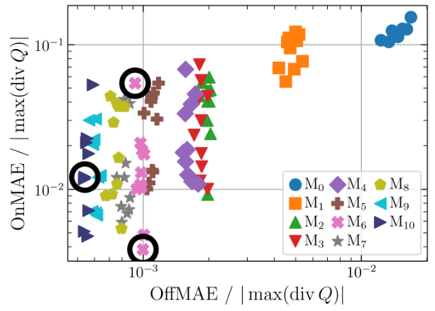
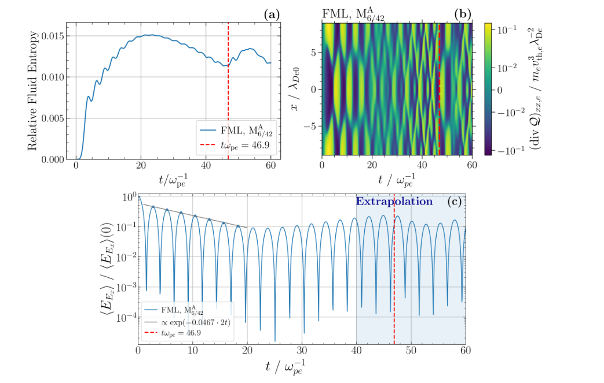

# 十矩流体机器学习闭合的性能与困难：Landau 阻尼全文笔记

## 0. 论文信息与证据范围

- 正式题名：*Properties and challenges of machine learning closures for ten-moment fluid models in the case of Landau damping*
- 作者：Emanuel Jeß；Simon Lautenbach；Sophia Köhne；George Miloshevich；Kevin Schoeffler；Rainer Grauer；Maria Elena Innocenti。
- 版本：arXiv:2610.23080v1，2026-10-16 提交，32 页；本次收录是作者预印本。2026-10-20 核对的 arXiv 页面未给出正式期刊卷页或期刊 DOI，不把它标记为正式发表版。
- 来源：[arXiv 摘要页](https://arxiv.org/abs/2610.23080v1)；[官方 PDF](https://arxiv.org/pdf/2610.23080v1)；[官方 TeX source](https://arxiv.org/src/2610.23080v1)；[arXiv DOI](https://doi.org/10.48550/arXiv.2610.23080)。
- 本地：[经验证 PDF](../pdfs/Jess%20et%20al.%20-%202026%20-%20Machine%20learning%20ten%20moment%20closures.pdf)；[PDF 校验记录](../pdf_validation.json)。
- 阅读路径：MinerU `pipeline` 成功解析全文，再与独立布局文本及 PDF 原页交叉核对；目视检查首页、原图 3 所在第 13 页、图 6 所在第 16 页、图 10 所在第 21 页和图 11 所在第 23 页中的关键内容。文中数字来自作者算例，本次没有重新训练网络或复跑 Vlasov/流体模拟。
- 主题：Vlasov；十矩流体；Landau damping；Fourier neural operator；离线训练与在线验证；熵诊断。对本库 PIC/机器学习降阶模拟方向直接相关；对激光、强场 QED、转换靶和核应用仅有方法学联系。

**作品去重与版本边界。** 本文不是 Huang、Dong、Wang 在 PNAS 2025 的论文 [10.1073/pnas.2419073122](https://doi.org/10.1073/pnas.2419073122) 的正式版或修订版：作者不同，本文明确将该文作为待复现的前作。本文也不是本库 [Burles 等的 Landau 阻尼神经算子闭合](../../2026-08-04/notes/Burles%20et%20al.%20-%202026%20-%20Neural%20operator%20Landau%20damping%20closure.md)（[arXiv:2607.29364](https://arxiv.org/abs/2607.29364)）或 [Luo 等的 ICF 非局域热流闭合](../../2026-09-10/notes/Luo%20et%20al.%20-%202026%20-%20Resolution-robust%20ML%20heat%20flux%20closure.md)（[10.1103/9l4n-mnz6](https://doi.org/10.1103/9l4n-mnz6)）。前者使用带历史信息的非 Markov 闭合及在线训练，Luo 的对象是一维 ICF 热输运；Jeß 本文使用当前流体矩的离线训练闭合，并系统考查复杂度、随机种子、外推和熵诊断。

## 1. 摘要与通俗摘要（原文第 2 页）

十矩模型推进分布函数到二阶矩为止，因而需要近似下一阶热流张量的散度。作者以 FNO 替换常用 Hammett–Perkins 类闭合，在 Landau 阻尼中检验线性阻尼频率和非线性阶段。结果支持：训练参数范围内及幅度插值时，合适的 ML 闭合可优于本文的解析闭合；离开训练时间或初始幅度范围越远，性能通常越差。

摘要随后将评估分成两件事：离线评估把真实 Vlasov 流体矩送入网络，在线评估则把网络嵌入流体求解器，让它接收自身演化产生的状态。离线误差不能充分预测在线表现，是全文最关键的方法学结论。

通俗摘要进一步解释实际动机：大时空尺度上高保真动理学模拟昂贵，而便宜的流体模型需要保留部分波粒相互作用物理。没有动理学参考时，作者建议观察流体熵的时间模式；突然改变的振荡或转折可提示模拟开始偏离预期。这是本文案例中的诊断建议，不是任意工况准确性的充分证明。

## 2. 引言：为什么要同时研究闭合和评估方法（原文 §1，第 2–6 页）

**第一个论证层次是多尺度代价。** 太阳风和磁层等问题需要大尺度、长时间计算，但 MHD 难以描述微观不稳定性对温度各向异性、热流等宏观量的反馈。Vlasov 或 PIC 能保留无碰撞动理学效应，却受相空间维数、尺度分离和计算成本限制。作者列举隐式格式、自适应网格和低秩压缩等改进后指出：这些加速仍不能普遍代替具有适当闭合的降阶模型。

**第二个层次是十矩模型的缺口。** 每个组分包含密度 1 个、速度 3 个和对称压力张量 6 个独立分量。保留压力张量并不自动保留热流；压力演化仍依赖三阶矩。局域 Landau 流体近似用一个特征波数控制耗散尺度，这个自由参数依赖物理问题，往往还要用昂贵动理学参考来调节。

**第三个层次是只拟合增长率不够。** 引言原图 1 用双流不稳定性说明：改变解析闭合的特征波数可以改变线性增长表现，却仍不能正确给出 Vlasov 的场饱和值。这个图是动机示例，不是本文随后 ML 闭合对双流不稳定性的验证；正式训练测试对象仍是一维 Landau 阻尼。

接下来，作者按符号回归与神经回归回顾文献。SINDy 等方法给出可解释公式，但假设空间可能受限；MLP/FNO 更灵活，却要解决部署后的稳定性。作者特别区分“只在动理学数据上估计热流”的工作与“真正嵌入流体求解器”的工作。

在 Landau 阻尼背景中，电子分布在共振速度附近的斜率决定波粒能量交换；非线性俘获会产生回弹振荡。Huang 等已给出 ML 闭合在线运行的概念验证。Burles 等进一步以历史窗口和可微流体求解器进行在线训练，使优化目标直接约束流体轨迹；它学习的可能是适合特定数值格式的“有效热流散度”，未必逐点等于动理学热流散度。

引言最后提出本文的增量：验证初始条件平移和网格迁移；测量网络复杂度、随机种子与在线表现的关系；对成本较低的离线训练做幅度插值和外推；探索没有动理学参考时的诊断。作者没有把这些一维结果声称为三维大尺度常规应用已就绪。

## 3. 方法与数据（原文 §2，第 6–11 页）

### 3.1 从 Vlasov 方程到必须闭合的热流散度

动理学和流体模块均来自开源 muphyII。框架能按组分选择物理模型，也支持空间自适应耦合；本文没有使用空间自适应耦合。

原文式 (1) 是无碰撞 Vlasov 方程：

$$
\partial_t f_s+\mathbf v\cdot\nabla_x f_s+
\frac{q_s}{m_s}(\mathbf E+\mathbf v\times\mathbf B)\cdot\nabla_v f_s=0.
$$

其中 f 是相空间数密度，s 表示组分，q、m 为电荷与质量，E、B 为电磁场，x、v 是位置与速度。第一项为局部随时间变化，第二项为自由输运，第三项为 Lorentz 力导致的速度空间输运。

对方程依次乘以速度的零次、一次、二次张量积并对速度积分，利用速度边界项消失，得到矩方程。非中心二阶矩和中心压力张量满足

$$
\mathbb E_s=\int\mathbf v\otimes\mathbf v f_s\,d\mathbf v
=n_s\mathbf u_s\otimes\mathbf u_s+\frac{\mathcal P_s}{m_s}.
$$

这里 n 为数密度，u 为平均流速，压力张量是相对平均流的二阶矩乘质量。把三阶非中心矩展开为平均流和热运动的组合后，原文式 (5) 的核心闭合结构为

$$
\partial_t\mathbb E_s+
\nabla\cdot\left[\operatorname{sym}(\mathbf u_s\otimes\mathbb E_s)
-2n_s\mathbf u_s\otimes\mathbf u_s\otimes\mathbf u_s\right]
=\frac{q_s}{m_s}\operatorname{sym}
\left[n_s\mathbf u_s\otimes\mathbf E+\mathbb E_s\times\mathbf B\right]
-\frac{1}{m_s}\nabla\cdot\mathcal Q_s,
$$

$$
\mathcal Q_s=m_s\int(\mathbf v-\mathbf u_s)^{\otimes3}f_s\,d\mathbf v.
$$

sym 表示未收缩指标的循环置换求和。热流张量 Q 是三阶中心矩；在通常三维物理量约定中具有能量通量量纲，其散度决定压力/内能的局部再分配。展开并没有消除三阶信息，只把未知量集中到最后一项。物理直觉是：已知密度、流速和压力，仍不能唯一确定携能粒子从哪里来、往哪里去。

作为对照的原文式 (6) 是温度梯度型 Landau 流体闭合：

$$
\nabla\cdot\mathcal Q_s
=-\frac{\chi}{k_{s,0}}n_s v_{\mathrm{th},s}\nabla^2\mathcal T_s.
$$

T 为温度张量，热速度 vth 与温度有关，k0 是可调特征波数，χ 为系数。负 Laplacian 结构相当于使温度非均匀性扩散；χ/k0 具有长度尺度含义。该近似能模拟某些线性耗散，却没有显式记录共振粒子俘获形成的相空间结构。

### 3.2 Landau 阻尼初值、归一化与模拟范围

原文先解释线性过程：Maxwell 分布在相速度处为负斜率，稍慢于波的粒子获得能量的净效应超过稍快粒子给回波的能量，因而电场衰减。非线性阶段中，被俘获粒子能再把部分能量交回波，形成 bounce 周期。原文给出

$$
\tau_b=2\pi\sqrt{\frac{m_e}{eE_0 k}},\qquad
\omega_b=\sqrt{\frac{eE_0 k}{m_e}}.
$$

E0 是波电场幅度，k 是波数，e 是电荷绝对值。该关系可由波势阱底附近的回复力近似为谐振子得到：力的线性梯度给出平方频率。幅度越强，回弹周期越短，非线性效应越早出现；线性理论适用于远短于该周期的时间。

模拟均为 **1D 空间、1D 速度**；仅 x 方向速度、压力和热流相关分量非零。电子用 Vlasov 或流体模型；离子初态为均匀背景，但始终由 Vlasov 模块推进，不能把“均匀背景初值”写成完全冻结离子。这样避免离子流体闭合干扰电子尺度比较，并使用真实电子/质子质量比。

原文式 (7) 的电子初态为

$$
f_e(x,v,0)=n_0\sqrt{\frac{m_e}{2\pi k_BT_{0,e}}}
\exp\left[-\frac{m_ev^2}{2k_BT_{0,e}}\right]
\left[1+\alpha\cos(kx+\phi)\right].
$$

n0 是参考密度，T0 是初温，α、k、φ 分别是密度扰动相对幅度、波数和相位。对应的正弦电场初值按原文式 (8) 的电荷/场符号转录为

$$
E(x,0)=-\frac{\alpha q_e n_0}{\varepsilon_0k}\sin(kx+\phi).
$$

所有长度、时间、速度分别按电子 Debye 长度、逆电子等离子体频率和电子热速度归一；电荷、质量按电子值归一，代码约定 kB、ε0、n0 均为 1。下述数值不是 SI 时间或长度。

| 项目 | 论文采用的范围/设置 | 解释 |
|---|---|---|
| 基本波数 | kλDe = 0.35，始终固定 | 本文没有证明跨波数泛化 |
| 空间域 | −π/0.35 至 +π/0.35，单位 λDe | 域内为一个初始基本模 |
| 默认空间网格 | 64 格，约 0.28λDe | 迁移测试还用 32、48、128 格 |
| 动理学速度域 | −6 至 +6，单位 vth,e；128 格 | 有限速度分辨率影响熵演化 |
| 默认 CFL | 0.1；另测 0.27 | 时间步由 CFL 动态确定 |
| 默认演化时间 | tωpe = 0–60；另测至 100 | 训练只到 40 |
| 单算例训练 T1 | α = 0.1，φ = 0 | 用于复杂度、随机种子等比较 |
| 相位测试 V1 | α = 0.1，φ = 0.33π | 测试初值平移和时间步变化 |
| 多算例训练 T2 | α = 0.01–0.09 与 0.11–0.15，步长 0.01 | 特意未含 α = 0.10 |
| 验证 V2 | 中间幅度及 α = 0.001、0.005、0.155–0.175 | 分别检查插值和幅度外推 |
| 熵诊断 V3 | α = 0.103 | 未含在训练幅度中 |

### 3.3 FNO 闭合、训练和部署

FNO 学习的是同一时刻整个空间场的算子：

$$
\mathcal G_\theta:\left[n_e(x,t),u_e(x,t),P_{xx,e}(x,t)\right]
\longmapsto h_e(x,t),\qquad
h_e=\left(\nabla\cdot\mathcal Q_e\right)_{xx}.
$$

θ 是训练权重。输入没有时间戳、先前状态或显式历史窗口，所以这是瞬时状态闭合；空间上通过 Fourier 模态感受非局域信息，不等于时间上具有记忆。

原图 2 的计算顺序是：点式全连接层把三种流体量提升到隐空间；Fourier 层对前若干模态施加可学习变换，再逆变换；与点式 skip 路径相加，经归一化与 GELU 非线性；堆叠若干层后投影成热流散度。skip 路径还允许高于谱截断的结构通过。本文因模型导出问题关闭了位置编码，后续平移测试与这个设置有关。

训练使用 `neuralops 2.0.0` 与 PyTorch；数据是 Vlasov 瞬时流体矩及其热流散度标签，约 8550 个时间样本，时间上限 tωpe = 40。采用 batch 16、MSE、Adam 加解耦权重正则化，训练 200 epochs；学习率通常为 10⁻⁵、逐 epoch 乘 0.96，首 epoch 为 10⁻⁸。输入输出均用训练均值/方差的 standard scaler，缩放函数与模型一并 JIT 导出至 muphyII，保证部署时使用同一尺度。

原文报告在一张 NVIDIA A100 80 GB 上，单算例训练约 1 h，多幅度训练约 13 h，具体依网络大小而变。这是作者训练耗时，不是本文库的复跑结果，也不是相对 Vlasov 的端到端加速比。

## 4. 结果：在线表现及其边界（原文 §3）

### 4.1 复现前作、相位平移与时间外推（§3.1，第 11–13 页）

所有模型均 **离线训练**。这里“在线”指在流体模拟中部署和评估，不意味着使用在线训练。单算例最佳模型 `M6/42` 中，6 表示超参数组，42 是训练随机种子；种子会改变权重初始化和样本打乱，因而也改变部署结果。

为明确两个评估问题，记真实动理学闭合量为 hK，参考动理学矩为 UK，在线流体矩为 UF，则笔记将原文的误差定义整理为

$$
\mathrm{OffMAE}=\left\langle
\left|\mathcal G_\theta(U^K)-h^K\right|\right\rangle_{x,t},
\qquad
\mathrm{OnMAE}=\left\langle
\left|\mathcal G_\theta(U^F)-h^K\right|\right\rangle_{x,t}.
$$

$$
\epsilon_{\mathrm{On}}(t)=
\frac{\left\langle\left|\mathcal G_\theta(U^F(x,t))-h^K(x,t)\right|\right\rangle_x}
{\max_{x,t}|h^K(x,t)|},
\qquad
t_{5\%}=\inf\{t:\epsilon_{\mathrm{On}}(t)\geq0.05\}.
$$

尖括号表示对给定范围取平均；原文称只在空间平均的误差为 OnSMAE。分母是参考热流散度的最大幅度，因此 5% 不是逐点相对误差，也不是所有物理量的误差上界。离线与在线的关键差别是输入状态：在线误差会反馈到下一步流体状态，再改变网络输入。

原图 3 比较 Vlasov、ML 闭合流体和解析闭合流体：`M6/42` 在训练时间内恢复场频率、线性衰减和非线性再增长。线性阻尼率与 Vlasov 在三位有效数字内一致；解析闭合的阻尼率相对误差约 11%，且没有恢复非线性回弹。ML 热流散度到 tωpe = 42.8 才超过上述 5% 阈值，已略超训练时间 40；密度、压力和电场能量通常稍后才明显偏离。这提示闭合项本身是比场能量更早的失效信号。

原图 4 同时改初相位至 0.33π、CFL 至 0.27，并延长到 tωpe = 100。偏离时间基本不变，支持本例中的平移和时间步鲁棒性。但更长时间的电场能量最终趋于近常值，不能继续跟随动理学 bounce 振荡；不能将“没有立即发散”写成长期物理准确。

作者还报告所测 FML 在 60 个逆等离子体频率时间内的总能量守恒误差约为 0.0001%。这说明这些算例中 ML 替换没有破坏原格式的能量守恒，但守恒与正确波粒相位演化是不同验收条件。

### 4.2 网络复杂度和离线指标的局限（§3.2，第 12–16 页）

作者改变 Fourier 层数、隐通道数和保留模态数，形成 `M0` 至 `M10` 共 11 组，参数量约 3 万至 1130 万。多数保留 8 个模态，文中对应最大波数 kλDe = 2.8；参考算例中更高波数对热流散度贡献较小，因此这个截断对当前训练问题有依据。它不能自动覆盖高波数更重要的其他工况。

每组以 10 个随机种子训练，原图 5 用小提琴图给出在线偏离时间的分布。低复杂度 `M0/M1` 明显较差；总体复杂度提高有益，但并非参数越多就一定在线最好。所有网络的参数数目相对 8550 个时间样本偏多，作者承认过拟合可能性；这些相邻时刻样本也不能视为等量独立物理工况。

**原图 6 阅读（PDF 第 16 页）。** 横坐标是 OffMAE，纵坐标是 OnMAE，二者都除以参考热流散度的最大幅度，均为无量纲，且两个轴都是对数轴。每种颜色/符号代表一组超参数，种子差异产生同组内散布；黑圈比较 `M6/42` 与两个离线误差更低的模型。图形展示总体趋势，却不存在一一对应的单调排名：更低的离线误差仍可能对应更差的在线误差。图中点是作者重复训练的结果，不是本地重新运行所得。

最醒目的反例是 `M0`：在训练数据上的离线 R² 约 0.997，热流散度图看上去几乎无法区别，但在线在 tωpe ≈ 12 后已严重恶化。作者将低离线误差称为当前实验中良好在线表现的必要而非充分条件；其“足够低”的门槛仍需在线测试校准。这不是对所有网络的数学必要条件定理。

可能机制是闭合误差经流体方程累积，使状态离开训练流形，而离线评估一直把网络置于真实 Vlasov 状态上。作者没有在本文给出该反馈失稳的完整误差传播证明。只报告 MSE、R² 或单张拟合图不足以完成闭合的验证。

### 4.3 幅度插值、外推与损失的尺度偏置（§3.3，第 15–19 页）

此节重新训练三组模型 `M4ᴬ/M6ᴬ/M9ᴬ`，使用表中 T2 的 14 个幅度，每组仍包含 10 个种子。振幅改变的不只是输出量大小，也改变回弹时间和非线性出现时间，因而比单纯平移初值更有物理区分力。

原图 7–9 的横坐标是 α，左轴是在线偏离时间，右轴是归一化 OffMAE；灰色为训练幅度，绿色为未见幅度，蓝色区域同时标识时间外推和幅度外推。`M4ᴬ` 在弱扰动更好、强非线性幅度更差；它甚至在离线误差较低的高幅度区更早在线偏离，重复支持离线排名的局限。

中等复杂度 `M6ᴬ` 的整体表现最好，插值幅度的分布与邻近训练幅度相当。种子 42 的模型在所测幅度中约 63% 取得最长在线保持时间，除 α ≥ 0.16 外至少位于前三。但这个百分数是有限测试网格上的相对排名，不是任意新工况成功率。幅度大于训练上限 0.15 后，离训练范围越远，保持时间通常越短。

更大的 `M9ᴬ` 在小幅度区反而更差。作者提出一个可检验解释：大幅度产生更大的绝对热流散度，未按扰动尺度重加权的 MSE 可能偏向高幅度数据。进一步增大网络不必消除这个损失尺度偏置；按物理幅度归一化可能更有针对性，但本文把它留给后续工作。

多幅度训练相较单幅度训练可提高部分测试中的平均偏离时间，作者列出两种可能原因：样本更多，以及更多物理条件有助于学习映射。本文没有把这两个因素控制分离。结论应限定为：本组固定波数问题中插值较稳健，时间和幅度外推更困难。

### 4.4 用流体熵观察部署后的异常（§3.4，第 19–24 页）

实际大系统往往没有足够便宜的 Vlasov 参考；线性理论又不能检验非线性阶段或多不稳定性竞争。因此作者希望找到只依赖流体状态的标量监控量。原文从局域 Maxwell 分布和 Boltzmann–Gibbs 定义推导熵（式 9–15）。

#### 从动理学熵到一维流体熵

在本文统一归一化约定下，定义

$$
S^K=-k_B\int dx\,dv\, f_e\ln f_e,
\qquad
f_M=n_e\sqrt{\frac{m_e}{2\pi k_BT_e}}
\exp\left[-\frac{m_e(v-u_e)^2}{2k_BT_e}\right].
$$

将 Maxwell 分布取对数后拆为密度、温度和二次速度项；利用零阶矩及中心二阶矩恒等式

$$
\int f_M\,dv=n_e,
\qquad
\int(v-u_e)^2f_M\,dv=\frac{n_e k_BT_e}{m_e},
$$

便得到原文式 (14) 的等价写法：

$$
S^F=\frac{k_B}{2}\int dx\,n_e
\left[\ln\left(\frac{2\pi p_e}{m_en_e^3}\right)+1\right]
=k_B\int dx\left[
\frac{n_e}{2}\ln\left(\frac{p_e}{(m_en_e)^3}\right)
+\frac{n_e}{2}\left(1+\ln(2\pi m_e^2)\right)\right].
$$

这里 p 是一维标量压力，原文在 kB = 1 约定下写作 nT；u 的贡献已在中心速度积分中消去。常数项使本例流体熵和动理学熵处于相近量级；对数中的参考尺度也由统一代码归一化固定，不能随意把不同单位系的绝对熵数值比较。一般自由度 df 下，作者给出的每粒子形式含有绝热指数：

$$
s_e=\frac12\ln\left[
\frac{p_e}{(n_em_e)^{1+2/\mathrm{df}}}\right],
\qquad \mathrm{df}=1\quad\text{（本文）}.
$$

这套推导依赖以局域 Maxwell 分布表征已保留矩；实际 Vlasov 分布可明显非 Maxwell。因此由真实分布求得的 SK 与由相同矩构造的 SF 不必相等。作为笔记的物理补充：固定低阶矩时 Maxwell 分布具有最大熵，二者差异反映未被流体矩保留的非 Maxwell 结构，不能把 SF 直接当作真实细粒化动理学熵。

#### 有参考时的标定：原图 10

全文图中使用的是相对初始值的变化：

$$
S_{\mathrm{rel}}(t)=\frac{S(t)-S(0)}{S(0)}.
$$

此处“relative entropy”指这个无量纲相对变化，不是 Kullback–Leibler 散度。理想连续无碰撞 Vlasov 演化保持细粒化熵；原图 10 中动理学熵增加并在 tωpe ≈ 45 附近趋于饱和，作者解释为速度空间微结构到达网格尺度后的数值丢失，不能把它归因于本文模拟了真实碰撞熵产生。

由 Vlasov 矩计算的流体熵含快速小振荡和 bounce 尺度的慢变化，慢变化约与场能量交换相反：流体熵极大值大体对应电场能量极小值。解析闭合的流体熵近乎单调增加，反映其持续阻尼，未恢复非线性回弹。随模型能力提高，ML 流体熵与参考偏离得更晚；`M6/42` 的熵异常约与热流散度定义的 tωpe = 42.8 一致。

作者还定义相对 Vlasov 流体熵的误差阈值 0.03%，与热流散度 5% 阈值所得偏离时间作比较。在单幅度训练模型集合上，Pearson 相关系数约 0.85；两个阈值都由目视偏离经验校准，作者明确指出相关性可能受阈值选择影响。因此这不是独立校准的普适检测灵敏度，也没有给出对所有参数的误报率或漏报率。

#### 无参考时的案例：原图 11

**原图 11 阅读（PDF 第 23 页）。** 此图用多幅度训练的 `M6/42ᴬ` 在 α = 0.103 上在线运行。三幅图横坐标均是按逆等离子体频率归一的时间；(a) 纵坐标为无量纲流体熵相对初值变化；(b) 纵坐标为 x/λDe，颜色为电子热流散度 xx 分量，图示单位为电子质量乘热速度三次方再乘 Debye 长度的负二次方，是本文 1D 归一化的热流散度尺度；(c) 为平均电场能量除以初始平均电场能量，纵轴为对数。蓝色阴影从训练结束 tωpe = 40 开始，红色竖线标 tωpe = 46.9（正文约称 47）。

作者先在 (a) 的慢趋势拐折及快速振荡改变处目视标记偏离，再检查 (b) 的热流空间时间模式和 (c) 的能量阶段转换。红线后热流模式过早地回到类似初始阻尼阶段，第二次场衰减过早开始、持续时间也偏短。热流图本身并不一定“看起来非物理”，错误可能体现在阶段转换时间；这说明联合观察熵和场能量比只看一张闭合图更有用。

但这个无参考演示本身不能给出相对真实动力学的数值误差。作者提出两种解释：进入时间外推，或非线性阶段的瞬时低阶矩不足以唯一确定闭合；本文未用控制实验区分二者。需要更长训练序列覆盖多个回弹周期，或与含记忆闭合比较，才能进一步判断。

#### 网格迁移：原图 12

作者在原来约 0.28λDe 的基础上，改用约 0.14、0.37、0.56λDe 网格，并让 CFL 同时改变时间步。流体熵曲线大体到 tωpe ≈ 40 前相符；最粗网格的热流 5% 偏离时间约 38.8，基准为 42.8。标量熵避免逐分量、逐网格插值参考场，便于网格间比较。

这些数据支持有限网格集合上的 FNO 迁移能力；“算子架构不固定网格点数”并不等于任何网格、任何高波数物理及任何域长下都准确。离散流体格式和闭合反馈仍参与定义在线表现。

## 5. 结论、开放数据及可复现性（原文 §4 与 Open Research，第 23–26 页）

作者先重申降阶的目标：用热流闭合把截断的动理学信息反馈到低阶矩和场。本文的离线 FNO 在训练范围内可恢复比解析闭合更多的线性与非线性 Landau 阻尼物理，并在初值平移、有限时空分辨率变化、训练幅度包络内插值等测试中保持一定鲁棒性。

结论随后强调评估成本：在线表现依赖数值格式与闭合反馈，因此离线最优不保证在线最优；超参数研究必须考虑真正部署和随机种子分布。本文的偏离时间是经验但可操作的比较指标，熵则为无参考时提供一个廉价的状态观察量。

作者列出的未解决问题包括：更高波数效应重要时的谱截断；域长与目标波数比例改变；大尺度并行域分解下 FNO 的实际接入；以及离线预训练加在线微调能否结合两种训练方式的优点。将熵用作解析闭合和 ML 闭合间切换的触发量也是建议，本文没有实现并验证这样的自适应切换算法。

代码公开于 [muphyII GitHub](https://github.com/muphy2-framework/muphy2) 及论文给出的 [Zenodo 软件记录](https://doi.org/10.5281/zenodo.8061586)。**本预印本的 Open Research 明确写道：模拟数据和 ML 模型最晚将在稿件接收时上传 Zenodo。** 本次没有取得已发布权重、训练清单或完整算例数据，因此阅读与 PDF 核验不等于端到端可复现性验收。

## 6. 对本库研究方向的理解与限制

1. **可直接借用的评估设计：** 把闭合标签误差、嵌入求解器后的轨迹误差、守恒误差、随机种子分布、训练域内插值和域外外推分别报告。对 PIC 数据驱动闭合尤其有价值，因为低噪声标签拟合成功仍不能代替长期耦合验证。
2. **可尝试的诊断：** 同时跟踪流体熵、场能量和关键闭合模式；有参考时先标定异常模式和经验阈值。没有参考时只能说“发现可疑变化”，不能据此证明模拟正确，也不能直接采用本文 0.03%/5% 阈值处理不同工况。
3. **物理范围：** 本文是固定波数、单初始模、1D1V、无碰撞电子 Landau 阻尼，使用理想化初始分布；没有激光驱动、强场 QED、碰撞辐射输运、真实转换靶、光核/中子/同位素产额或实验数据。
4. **泛化范围：** 幅度插值、相位平移和少数网格迁移均已由作者测试；跨波数、跨域长、多模湍流、磁重联、多维电磁和生产级 HPC 域分解尚不能由这些结果推出。
5. **后续合理比较：** Jeß 的瞬时、离线训练模型与 Burles 的历史、在线训练模型之间存在多个同时变化的因素；比较不能将所有差异单独归因于“在线训练优于离线训练”。应固定求解器、训练时长与物理覆盖范围，再逐项改变历史窗口、归一化和训练目标。

## 7. 复习速记

离线模型看到真实状态，在线闭合必须承受自己的误差反馈；高 R²、能量守恒和短期稳定都不能单独证明长期物理准确。本文用有限参数扫描展示这个区别，并以流体熵的振荡与转折为无参考诊断提供案例证据，尚未建立普适可靠性保证。
