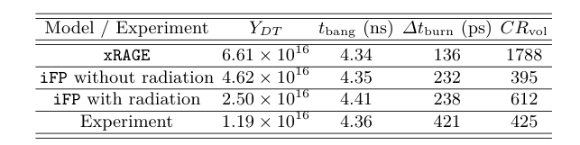
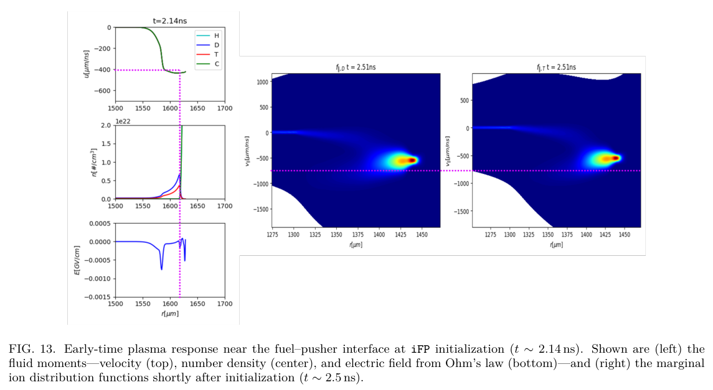

# NIF 极向直接驱动靶丸的离子动理学—辐射耦合

> Hans R. Hammer、William T. Taitano、Steven E. Anderson、Brett D. Keenan、Luis Chacón、Andrei N. Simakov，[arXiv:2610.26537v1](https://arxiv.org/abs/2610.26537v1)，提交 2026-10-19，PDF 内署日期 10-20。阅读 [24 页官方作者稿](../pdfs/Hammer%20et%20al.%20-%202026%20-%20Kinetic%20radiation%20NIF%20capsule.pdf)、布局文本和 MinerU。精确题名 Crossref 前三条未发现同篇正式版；本文是作者模型及既有实验比较，不是新的 NIF 实验或本地复现。

## 一句话结论

iFP 将球对称 1D2V 多离子 Vlasov–Fokker–Planck 模型与灰群 P1 辐射输运隐式耦合，在 NIF “Cutie” exploding-pusher 案例中同时改善中子产额与燃烧宽度预测；但产额仍是实验的约 2.1 倍，燃烧宽度仍低约 43%，而早期驱动和边界来自经 bang time 校准的 xRAGE，尚非完整端到端第一性原理预测。

## 方法与可复现输入

- 离子由分布函数演化，电子采用无惯性、准中性流体闭合；在球对称假设内，径向一维空间和两维速度构成 1D2V。辐射为频率积分的 P1 能量/通量矩，压力各向同性；非相对论材料运动修正保留低阶，动量沉积使用扩散极限近似。
- 共用自适应移动网格，时间积分为 BDF2；高阶动理学与低阶流体—辐射系统通过 HOLO 固定点及 Anderson 加速迭代。TOPS 的 LTE 不透明度按组分质量加权混合，在每步开始更新电离度/不透明度，步内冻结。
- 作者用 Marshak 辐射波和 Mach-45 激波验证耦合。在前者人为增加离子质量、抑制其运动；后者人为增强离子—电子耦合、抑制热流以匹配单流体基准。这些属于实现核验，不能当成真实靶丸的完整物理验证。
- Cutie 靶丸外半径 1978 μm、CH 壳厚 22.7 μm、初始燃料密度 1.52 mg/cm³；表 I 激光能量 1256 kJ、峰功率 425 TW、脉长 3.90 ns。xRAGE 的电子热流限制因子调到 0.0275，使 bang time 4.34 ns 接近实测 4.36 ns。
- iFP 从 2.14 ns 接收 xRAGE 状态，在壳内截断边界避开激光吸收区，以随时间变化的 Maxwell 分布驱动到约 5 ns。网格为 $(N_x,N_\parallel,N_\perp)=(384,128,64)$，最大步长约 0.2 ps；P1 与外侧 xRAGE 灰扩散存在闭合不一致。

## 定量比较：改善仍有明显残差

**表 II，PDF 第 17 页。** 以下直接转录其结果，并与原表目视核对；没有另行拟合或运行模拟。

| 模型/实验 | DT 中子产额 | bang time/ns | 燃烧宽度/ps | 体积收敛比 |
|---|---:|---:|---:|---:|
| xRAGE | 6.61×10¹⁶ | 4.34 | 136 | 1788 |
| iFP，无辐射 | 4.62×10¹⁶ | 4.35 | 232 | 395 |
| iFP，含辐射 | 2.50×10¹⁶ | 4.41 | 238 | 612 |
| 既有实验 | 1.19×10¹⁶ | 4.36 | 421 | 425 |

相对实验，产额比约由 5.55 降到 3.88、再到 2.10；含辐射燃烧宽度仅约实测的 56.5%。辐射主要改善产额，宽度只由 232 增至 238 ps；bang time 并未单调改善，体积收敛比也由 395 回升至 612，不能概括为“所有量随物理保真度单调改善”。体积收敛比不是通常的半径收敛比，需要开立方比较。表 II 未附误差条，不能据此声称统计上吻合实验。

## 机制与关键原图

动理学离子可跨越燃料—壳界面，降低热点有效燃料密度；作者给出的燃烧加权密度为 xRAGE 的 $7.24\times10^{29}$ 与 iFP 的 $1.87\times10^{29}\,\mathrm{m^{-3}}$。若仅按密度平方外推，会得到约 15 倍产额差，远大于实际模拟比 6.61/2.50≈2.64，说明不能只用“漏燃料”解释全部变化。快速弹道离子的预热提高温度与燃烧体积，同时抬升 adiabat、减弱收敛，构成竞争效应。

**图 13，PDF 第 19 页。** 左列是 2.14 ns 附近随半径（μm）变化的流速（μm/ns）、数密度（cm⁻³）和电场（GV/cm）；右列是约 2.51 ns 的 D、T 径向速度边缘分布，横轴半径、纵轴平行速度。色亮表示作者分布的相对强弱，未给可用于绝对读数的公共色标。右图出现高速度支群，接近两倍壳速度的紫虚线；当壳速度约 −400 μm/ns，重活塞反射估计 $v_{\parallel,s}\simeq2u_\mathrm{shell}$ 为约 −800 μm/ns。电场及有限壳质量造成修正。这是计算中的双峰，不是直接测到的离子谱。

界面扩散估计的 DT、CH 宽度分别 126、21 μm，平均 73 μm；作者认为真实动理学界面更宽。此估计还忽略反射冲击的压缩，不能当成独立实测混合宽度。辐射使燃料降温、收敛增加，并改变能量分配；无辐射产额相对于含辐射约高 1.85 倍，这个“近两倍”应明确分母是**含辐射模型**。

## 局限与对当前研究的价值

这是有价值的动理学—辐射求解器概念验证，适合检查“离子漏失、预热和辐射损失”能否被同一模型容纳。当前缺多群辐射、完整激光沉积、非理想/强耦合离子 EOS 及动理学电子；球对称也不处理真实 PDD 不对称。边界从已校准流体模型继承，含辐射结果仍有大残差。首次耦合的优先权属于作者表述，本轮未独立做历史穷尽审查。

本文中子属于 DT 聚变，不能替代电子转换靶的光核中子、同位素产额或屏蔽研究。下一步应比较多群闭合、边界交接位置/时刻、电子热流限制因子、网格收敛与实验误差预算。本轮未运行 iFP、xRAGE、TOPS 或重算核反应率。

## 来源与复核记录

[官方作者页](https://arxiv.org/abs/2610.26537v1)与 PDF 第 1、11、13、17–20 页的身份/基准/表图核对；[PDF 核验](../pdf_validation.json)、[图像出处与裁框](../research/figure-manifest.json)、[MinerU 记录](../research/mineru-attempts.json)。
